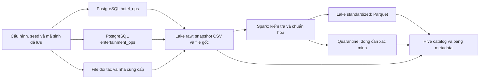

# CompanyE — Nguồn, Data Lake và hai nhánh phân tích

Đây là bản dữ liệu chạy được cho case CompanyE: **hai database PostgreSQL nguồn, bộ sinh dữ liệu có thể tái lập, data lake có catalog, Spark ETL, Oracle warehouse và Iceberg lakehouse**. Đã nạp dimension/fact, công bố batch nhất quán, kiểm chứng 47 KPI và hoàn thiện dashboard Power BI local gồm tổng quan, B01–B08 và trang QA. Web, benchmark và đánh giá hiệu quả hỗ trợ quyết định còn ở bước tiếp theo. Các mục bên dưới giữ cả những mốc lịch sử; trạng thái mới nhất nằm cuối README.

## Bản mở rộng v2 — dùng cho các bước tiếp theo

V2 đã được sinh và nạp vào **`hotel_ops_v2` và `entertainment_ops_v2`**, tổng cộng **41 bảng, 591.242 dòng**. Hai database là hai miền nghiệp vụ tách biệt nhưng đang chạy trên cùng PostgreSQL local; chưa mô phỏng các máy chủ ở nhiều địa phương. Bản v1, mã sinh v1 và catalog v1 được giữ để đối chiếu.

| Phần bổ sung | Dữ liệu thực tế trong v2 |
|---|---|
| Mua hàng nhiều mặt hàng | 4.007 đơn mua có nhiều loại hàng |
| Giao hàng nhiều đợt | 5.941 dòng đơn mua có nhiều phiếu nhận; bảo toàn lượng đặt = nhận + từ chối, theo dõi kho theo lô |
| Định danh khách phân tán | ID riêng không chứa số thứ tự dùng chung; có số điện thoại hộ gia đình, thiếu/đổi liên hệ, lỗi tên, email khác định dạng và 120 hồ sơ khách trùng |
| Điều chỉnh giao dịch | 160 booking có lịch sử giá trước/sau, chi tiết giá phòng và khoản thu bổ sung; thêm `booking_revisions`, `booking_room_revisions` |
| File đến trễ, gửi lại và sửa đổi | 240 phiếu nhận được biểu diễn qua file ngoài; 24 phiếu có bản sửa đến trước bản cũ, 3 dòng gửi lại và 12 dòng dùng đơn vị chưa chuẩn hóa |

Luồng file nhận hàng có **267 dòng đầu vào → 252 phiên bản hợp lệ + 12 dòng quarantine + 3 dòng gửi lại**. Từ 252 phiên bản hợp lệ lấy được **228 phiếu hiện hành**, giữ lại 24 phiên bản cũ để truy vết. Có 69 sự kiện hợp lệ đến trễ hơn hai ngày so với thời điểm ghi nhận ở nguồn. Đơn vị `g` được đổi sang `kg`; giá trong feed luôn là VND/kg. Dòng dùng đơn vị không xác định không được tự đoán quy đổi.

File ngoài là **biểu diễn của phiếu nhận đã có trong nguồn**. Không cộng thêm chúng như giao dịch mua mới, không cộng tất cả phiên bản thành tổng lượng nhận. Chọn trạng thái mới nhất theo số phiên bản, không theo thứ tự đến. Cùng event ID nhưng khác nội dung bị từ chối để điều tra.

### Chạy và truy vấn v2

Tại thư mục `Project`, với Docker Desktop đang chạy:

```powershell
# Xác minh dữ liệu đã tạo:
.\scripts\run-v2.ps1 -Action verify
# Truy vấn catalog riêng của v2:
.\scripts\run-v2.ps1 -Action query -Sql "SELECT * FROM companye_v2_external.receipt_latest LIMIT 10"
.\scripts\run-v2.ps1 -Action query -Sql "SELECT dataset_id, row_count, quality_status FROM companye_metadata.datasets ORDER BY dataset_id"
```

Để dựng lại trên môi trường mới: chạy `.\scripts\run.ps1 -Action up`, rồi `.\scripts\run-v2.ps1 -Action all`. Lệnh `all` tạo/xác minh seed v2, nạp DB nếu chưa tồn tại, ingest một batch mới, xây lake và đối soát. Lệnh `lake` trên batch hoàn tất chỉ kiểm tra lại; không append thêm. Các hướng dẫn `run.ps1` bên dưới vẫn dành cho v1.

V2 dùng `lake/v2/` và Hive/Derby metastore riêng. Catalog có 30 bảng `companye_v2_hotel`, 11 bảng `companye_v2_entertainment`, bốn bảng `companye_v2_external` (`receipt_versions`, `receipt_latest`, `receipt_replays`, `receipt_quarantine`) và bốn bảng metadata. Hồ sơ đầy đủ nằm ở `lake/v2/catalog/catalog.json`; các file raw có checksum, thời điểm nhận và nguồn, bảng dẫn xuất có schema và danh sách nguồn đầu vào.

### Tái lập và bằng chứng v2

- `config/generation_v2.json`: seed nền và bốn seed riêng cho mua hàng, định danh, giao file và điều chỉnh giá.
- `generated/v2/manifest.json`, `reports/reproducibility/v2/`: hash file, mã sinh/schema đóng băng, cấu hình, giả định, giới hạn và tổng đối chứng.
- `generated/v2/audit_only/`: đối chứng định danh chỉ để đánh giá, không ingest vào lake và không dùng làm đầu vào nối khách.
- `reports/reproducibility/v2/runtime.json`: image ID/digest của container đang chạy, phiên bản runtime, hash backup và liên kết bằng chứng.
- `databases/hotel_ops_v2.dump`, `databases/entertainment_ops_v2.dump`: backup database.
- `reports/source_v2_validation.json`, `reports/lake_v2_validation.json`: kết quả kiểm tra nguồn và lake vận hành.
- `reports/testing/20261012T092133914051Z/`: lần kiểm thử đạt **106/106**, gồm 94 ca nền và 12 ca mở rộng. V2 được sinh lại toàn bộ để so sánh từng byte của 41 bảng và các file ngoài; kiểm tra bảo toàn tiền/kho, fixture độc lập về gửi lại/sai thứ tự và từ chối event xung đột.

Đây là xử lý **batch với lịch sử phiên bản và thời điểm nhận file mô phỏng**, chưa phải CDC chạy liên tục. Chưa triển khai thuật toán tự hợp nhất hồ sơ khách, hủy một phần booking, ERP đầy đủ hoặc warehouse. Đối soát lake v2 hiện gồm checksum raw, số dòng và batch của 41 bảng, tổng cột số và so sánh phiếu nhận hiện hành với nguồn; không gọi đó là kiểm tra từng ô của mọi bảng v2. Các giả định mùa vụ và phân bổ chi phí của v1 vẫn phải được cân nhắc khi đánh giá warehouse.

## Phạm vi đã chốt và công việc còn lại theo đề bài

Ngày 12/10/2026, người dùng chốt tám nhu cầu B01–B08: lưu trú; kênh bán/khuyến mãi; bán chéo; buffet/nhà hàng; giải trí/phương tiện; giao hàng nhà cung cấp; tồn kho/hao hụt; bảo trì/khả năng cung cấp phòng. Chi tiết ở mục 18 của `CompanyE_Mo_ta_case.md`. Theo hồ sơ nhóm 25 có bốn thành viên, tám nhu cầu đáp ứng mức tối thiểu 2*n tại mục 2.2 đề bài.

Đối chiếu `../Presentation and Project Description/DE_Presentation and Project Descriptions and Requirements-Semester 1-2026-2027.pdf`, mục 2.2 (trang 1–2), mục 3.2 (trang 4–6):

| Phần việc | Trạng thái và đầu ra còn cần |
|---|---|
| Bối cảnh, stakeholder, nhu cầu sử dụng dữ liệu | Đã chốt case, tám nhu cầu và đặc tả KPI v1 gồm người dùng, công thức, grain, ngày nghiệp vụ, bộ lọc, nhịp cập nhật dự kiến và tiêu chí nghiệm thu; tiếp theo là thiết kế mô hình dữ liệu |
| Nguồn dữ liệu và đặc điểm | Có hai DB, bộ sinh tái lập, lake/catalog; cần tổng hợp sơ đồ nguồn, từ điển và các vấn đề chất lượng vào báo cáo |
| Giải pháp data engineering | Có pipeline nguồn → lake; cần thiết kế và xây lớp dữ liệu phục vụ phân tích, tích hợp lake → warehouse, lịch sử/cập nhật, kiểm tra chất lượng và truy vết tới KPI |
| Công nghệ quản lý/xử lý | Đang dùng PostgreSQL, Hive/Derby, Spark batch; cần lý giải lựa chọn, kiến trúc, cấu hình, cách áp dụng và giới hạn. Không gọi Spark batch là Spark Streaming |
| Ít nhất một giải pháp thay thế | Đã dựng Oracle warehouse và Spark + Apache Iceberg, nạp dimension tương đương; còn fact, publication và benchmark |
| Ứng dụng khai thác dữ liệu | Power BI Import đã nối bản xuất hai nhánh, có 18 biểu đồ và 36 thẻ KPI, đã kiểm thử số liệu/bộ lọc/tổng/cảnh báo; bản web còn ở bước sau |
| Độ đúng sau xử lý | Đã kiểm tra nguồn/lake và fixture tham chiếu; cần kiểm tra end-to-end tới warehouse và kết quả ứng dụng |
| Hiệu năng | Chưa benchmark có kiểm soát; cần kịch bản, quy mô, cấu hình, phép đo thời gian ETL/truy vấn, tài nguyên và phân tích kết quả |
| Hiệu quả hỗ trợ khai thác | Chưa đánh giá; cần tám kịch bản sử dụng ứng dụng, đầu ra mong đợi, kết quả thật và quyết định được hỗ trợ |
| Kết luận và bàn giao | Cần báo cáo PDF, slide PDF, video MP4/WebM 20–30 phút và ứng dụng có thể chạy/đánh giá; tên file có mã nhóm, hạn theo đề là cuối môn |

Warehouse với fact/dimension là lựa chọn triển khai của CompanyE, không phải một schema bắt buộc được đề bài quy định. Đề yêu cầu ít nhất một phương án thay thế để so sánh; mức triển khai benchmark hai phương án là kế hoạch của nhóm để tạo bằng chứng đánh giá, không mặc định phải xây hai ứng dụng hoàn chỉnh. Không bắt buộc thêm ML, streaming, HDFS hoặc cloud chỉ để tăng số công nghệ.

Thứ tự triển khai: đặc tả tám nhu cầu → mô hình dữ liệu phân tích chung → dựng hai nhánh warehouse/lakehouse → Power BI và bản thử trên web → đánh giá đúng/nhanh/hữu ích và so sánh phương án → hoàn thiện báo cáo, slide, video và gói chạy. Phần Presentation riêng của môn vẫn có yêu cầu và lịch nộp riêng.

## Đặc tả KPI dùng chung cho hai nhánh

[Đặc tả KPI CompanyE](docs/CompanyE_KPI_Specification.md) phiên bản 1.0 ngày 12/10/2026 quy định **47 chỉ tiêu trong tám nhu cầu B01–B08**. Bao gồm các số cơ sở, tỷ lệ, công thức, grain, ngày nghiệp vụ, nguồn/cột, bộ lọc hợp lệ, giới hạn và ví dụ nghiệm thu. Đây là đặc tả triển khai, chưa phải nghiệm thu Oracle, Iceberg hoặc Power BI.

Danh mục máy đọc được nằm ở `config/kpi_contract_v1.json`; công thức là ký hiệu nghiệp vụ, chưa phải SQL thực thi. Kiểm tra tính nhất quán tài liệu, cột nguồn và ví dụ tính tay bằng:

```powershell
python -X utf8 scripts/validate-kpi-spec.py
```

Kết quả tại `reports/kpi_specification_v1_validation.json`: 8 nhóm, 47 chỉ tiêu, 188 tham chiếu cột hợp lệ, 18 ví dụ tính tay đạt; hash mã sinh v2 không đổi. Kết quả này tách biệt với 106 kiểm thử nguồn/lake trước đó. Quy tắc mới về thời gian và phạm vi KPI phải được nghiệm thu xuyên suốt khi hai nhánh phân tích hoàn thành; các fixture tham chiếu cũ được giữ nguyên.

Các quy tắc cốt lõi: thời gian địa phương +07:00 và khoảng `[S,E)`; tỷ lệ tính từ tổng tử/mẫu, mẫu số 0 trả BLANK; booking hủy/no-show tính theo cohort arrival, giá trị booking hoàn thành theo departure; buffet kèm phòng không tạo doanh thu thứ hai; số lượng khác đơn vị không cộng chung; tồn kho không cộng qua ngày; chi phí bảo trì theo ngày hoàn tất, ngày ngừng phòng theo hợp các khoảng ảnh hưởng.

## Quyết định kiến trúc ngày 12/10/2026

Người dùng chốt hướng **warehouse vs lakehouse**, trực quan hóa bằng **Power BI** và triển khai **bản thử trên web**. Quyết định này thay thế đề xuất trước về so sánh Oracle với truy vấn Parquet trực tiếp. Hai engine đã nạp dimension/fact, công bố cùng publication và kiểm chứng 47 KPI. Power BI Import đã chạy trên Desktop; web và benchmark còn ở bước sau. Trạng thái chi tiết hiện hành nằm cuối README.

| Thành phần | Phương án A: Warehouse | Phương án B: Lakehouse |
|---|---|---|
| Đầu vào | Cùng snapshot lake v2, cùng manifest | Cùng snapshot lake v2, cùng manifest |
| Xử lý | Spark, nạp staging rồi cập nhật warehouse | Spark, nạp/cập nhật bảng Iceberg |
| Quản lý dữ liệu phân tích | Oracle; dự kiến bản Free cho môi trường local | Apache Iceberg, Parquet và catalog tương thích |
| Mô hình nghiệp vụ | Fact/dimension theo grain đã chốt | Cùng grain, fact/dimension và quy tắc lịch sử |
| Truy vấn | Oracle SQL | Spark SQL trên bảng Iceberg |
| Trực quan hóa | Power BI | Power BI với kết nối được kiểm chứng tới nhánh lakehouse |
| Demo | Báo cáo trên web phục vụ B01–B08 | Cùng cấu trúc báo cáo và định nghĩa KPI |

Giữ nguyên nguồn/v1/v2 để tái lập; tạo vùng lưu trữ và catalog riêng cho nhánh lakehouse. Không chỉ đổi tên lake Parquet hiện tại thành lakehouse. Cần kiểm chứng commit, cập nhật, đọc snapshot và phục hồi theo khả năng thực tế của phiên bản Iceberg được chọn. Giữ grain và schema logic tương đương để tránh thay đồng thời cả kiến trúc lẫn mô hình; star vs snowflake chỉ là nghiên cứu bổ sung, chưa thuộc trục so sánh chính.

Power BI dùng cùng thiết kế báo cáo và định nghĩa measure cho hai nhánh. Bản đầu chốt Import từ CSV bất biến của từng engine, cùng publication; không phải kết nối trực tiếp thư mục Iceberg hoặc Hive/Derby embedded. Dữ liệu lakehouse được xuất từ Spark–Iceberg, không nạp sang Oracle để truy vấn thay. DirectQuery hoặc endpoint Spark là phần tích hợp tùy chọn sau.

Đo riêng thời gian ETL, truy vấn engine, refresh Power BI và phản hồi giao diện. Nếu dùng Import, tương tác biểu đồ chủ yếu chạy trên mô hình Power BI; không dùng thời gian đó để suy ra tốc độ Oracle so với Spark. Công bố cấu hình, giới hạn Oracle Free, cache, snapshot và độ mới dữ liệu. Đánh giá đủ ba hướng: tính đúng; hiệu năng; hiệu quả phục vụ tám nhu cầu.

Bản thử web dự kiến cung cấp báo cáo tương tác qua Power BI Service hoặc nhúng vào trang web. Cách triển khai cụ thể phụ thuộc tài khoản/workspace, giấy phép, quyền xem và kết nối/gateway tới nguồn local; xác minh các điều kiện này khi triển khai. Hướng dẫn Microsoft: [Power BI secure embedding](https://learn.microsoft.com/en-us/power-bi/collaborate-share/service-embed-secure). Chưa chốt hạ tầng hosting hoặc cấp phát dịch vụ trả phí.

## Trạng thái bản nền v1

| Thành phần | Bản đầu v1 |
|---|---|
| Giai đoạn mô phỏng | 01/01/2024–31/12/2025; ngày đặt có thể sớm hơn khoảng lưu trú |
| Random seed | `20261012` |
| `hotel_ops` | 28 bảng, 422.763 dòng |
| `entertainment_ops` | 11 bảng, 154.637 dòng |
| Tổng hai database | **39 bảng, 577.400 dòng** |
| Quy mô doanh nghiệp | 4 cụm, 8 khách sạn, 240 phòng, 4 trung tâm, 120 phương tiện |
| Booking khách sạn | 32.000 đơn, 36.711 phòng booking, 30.736 lượt lưu trú phòng |
| File bên ngoài | CSV đối soát, CSV chưa chuẩn, TXT, JSONL và SVG chứng từ giả lập |
| Catalog SQL | 39 bảng nguồn chuẩn kiểu, 2 bảng nhà cung cấp/kiểm tra, 3 bảng metadata |
| CSV nhà cung cấp | 121 dòng đầu vào: 77 dòng chấp nhận, 44 dòng cần xác minh |

Mọi khách, giá, hợp đồng, liên hệ và giao dịch đều giả lập. Email dùng miền `example.invalid`. Thương hiệu thật chỉ làm tên tham khảo trong quan hệ thương mại giả định.

## Công nghệ và vai trò

| Công nghệ | Vai trò |
|---|---|
| PostgreSQL 17 | Hai database nghiệp vụ độc lập, có PK, FK, CHECK và chỉ mục |
| Apache Spark 3.5.7, PySpark | Đọc bản xuất nguồn, ép kiểu theo contract, kiểm tra và ghi Parquet |
| Hive Metastore qua Spark Hive support | Lưu schema, tên bảng, vị trí dữ liệu và table properties qua nhiều lần chạy |
| Apache Derby embedded | Lưu vật lý metastore của bản triển khai một máy, một tiến trình truy cập mỗi lần |
| CSV, JSONL, TXT, SVG và Parquet | Giữ dữ liệu thô đa dạng, cung cấp bản bảng có kiểu để truy vấn |
| Docker Compose | Đóng gói hai dịch vụ `postgres` và `spark` riêng cho CompanyE |

Tài liệu project CO5173, mục 2.2, giới thiệu Hive và Spark Streaming; slide chương 2 giới thiệu data lake, catalog và metadata. Bản này dùng Spark SQL **batch**, chưa triển khai streaming. PostgreSQL là hệ quản trị nguồn; Docker là công cụ chạy môi trường. Không khẳng định đề bài bắt buộc chính xác stack này.

Data lake bản đầu dùng thư mục được mount từ máy Windows. **Chưa triển khai HDFS, object storage, metastore server nhiều người dùng hoặc lakehouse ACID.** Những giới hạn này giữ môi trường học tập nhỏ và dễ kiểm tra. Thư mục có tên `lake/catalog/warehouse` chỉ là vị trí mặc định kỹ thuật của Hive/Spark, không phải kho dữ liệu phân tích CompanyE đã được xây.

## Luồng dữ liệu



Raw được xuất **từ database đã nạp**, không chỉ sao chép lại CSV seed rồi gọi đó là dữ liệu đã trích xuất. Mỗi database dùng snapshot `REPEATABLE READ` riêng; đây không phải snapshot giao dịch phân tán đồng thời giữa hai database. Bản v1 nạp toàn bộ snapshot, chưa phải CDC.

Mỗi lần ingest tạo batch mới. Các file raw của batch trước được giữ; checksum giúp phát hiện sửa đổi. Chưa cấu hình cơ chế lưu trữ WORM hoặc quyền chống ghi vật lý. Parquet lưu theo `batch / source / table`. Các bảng Hive trỏ tới snapshot được publish gần nhất; **không nối chồng các snapshot rồi nhân đôi giao dịch**.

## Bố cục thư mục

```text
Project/
  CompanyE_Mo_ta_case.md       Bối cảnh doanh nghiệp đã chốt
  compose.yaml                Hai dịch vụ CompanyE
  .env                        Mật khẩu local tự sinh, không đưa vào Git
  config/
    generation.json           Seed, khoảng thời gian, quy mô
    source_contracts.json     Schema và từ điển nguồn
  src/
    model.py                  DDL, mô tả bảng/cột và ràng buộc
    generate.py               Toàn bộ thuật toán sinh dữ liệu
    audit_generation.py       Kiểm tra tái lập và hồ sơ phân bố
    manage.py                 Nạp DB, xuất snapshot, chạy và kiểm tra lake
    lake_job.py               Spark và catalog
  scripts/run.ps1             Lệnh chạy trên Windows
  generated/v1/
    hotel_ops/                DDL và CSV seed
    entertainment_ops/        DDL và CSV seed
    external/                 File đối tác và nhà cung cấp
    load.sql                  Script nạp nguồn
    manifest.json             Cấu hình, hash mã sinh và hash mọi file seed
    audit_only/               Đối chứng, giả định và giới hạn; không ingest
  databases/                  Backup PostgreSQL dạng pg_dump custom
  lake/
    raw/<batch>/              Snapshot, file gốc, ingestion manifest
    standardized/<batch>/    Bảng Parquet
    quarantine/<batch>/      Bản ghi lỗi giữ giá trị gốc và lý do
    catalog/                  Hive Metastore, JSON catalog và mục lục
    _jobs/<batch>/            SQL đã dùng để trích xuất
  reports/
    source_validation.json   Kiểm tra nghiệp vụ nguồn
    lake_build_<batch>.json  Kết quả Spark theo batch
    lake_validation.json     Kiểm tra lake và catalog sau khởi động lại
    reproducibility/v1/      Mã sinh đóng băng, seed, baseline và tái lập
```

## Cách chạy

Yêu cầu: Docker Desktop chạy Linux containers, Docker Compose và Python 3.11 có trong PATH. Python host chỉ dùng thư viện chuẩn; PySpark và Java nằm trong image Spark. Hai container được giới hạn bộ nhớ lần lượt 1 GB và 3 GB. Lần đầu cần tải image qua mạng.

Tại thư mục `Project`, chạy PowerShell:

```powershell
.\scripts\run.ps1 -Action all
```

Lệnh tạo hoặc xác minh bộ seed, kiểm tra sinh lại, khởi động dịch vụ, nạp hai DB nếu chưa tồn tại, giữ backup theo phiên bản, kiểm tra nguồn, ingest snapshot, chuẩn hóa, kiểm tra lake và chụp runtime. Không tự xóa database hoặc volume. Nếu database có số dòng hoặc tổng đối chứng khác baseline, lệnh dừng; baseline và backup cũ không tự bị ghi đè.

Các bước riêng:

```powershell
python -X utf8 src/generate.py
.\scripts\run.ps1 -Action up
.\scripts\run.ps1 -Action load
.\scripts\run.ps1 -Action ingest
.\scripts\run.ps1 -Action lake
.\scripts\run.ps1 -Action verify
python -X utf8 src/audit_generation.py
python -X utf8 src/capture_provenance.py
.\scripts\run.ps1 -Action status
```

`lake` trên batch đã hoàn tất sẽ kiểm tra lại, không append thêm dữ liệu. Các lệnh truy cập Hive được khóa để tránh hai JVM cùng mở embedded Derby. Chạy từng lệnh đến khi kết thúc; không chạy đồng thời hai phiên Spark truy cập cùng catalog.

PostgreSQL được publish tại `127.0.0.1:55432`, user `companye`, database `hotel_ops` và `entertainment_ops`. Mật khẩu ở `.env`. Đây là tài khoản quản trị của môi trường demo local; chưa triển khai phân quyền nhiều vai trò.

Khi cần dừng các dịch vụ nhưng giữ dữ liệu:

```powershell
docker compose stop
```

## Tra cứu catalog và metadata

Mở `lake/catalog/CATALOG.md` để xem mục lục hoặc `lake/catalog/catalog.json` để xem hồ sơ đầy đủ. Catalog thực tế nằm trong Hive Metastore, không chỉ là hai file này.

```powershell
.\scripts\run.ps1 -Action query -Sql "SHOW DATABASES"
.\scripts\run.ps1 -Action query -Sql "SHOW TABLES IN companye_hotel"
.\scripts\run.ps1 -Action query -Sql "DESCRIBE EXTENDED companye_hotel.bookings"
.\scripts\run.ps1 -Action query -Sql "SELECT dataset_id, row_count, quality_status FROM companye_metadata.datasets ORDER BY dataset_id"
.\scripts\run.ps1 -Action query -Sql "SELECT column_name, sql_type, description, constraints FROM companye_metadata.columns WHERE dataset_id='hotel_ops.bookings'"
.\scripts\run.ps1 -Action query -Sql "SELECT quality_reason, COUNT(*) AS records FROM companye_external.supplier_quarantine GROUP BY quality_reason"
```

Metadata gồm:

- **Nghiệp vụ:** mô tả, grain, đơn vị sở hữu, ý nghĩa cột, đơn vị VND và nhãn dữ liệu giả lập.
- **Kỹ thuật:** schema, kiểu SQL, nullable, PK/FK/CHECK được khai báo ở nguồn, định dạng và vị trí file/bảng. Hive chỉ lưu metadata; không tự thực thi các FK nguồn trên Parquet.
- **Vận hành:** batch, thời điểm nhận, số dòng, dung lượng, checksum, phiên bản seed và trạng thái chất lượng.
- **Truy vết:** hệ thống nguồn, file nguồn, hash nguồn và quan hệ raw → standardized. Mỗi bảng chuẩn có `_source_system`, `_source_path`, `_ingestion_batch`, `_ingested_at_utc`.

Các ảnh, văn bản và thông báo điều chỉnh chưa được chuẩn hóa vẫn có hồ sơ trong `companye_metadata.artifacts`. Ảnh SVG là chứng từ giả lập minh họa, **chưa có OCR**. Một dòng nhà cung cấp đã chuẩn hóa cũng chưa mặc nhiên là phiếu nhận hàng được phê duyệt hoặc khoản được phép thanh toán.

## Kiểm chứng và bảo vệ đánh giá warehouse về sau

`generated/v1/manifest.json` lưu seed, cấu hình, Python version, SHA-256 mã sinh và từng file. Mã sinh và cấu hình được đóng băng thêm ở `reports/reproducibility/v1/`. Nếu thay seed, thuật toán hoặc schema, tạo một phiên bản dữ liệu mới; không sửa âm thầm v1. Chỉ đổi seed mà không lưu phiên bản mã/Python không đủ bảo đảm tái lập.

`reports/runtime_environment.json` và thư mục `reports/runtime/` giữ digest image Docker thực tế, phiên bản PostgreSQL/Spark/Python, bản sao mã/cấu hình và checksum backup. `reports/processing/<batch>/` giữ mã của các lần gọi xử lý batch. Tag image trong Compose có thể có bản cập nhật; muốn tái lập đúng runtime đã kiểm tra, dùng digest đã lưu thay vì kéo lại tag một cách mặc định.

`audit_generation.py` sinh lại dữ liệu trong bộ nhớ, tuần tự hóa theo cùng hợp đồng và so sánh checksum cả 39 bảng với seed đã lưu. Script cũng kiểm tra seed khác tạo booking khác và ghi phân bố theo khách sạn/tháng. Không nạp bộ dùng để kiểm tra độ nhạy vào DB hoặc lake.

`generated/v1/audit_only/generation_audit.json` ghi từng quy tắc và rủi ro sai lệch: mùa vụ được áp đặt, tỷ lệ hủy giả định, cơ chế chọn khuyến mãi, xác suất mua chéo, liên hệ thời tiết–đóng hoạt động, phân bổ nguyên liệu và chất lượng nhà hàng. Những tương quan do bộ sinh tạo ra không phải bằng chứng để kết luận tác động kinh doanh thực tế.

File đối chứng nối khách và tổng kiểm tra chỉ phục vụ đánh giá riêng, không là đầu vào ETL. `manage.py` dùng danh sách nguồn cho phép; không quét cả `generated/` để ingest. `lake_job.py` chỉ đọc đối chứng tổng hợp ở lệnh `verify`, không dùng để tạo bảng chuẩn.

Đối chiếu warehouse sau này cần tối thiểu:

1. Lưu seed version, manifest hash, phiên bản mã ETL, quy tắc phân bổ và cấu hình chạy.
2. Kiểm tra số lượng và tổng tiền độc lập với kết quả hiển thị trên dashboard.
3. Kiểm tra không nhân đôi snapshot, gói dịch vụ, khoản tài trợ hoặc bảng kê đối tác.
4. Đánh giá nhiều seed, quy mô và kịch bản lỗi; tách thời gian sinh dữ liệu khỏi thời gian đo xử lý.
5. Không dùng dữ liệu đối chứng định danh làm đặc trưng nối khách hoặc làm dữ liệu huấn luyện.

**Giới hạn dữ liệu v1 cần tính tới khi chọn bài toán:**

- Dữ liệu là full snapshot, chưa có đầy đủ lịch sử cập nhật/CDC và hủy một phần booking.
- Có bán chéo gắn tham chiếu booking nhưng chưa có mô hình phân bổ toàn bộ gói nhiều dịch vụ.
- E Family mới ghi nhận chủ gói, chưa đầy đủ thành viên, sổ điểm và lịch dùng voucher.
- Suất buffet và bữa ăn của v1 mới tính người lớn; trẻ em được ghi trên booking nhưng chưa mô hình hóa riêng quyền lợi và phụ thu ăn uống.
- ID và tên khách có mẫu tổng hợp dễ nhận biết; v1 chưa phù hợp để kết luận chất lượng thuật toán giải quyết định danh trong dữ liệu thực.
- Chi phí nguyên liệu được phân bổ từ xuất kho theo lượt phục vụ; không dùng tương quan này để chứng minh mô hình dự báo phát hiện quan hệ mới.
- Nguồn cung mới mô phỏng đơn mua, nhận hàng và kho; chưa đầy đủ hóa đơn/công nợ nhà cung cấp hay điều chuyển kho.
- Chưa có đầy đủ lương, khấu hao, thuế và chi phí chung để tính lợi nhuận doanh nghiệp.
- Dữ liệu lỗi nhà cung cấp là fixture riêng, không tự coi mọi dòng fixture là giao nhận đã xảy ra trong database nguồn.
- Một máy và quy mô hiện tại là bản kiểm chứng chức năng, chưa phải bằng chứng hiệu năng Big Data.

Các giới hạn này không cản trở kiểm tra pipeline, schema, catalog và tính đúng khi chuyển dữ liệu. Chúng là điều kiện cần xem lại trước khi chọn các bài toán phân tích tương ứng.

## Bộ kiểm thử tự động (sáu bước nền và phần mở rộng v2)

Chạy từ thư mục `Project` bằng PowerShell:

```powershell
.\scripts\test.ps1 -Build
# Những lần sau dùng lại image đã xây:
.\scripts\test.ps1
# Chạy riêng một nhóm:
.\scripts\test.ps1 -Select 'property'
```

Lệnh tạo project Docker **companye-tests** riêng: PostgreSQL nạp bản sao seed v1 và v2 vào tmpfs, không publish cổng; runner Python 3.11.9 / Spark 3.5.7 có mount project chỉ đọc. Output được ghi riêng vào `reports/testing/`. PostgreSQL và lake vận hành của project **companye** không bị dừng hoặc thay dữ liệu. PostgreSQL kiểm thử bị gỡ sau lệnh PowerShell; dữ liệu lỗi thử nghiệm không trở thành nguồn nghiệp vụ. Không chạy trực tiếp `pytest` toàn bộ trong một process; dùng runner vì bước kiểm tra Hive cần kết thúc JVM sở hữu embedded Derby trước khi mở JVM mới.

| Bước | Hiện thực | Phạm vi |
|---|---|---|
| 1 | `tests/test_baseline.py`, `tests/test_sources.py` | Hash seed/code, tái sinh 39 bảng, 16 SQL invariant, kiểm thử ràng buộc từ chối dữ liệu sai và phát hiện overlap |
| 2 | `tests/scenario_matrix.json`, `tests/fixtures/`, `tests/test_coverage.py` | Ma trận tình huống v1, ghi rõ giới hạn của bản nền, dữ liệu nhỏ và đáp án viết độc lập |
| 3 | `tests/test_properties.py` | Hypothesis đổi seed/tháng, kiểm tra bảo toàn tiền, đêm phòng, số lượng kho, vé, buffet và tính tái lập |
| 4 | `tests/test_spark.py`, `tests/test_lake.py` | Biến đổi thực tế, lỗi ghi Parquet, retry, kiểm tra mọi giá trị của 39 bảng sau export PostgreSQL → raw → Parquet, catalog qua JVM mới |
| 5 | `tests/test_gx.py` | GX Core trên bảng booking PostgreSQL và snapshot Spark, có dữ liệu cố ý sai để chứng minh kiểm tra phát hiện được lỗi, xuất Data Docs |
| 6 | `tests/test_acceptance.py`, `tests/fixtures/business_acceptance.json` | Tám ca nghiệp vụ với đáp án tính tay và SQL tham chiếu; **chưa phải nghiệm thu warehouse triển khai thật** |

Sau sáu bước nền, runner chạy thêm `07_v2_extensions` với 12 ca trong `tests/test_v2.py`. Có thể chạy riêng bằng `-Select v2`. Cần sinh cả seed v1 và v2 trước khi chạy bộ kiểm thử trên môi trường mới.

Bước 4 chạy thành hai tiến trình pytest (Spark unit/recovery và lake integration), vẫn là cùng một bước triển khai. Bước 5 là thử nghiệm tương thích trên hai dataset; chưa khai báo GX cho cả 39 bảng. Nguồn PostgreSQL ở bước 5 là bản sao kiểm thử; dữ liệu Spark được đọc từ snapshot v1 vận hành ở chế độ chỉ đọc. Không cần tài khoản GX Cloud.

**Đọc bằng chứng:** `reports/testing/latest.json` trỏ tới lần chạy gần nhất. Mỗi lần có `summary.json`, JUnit XML, log từng bước, `cases.jsonl`, kết quả bao phủ tình huống, kiểm tra tái lập, đối soát từng bảng, kết quả GX và thư mục Data Docs. `runtime.json` lưu Python, toàn bộ phiên bản pip, hash manifest và mã nguồn; `code/` giữ bản sao mã/cấu hình/fixtures được dùng. Không ghi `.env` hoặc mật khẩu vận hành. Cấu hình Hypothesis lưu trong `tests/conftest.py`; lỗi được giữ trong báo cáo và nên chuyển thành fixture hồi quy cố định khi xử lý.

**Cách kết luận:** quy tắc bắt buộc, đối soát tiền và các fixture độc lập phải đúng hoàn toàn; lỗi có chủ đích chỉ được coi là test đạt khi bị phát hiện. Raw được phép chứa dữ liệu lỗi nhưng phải giữ nguyên checksum; bước chuẩn hóa phải phân loại đủ accepted/quarantine và lưu lý do. Hash/tổng baseline chỉ chứng minh hồi quy, không chứng minh dữ liệu mô phỏng giống thị trường thật. Ma trận ghi rõ tình huống nào chưa được sinh ở v1, dù toàn bộ test hiện có đạt.

**Phục hồi:** từng dataset Parquet mới được ghi vào thư mục staging rồi đổi tên sau `_SUCCESS`; retry chỉ tái sử dụng output đã hoàn tất và khớp nội dung. Output cũ thiếu `_SUCCESS` bị từ chối để điều tra, không tự xóa. Đây là tính hoàn tất ở mức dataset, **chưa phải transaction nguyên tử cho toàn batch và Hive catalog**: lỗi giữa batch có thể để lại một số bảng đã đăng ký; consumer phải kiểm tra trạng thái batch trước khi dùng. Cần lakehouse/chiến lược publish catalog khác nếu yêu cầu đọc đồng thời và atomic batch trong tương lai.

Mã xử lý được bổ sung kiểm tra nhà cung cấp thiếu đơn vị, giá không dương và thiếu khóa nghiệp vụ. Mã sinh, schema nguồn, seed v1, manifest và backup v1 được giữ nguyên. Các thay đổi của ETL được lưu độc lập trong bằng chứng kiểm thử.

**Trước khi nghiệm thu warehouse:** chốt tám định nghĩa chỉ tiêu, dimensional model và grain; nạp các fixture độc lập qua ETL warehouse; chạy truy vấn thật và đối chiếu với đáp án B01–B08. B06 có giao hàng nhiều đợt: v1 chưa bao phủ, v2 đã sinh tình huống này; fixture độc lập vẫn phải được chạy qua warehouse sau khi triển khai. Kết quả chạy SQL tham chiếu không thay thế kết quả warehouse. Bộ test hiện tại có đo thời gian từng bước để chẩn đoán, chưa phải benchmark hiệu năng nhiều quy mô.

## Ma trận chiều và môi trường thử nghiệm

- [ERD doanh nghiệp, nguồn và liên hệ thống - PDF](docs/CompanyE_Enterprise_Source_ERD.pdf), [bản draw.io chỉnh sửa được](docs/CompanyE_Enterprise_Source_ERD.drawio): 17 trang gồm nghiệp vụ khái niệm (1-3), schema nguồn (4-15), liên kết hai DB và feed/lake (16-17). Bao phủ đủ 41 bảng, 249 cột, 57 FK của DDL v2. Phân biệt quan hệ nguồn có ràng buộc với tham chiếu cần kiểm tra trong ETL; ghi chú XOR, UNIQUE, NULL và các ràng buộc nghiệp vụ chưa có trong DDL.
- ERD được tái tạo bằng `python scripts/build-companye-erd.py`. [Quan hệ trích từ schema](config/source_erd_relationships_v2.json) và [báo cáo kiểm tra](reports/companye_erd_validation.json) lưu độ bao phủ, mục lục và checksum đầu vào. Đây là đối chiếu DDL/contracts/catalog lưu trong project; chưa phải kiểm toán constraint của database đang chạy. Script không sửa DB, dữ liệu, seed hoặc dimensional model.
- [Dimensional model baseline v1.0 dạng PDF](docs/CompanyE_Dimensional_Model.pdf) và [bản draw.io baseline](docs/CompanyE_Dimensional_Model.drawio): 20 trang theo mẫu Star Schema/Multiple Fact Tables của bài giảng; giữ để truy vết thiết kế trước SCD2. Bản luận lý hiện hành là [Logical Model 1.1](docs/CompanyE_Logical_Model_v1_1.pdf), gồm đủ cột và chính sách lịch sử đã chốt.
- [Vai trò khóa trên sơ đồ](config/dimensional_diagram_roles_v1.json), [kiểm tra sơ đồ](reports/dimensional_diagrams_validation.json): PK/FK, grain, số đo và các quan hệ có thể thiếu được tách rõ. `fact_key` là khóa kỹ thuật; UQ vẫn giữ grain trong từng batch. BK/DD nguồn có namespace. Bản sơ đồ chỉ thể hiện mô hình logic; kiểu dữ liệu và chính sách khóa được cụ thể hóa trong đặc tả bước 1 bên dưới.
- Tái tạo PDF và draw.io bằng `python scripts/build-dimensional-diagrams.py` (ReportLab, pypdf và Arial). Script đọc hợp đồng mô hình hiện có, không sửa database hoặc seed. Các dimension được lặp lại trên nhiều trang để dễ đọc, không phải các bảng mới; thuộc tính `hotel_id`, `site_id`, `centre_id` trong dimension không tạo thêm quan hệ snowflake.
- [Bus matrix tổng quan dạng PDF](docs/CompanyE_Bus_Matrix.pdf): bản trình bày theo mẫu slide 89, tiêu đề cột nghiêng và dấu X; 12 quá trình nghiệp vụ × 16 dimension trên một trang. Tái tạo từ mô hình bằng `python scripts/build-bus-matrix-pdf.py`.
- [Bus matrix tổng quan và các ma trận chi tiết](docs/CompanyE_Dimensional_Matrices.xlsx): sheet đầu theo mẫu slide 89, gồm 12 quá trình nghiệp vụ × 16 dimension; tiếp theo là các ma trận B01–B08, fact, dimension và 47 KPI.
- [Thiết kế logic và quy tắc nối dữ liệu](docs/CompanyE_Dimensional_Matrices.md): 16 dimension, 17 fact/bảng tổng hợp, trong đó tồn theo ngày là tùy chọn và thời tiết là ngữ cảnh. Chưa tạo DDL hoặc nạp warehouse/lakehouse.
- [Hợp đồng mô hình](config/dimensional_model_v1.json) và [báo cáo xác minh](reports/dimensional_model_v1_validation.json): kiểm tra 47 KPI, mã tham chiếu, 255 tham chiếu cột nguồn và checksum mã sinh v2. Tái tạo bằng `python scripts/build-dimensional-spec.py`.
- [Đánh giá máy và kế hoạch stress test](docs/CompanyE_Local_Environment_Assessment.md), [số đo phần cứng](reports/local_environment.json). CPU/RAM đủ cho bản thử một máy; ổ D còn khoảng 10 GiB nên chưa đạt ngân sách đĩa để tăng tải. Chưa chạy stress test hoặc đổi cấu hình Docker.

## Nguồn tài liệu kiểm thử

- [pytest fixtures](https://docs.pytest.org/en/stable/how-to/fixtures.html)
- [Hypothesis](https://hypothesis.readthedocs.io/en/latest/)
- [Kiểm thử PySpark 3.5.7](https://spark.apache.org/docs/3.5.7/api/python/getting_started/testing_pyspark.html)
- [GX compatibility](https://docs.greatexpectations.io/docs/help/compatibility_reference/)
- [GX Data Docs](https://docs.greatexpectations.io/docs/core/configure_project_settings/configure_data_docs/)

## Tham khảo triển khai ban đầu

- Tài liệu project: `../Presentation and Project Description/DE_Presentation and Project Descriptions and Requirements-Semester 1-2026-2027.pdf`, mục 2.2.
- Slide kiến trúc dữ liệu: `../slides/Data Engineering - Chapter 2 - Data Warehouse  and Data Management Architecture Design.pdf`, các trang về metadata và data lake.
- [Spark 3.5.7 Hive support và persistent metastore](https://spark.apache.org/docs/3.5.7/sql-data-sources-hive-tables.html).
- [PostgreSQL COPY và cách biểu diễn NULL trong CSV](https://www.postgresql.org/docs/17/sql-copy.html).

## Đặc tả cột và ràng buộc kho dữ liệu

[Đặc tả chi tiết bước 1](docs/CompanyE_Warehouse_Detailed_Design.md) phiên bản 1.1 mô tả grain, PK/UK/FK, từng cột và kiểu dữ liệu Oracle/Iceberg, thành viên UNKNOWN/NOT_APPLICABLE, tính cộng được, lịch sử và xử lý sửa đổi. Bao phủ 16 dimension, 17 fact/context/aggregate và bốn bridge/view. Người dùng đã chốt ngày 13/10/2026: **SCD Type 2 cho 14 dimension nghiệp vụ; DimDate và DimMeal cố định**, và **công bố phần hợp lệ kèm cảnh báo thiếu dữ liệu**. Quyết định lưu trong [sổ quyết định](config/warehouse_design_decisions_v1.json).

Nguồn v2 giữ nguyên, mỗi BK có một phiên bản khởi tạo với thời điểm hiệu lực được ghi rõ là giả định mô phỏng. SCD2 có đủ khoảng hiệu lực, khóa phiên bản, current flag, cách lookup fact as-of và xử lý replay; fixture kiểm thử cơ chế nhiều phiên bản sẽ tách riêng khi triển khai ETL. Báo cáo phân biệt COMPLETE/PARTIAL/UNAVAILABLE theo KPI; không tự thay giá trị thiếu bằng 0 hoặc trộn batch cũ vào batch mới. Đặc tả 1.1 thay thế ghi chú Type 1 trong baseline logic/sơ đồ v1 và chính sách chặn chỉ tiêu do dữ liệu lỗi trong đặc tả KPI cũ; grain nghiệp vụ và công thức 47 KPI không đổi. Các PDF/draw.io baseline chưa bổ sung cột SCD2.

[Hợp đồng máy đọc](config/warehouse_design_v1.json) và [báo cáo kiểm tra](reports/warehouse_design_v1_validation.json) giữ 102 vai trò FK và 47 ánh xạ KPI. Thiết kế bước 1 đề xuất registry khóa dùng chung hai nhánh để tiện đối chiếu. Phạm vi DimDate được xác định từ mọi ngày nguồn, tách khỏi kỳ tính công suất 2024–2025. Dữ liệu nguồn và seed không thay đổi; chưa tạo DDL hoặc chạy ETL warehouse. Mapping ETL chi tiết là bước 2.

Tái tạo bằng `python -X utf8 scripts/build-warehouse-design.py` từ thư mục Project. Script kiểm tra cấu trúc hợp đồng, khả năng chứa giá trị nguồn của kiểu dữ liệu, ba grain nguồn chưa có UNIQUE trong DB và checksum đầu vào. Đây là kiểm tra thiết kế, chưa phải kiểm thử Oracle/Iceberg hoặc nghiệm thu KPI.

## Mapping nguồn đến đích và quy tắc biến đổi

[Mapping CompanyE bước 2](docs/CompanyE_Source_Target_Mapping.md) mô tả đầy đủ nguồn/alias, đường nối và cardinality, bộ lọc, biểu thức từng cột, xử lý NULL/lỗi, SCD2, ngày nghiệp vụ, chống fan-out, công bố PARTIAL và replay/correction. Có 17 nhóm quy tắc giải thích theo từng bước và ví dụ, 37 kế hoạch entity, mapping toàn bộ 631 cột trong JSON và thứ tự nạp không có vòng phụ thuộc.

[Hợp đồng mapping](config/source_target_mapping_v1.json) gắn với design 1.1, ghi vai trò của toàn bộ 41 bảng nguồn, 57 FK kiểm tra nguồn và 102 vai trò FK fact-dimension. Bốn dataset feed receipt chỉ dùng đối soát. Ngày quyền lợi sáng được kiểm chứng từ mã sinh và 52.979 dòng nguồn: `checkin_date < service_date <= checkout_date`; khi đối chiếu FactStayNight phải dùng đêm trước ngày ăn. Quy tắc SCD2 còn resolve quan hệ hotel/site/centre từ phiên bản đúng thời điểm, không lấy danh mục current cho giao dịch cũ.

Tái tạo bằng `python -X utf8 scripts/build-source-target-mapping.py` từ Project. [Báo cáo xác minh](reports/source_target_mapping_v1_validation.json) lưu coverage, DAG, hash input/output; [18 ví dụ tham chiếu](reports/source_target_mapping_reference_examples.json) lưu đáp án và phép tính kiểm tra. Đây là **đặc tả pseudocode và kiểm tra tham chiếu**, chưa là ETL Oracle/Spark đã chạy. Nguồn, lake và seed được giữ nguyên. Bước tiếp theo là chốt môi trường thực thi trước khi viết DDL và ETL theo mapping.

## Hoàn thiện thiết kế ý niệm kho dữ liệu

[Mô hình ý niệm PDF](docs/CompanyE_Conceptual_Warehouse_Model.pdf) gồm 19 trang, kèm [bản draw.io chỉnh sửa được](docs/CompanyE_Conceptual_Warehouse_Model.drawio). Tài liệu trình bày 12 quá trình nghiệp vụ, 17 khái niệm fact/ngữ cảnh/tổng hợp, 16 chiều phân tích, chín đường phân cấp hoặc phân nhóm; mỗi fact có grain, số đo và quy tắc cộng riêng. Trang đối chiếu liên kết mô hình với B01–B08 và phạm vi 47 KPI đã chốt. Cách trình bày tham khảo slide CO5173 Chapter 2, trang 65–68; đây là mô hình ý niệm đa chiều, khác với ERD hệ thống nguồn đã có.

[Đặc tả máy đọc](config/conceptual_warehouse_model_v1.json), [script tái tạo](scripts/build-conceptual-warehouse.py) và [báo cáo kiểm tra](reports/conceptual_warehouse_model_v1_validation.json) lưu cấu trúc, nguồn tham chiếu và checksum. Tái tạo bằng `python -X utf8 scripts/build-conceptual-warehouse.py` từ Project; mỗi lần tái tạo cần kiểm tra trực quan PDF và cập nhật kết quả kiểm tra. XML draw.io được kiểm tra cấu trúc, chưa nghiệm thu bằng giao diện draw.io.

Sau bước ý niệm, đã hoàn thành việc cập nhật và đối chiếu sơ đồ luận lý với design 1.1 ở mục bên dưới. Dữ liệu nguồn, seed, lake và sơ đồ baseline được giữ nguyên. Chính sách giữ lịch sử phiên bản và công bố phần hợp lệ kèm cảnh báo thiếu được giữ nguyên.

## Thiết kế luận lý hiện hành - phiên bản 1.1

[PDF luận lý 1.1](docs/CompanyE_Logical_Model_v1_1.pdf) và [bản draw.io](docs/CompanyE_Logical_Model_v1_1.drawio) gồm 35 trang theo cách trình bày bảng và quan hệ trong bài giảng. Đây là bản dùng để tiếp tục thiết kế vật lý, thay cho sơ đồ baseline v1.0 còn ghi Type 1. Bản mới sinh trực tiếp từ `config/warehouse_design_v1.json` phiên bản 1.1, không sửa hợp đồng thiết kế hay công thức KPI.

- Trang 01–04: tổng thể, chú giải/miền dữ liệu, quy tắc và ví dụ SCD Type 2, hai fact dùng chung dimension.
- Trang 05–21: 17 star với đầy đủ cột fact, FK theo vai trò, grain, UK và thời điểm tra phiên bản dimension.
- Trang 22–29: đủ thuộc tính của 16 dimension; đánh dấu thuộc tính theo dõi thay đổi, năm cột điều khiển SCD, audit/lineage, khóa nghiệp vụ và các UK.
- Trang 30–33: hai bridge và hai validation view, khóa ghép và giới hạn sử dụng khi đối chiếu.
- Trang 34–35: liên kết B01–B08 với các fact và 47 mã KPI.

Sơ đồ bao phủ **37 entity, 631 cột, 102 FK fact-dimension và bốn FK bridge-dimension**. Có 14 dimension SCD2, DimDate và DimMeal STATIC. FK công bố tham chiếu đúng một dòng dimension; khi nghiệp vụ cho phép thiếu/không áp dụng thì dùng thành viên 0/-1, không vẽ FK thành nullable. SK xác định phiên bản; UK fact và đối chiếu xuyên thời gian dùng mã nghiệp vụ bền vững. Các cột mã cha trong dimension không trở thành FK snowflake.

[Đặc tả luận lý máy đọc](config/logical_model_v1_1.json) và [báo cáo kiểm tra](reports/logical_model_v1_1_validation.json) lưu coverage, đối chiếu ý niệm/KPI, checksum và kết quả kiểm tra PDF/XML. [Script tái tạo](scripts/build-logical-model-v1-1.py) chạy bằng `python -X utf8 scripts/build-logical-model-v1-1.py` từ Project. Sau khi tái tạo cần render và kiểm tra lại PDF; script chủ động đặt visual review về PENDING. File draw.io có node/edge chỉnh sửa được và đã kiểm tra endpoint XML, chưa được thử bằng giao diện draw.io.

Thiết kế vật lý và cấu hình môi trường được chốt ở mục tiếp theo. Bản luận lý giữ vai trò mô hình độc lập engine; chưa tạo bảng hay chạy ETL.

## Thiết kế vật lý và cấu hình analytics

[Thiết kế vật lý CompanyE](docs/CompanyE_Physical_Design.md) chốt Oracle AI Database 26ai Free `23.26.3.0`, Spark 3.5.7/Scala 2.12 và Iceberg 1.10.2, JDBC Catalog trên PostgreSQL metadata riêng. PostgreSQL này chỉ phục vụ catalog, registry và điều phối, không phải nhánh warehouse thứ ba. [Khóa runtime](config/analytics_runtime_lock_v1.json) giữ image digest và dependency/POM checksum đã kiểm chứng; tổ hợp runtime đã được cài và qua kiểm thử dịch vụ trước/sau restart; [biên bản](reports/analytics-runtime/verification.json) giữ kết quả.

[Hợp đồng vật lý](config/physical_design_v1.json) ánh xạ đủ 631 cột, 35 bảng và hai view logic mỗi nhánh, 106 FK và 99 khai báo index/ràng buộc duy nhất Oracle mỗi slot. Có quy tắc SCD2, điều kiện UK, NULL/decimal/UTC, publication nhất quán, reader lease, quality status và kế hoạch benchmark. Cột UTC dùng Spark `TIMESTAMP_NTZ` để tương ứng Iceberg timestamp không timezone và Oracle TIMESTAMP(6).

[Môi trường kiểm tra lại](reports/local_environment_physical_design.json) xác nhận i7-14700F, khoảng 64 GB RAM. Docker đã chuyển sang `E:/DockerDesktopData/DockerDesktopWSL/disk/docker_data.vhdx`; sau chuyển E còn 312.38 GiB, C còn 95.89 GiB và D còn 9.01 GiB. [Biên bản đối chiếu](reports/docker-storage-migration-20261013/verification.json) xác nhận đủ 5 container, 4 volume, image inventory và số dòng từng bảng CompanyE khớp; khôi phục đúng bốn container vốn đang chạy. Bản sao trước chuyển được giữ trên E tại `E:/DockerMigrationBackup-20261013/docker_data.vhdx`. Dữ liệu đích/staging/shuffle đi vào Linux named volume, nguồn lake v2 trên D chỉ đọc. Hai engine baseline giới hạn 2 CPU quota/4 GiB container và đo lần lượt; Oracle Free vẫn có trần 2 GB database memory/12 GB user data. Dung lượng phải kiểm tra lại trước provision và trước mỗi nấc stress test.

[compose.analytics.yaml](compose.analytics.yaml), [Spark config](config/analytics/spark-defaults.conf) và [.env.analytics.example](.env.analytics.example) triển khai project Docker riêng `companye-analytics`. Ba service đã chạy; catalog/control schema, tài khoản giới hạn, JAR và launcher credentials đã được thiết lập. `ce_control` mới có schema, chưa có bảng điều phối nghiệp vụ. Không dùng Compose analytics thay cho compose nguồn hiện hành.

Tái tạo mapping bằng `python -X utf8 scripts/build-physical-design.py` từ Project. [Báo cáo kiểm tra](reports/physical_design_v1_validation.json) giữ checksum, coverage, kết quả kiểm tra Compose và trạng thái đã qua smoke test dịch vụ; chưa kiểm thử ETL/KPI nghiệp vụ. Seed, source schema, lake, hợp đồng ý niệm/luận lý và source-to-target mapping không thay đổi.

**Bước tiếp theo hiện hành:** kết nối semantic KPI với Power BI/web, đối chiếu slicer/tổng/BLANK, rồi thực hiện đánh giá so sánh. Đã xây và kiểm chứng đủ 47 KPI theo mô tả ở mục cuối README. Batch `pub_3f41f8fafa4c913187af2cc3` đã được công bố bằng coordinator và reader lease: 771.564 dòng logic mỗi nhánh, 37 entity trong manifest, 34 snapshot Iceberg được pin, hai helper và F15 disabled. Hai engine đã đối chiếu toàn cột; reader kiểm đủ 36 entity đang dùng và truy vấn nối fact–dimension. 28 kiểm thử tình huống lỗi đạt. Sau lần máy restart giữa prepare, đã xác minh BUILDING/chưa active, resume cùng ID/generation và công bố một lần. Xem [nghiệm thu publication](reports/publication/verification.json), [trạng thái trước resume](reports/publication/reboot-recovery.json) và [nghiên cứu, giao thức, runbook ở mục 19](docs/CompanyE_Physical_Design.md#19-nghiên-cứu-và-cơ-chế-công-bố-batch-nhất-quán). Chưa có benchmark/stress test hoặc nghiệm thu công thức dashboard. Các báo cáo ETL cũ giữ nguyên để thể hiện đúng mốc lịch sử trước công bố.

Mã và tài liệu nền được tạo với sự hỗ trợ của Codex. Nhóm cần đọc, kiểm tra, điều chỉnh và ghi nhận phạm vi sử dụng AI khi sử dụng trong sản phẩm học phần theo quy định của môn học.


DDL và manifest được lưu tại `config/analytics/ddl/`; script sinh/triển khai/kiểm tra schema nằm trong `scripts/`. Xem mục 16 trong [thiết kế vật lý](docs/CompanyE_Physical_Design.md) để biết đầy đủ ràng buộc được database thực thi và các kiểm tra còn phải triển khai trong ETL.


### Mốc ETL dimension ngày 14/10/2026

- Chạy bằng `python -X utf8 scripts/dimension-pipeline.py bootstrap|fixtures|run|verify` (chọn một action mỗi lần). Khi dựng máy mới, chạy `analytics-services.py prepare` trước khi `up` để có đủ secret mounts, rồi dựng DDL nghiệp vụ trước khi nạp dimension.
- [Kết quả lần đầu](reports/dimension-etl/first-load.json), [chạy lại](reports/dimension-etl/run.json), [đọc kiểm chứng](reports/dimension-etl/verify.json), [18 fixture](reports/dimension-etl/fixtures.json), [chất lượng đã kiểm tra lại](reports/dimension-etl/quality-revalidation.json).
- [Registry/control DDL](config/analytics/ddl/control_schema.sql); mã nạp và kiểm tra tại `src/analytics_runtime/`; canonical và event ledger tại `/analytics/canonical/<run_id>/` trên volume E.
- Lưu mã/hợp đồng đầu vào theo hash dưới `reports/dimension-etl/frozen/`; giữ cả bản sửa đọc timezone và bằng chứng Date từng bị cảnh báo nhầm. Hai nhánh không bị sửa hàng khi sửa kết luận chất lượng.
- Backup registry/control: `databases/ce_control-after-dimensions.dump`, có [checksum và kiểm tra archive](reports/dimension-etl/registry-backup.json). Chưa diễn tập restore database.
- Launcher hiện hỗ trợ bootstrap/replay candidate; chưa cho nạp snapshot nghiệp vụ mới hoặc sửa lịch sử production khi chưa có rekey fact/publication. Bộ xử lý SCD2 đã được kiểm thử bằng dữ liệu thử tách biệt.


### Mốc ETL fact/bridge ngày 14/10/2026

- Launcher: `python -X utf8 scripts/fact-pipeline.py bootstrap|run|verify` (chọn một action). Kiểm thử quy tắc: `python -X utf8 tests/test_fact_transform.py`. Đối soát độc lập: `python -X utf8 scripts/verify-fact-etl.py`, sau action verify.
- [Lần nạp đầu](reports/fact-etl/first-load.json), [replay](reports/fact-etl/run.json), [kiểm tra toàn cột](reports/fact-etl/verify.json), [đối soát từ nguồn](reports/fact-etl/independent-validation.json), [fixture](reports/fact-etl/fixtures.json).
- [Metadata nguồn](reports/fact-etl/canonical-source-quality.json), [chất lượng theo phạm vi](reports/fact-etl/canonical-scope-quality.json), [đối soát nhà cung cấp](reports/fact-etl/canonical-external-reconciliation.json), [độ sẵn sàng đầu vào 47 KPI](reports/fact-etl/canonical-metric-readiness.json).
- Feed nhà cung cấp có 12 sự kiện bị cách ly do đơn vị/số lượng không hợp lệ và 3 bản gửi lại. 228 phiên bản latest hợp lệ khớp phiếu nhận DB; không cộng feed vào F13 lần nữa.
- [Mã/hợp đồng đóng băng](reports/fact-etl/frozen-code.json); canonical nằm trên volume E. Backup control/registry: `databases/ce_control-after-facts.dump`, kèm [kiểm tra archive](reports/fact-etl/registry-backup.json).
- Pipeline này nạp snapshot đầu và chạy lại cùng candidate; chưa phải CDC, coordinator cập nhật lịch sử hoặc benchmark phân tán. Không chạy các script nghiệm thu schema rỗng cũ sau khi đã nạp dữ liệu.

### Mốc semantic KPI ngày 14/10/2026

- Đã triển khai đủ 47 KPI thuộc B01–B08 bằng tám query tổng hợp dùng chung Oracle và Spark–Iceberg; có 47 template SQL riêng trong [thư mục SQL](reports/semantic/sql/). Mã tại `src/semantic/`, hợp đồng triển khai tại [semantic_contract_v1.json](config/semantic_contract_v1.json).
- [Nghiệm thu](reports/semantic/verification.json): 47 KPI baseline, 96 lát cắt với 546 lần đối chiếu KPI, 20 fixture SQL với 117 phép kiểm số tính tay và 15 kiểm tra chính sách. Hai engine khớp raw độc lập; đọc lại không đổi kết quả; publication/nguồn/ETL cũ giữ nguyên.
- [Bảng kết quả dễ đọc](reports/semantic/KPI_Results.md) và [quy tắc, cách chạy, giới hạn ở mục 20](docs/CompanyE_Physical_Design.md#20-truy-vấn-và-kiểm-chứng-47-kpi). Các quantity KPI chọn một item; PARTIAL có cảnh báo, UNAVAILABLE/không áp dụng/mẫu số 0 không trình bày thành số 0.
- Chạy `python -X utf8 scripts/kpi-pipeline.py fixtures`, `baseline`, `slices` lần lượt; chốt bằng `scripts/finalize-semantic.py`. Dùng `SemanticSession` với Publication Reader để truy vấn; template SQL chưa bao gồm toàn bộ chính sách hiển thị chất lượng.
- Chưa nối Power BI/web, chưa đo benchmark hoặc stress test. Bộ lọc một giá trị và khoảng vận hành baseline 2024–2025 đã kiểm chứng; cảnh báo PARTIAL/âm lô áp dụng bảo thủ khi metadata chưa đủ để chứng minh filter không bị ảnh hưởng.

### Power BI ngày 14/10/2026 — đã kết nối Import và kiểm thử Desktop

- Project báo cáo: [CompanyE.pbip](powerbi/CompanyE.pbip). Power BI Desktop **2.158.1304.0** đã cài thành công sau khi người dùng cấp quyền. Đã mở và refresh 36 bảng, 69 quan hệ, 196 measure (47 KPI nghiệp vụ), 10 trang tổng quan/B01–B08/QA. Đã lưu project và mở lại, xác nhận dữ liệu và measure còn hoạt động.
- Kết nối ban đầu qua bộ CSV bất biến của cùng publication, xuất bằng tài khoản chỉ đọc từ Oracle và snapshot Iceberg đã pin. Đây là Import có bước xuất trung gian; không phải DirectQuery, lịch tự refresh hoặc kết nối trực tiếp Oracle từ Power BI. Không dùng thời gian refresh CSV để so hiệu năng hai engine.
- [Kiểm tra dữ liệu nhập](reports/powerbi/input-verification.json): 32 checksum, 69 quan hệ và 298 phép kiểm thành phần enrichment B03/B06 đạt. Bản sinh trước Desktop có [95 tệp đạt schema](reports/powerbi/static-validation-generated.json). Sau Desktop lưu, [kiểm tra hiện hành](reports/powerbi/static-validation.json) xác nhận 50 tệp; 45 visual chưa kiểm được vì schema 2.13.0 công khai trả HTTP 404. Đây là giới hạn kiểm tra schema, tách khỏi kết quả chạy DAX/UI.
- Tái tạo: `scripts/export-powerbi.py` → `scripts/build-powerbi.py` → `scripts/validate-powerbi.py` → `scripts/verify-powerbi-inputs.py`. Chạy từ Project bằng Python UTF-8. Bản xuất giữ tại `reports/powerbi/imports/<publication_id>/`; bản bổ sung phục vụ trình bày giữ riêng tại `powerbi/data/<publication_id>/`.
- [Kiểm chứng DAX](reports/powerbi/dax-verification.json): 202 truy vấn, **1.148 lượt đối chiếu KPI** với kết quả SQL; không có sai lệch. Hai lát cắt thời tiết và một ngày đánh giá B06 khác mặc định được loại có giải thích, không tính là đạt. Truy vấn 47 measure trình bày sau khi mở lại cũng thành công.
- [Nghiệm thu UI](reports/powerbi/ui-verification.json) và [ảnh bằng chứng](reports/powerbi/ui-evidence/): bộ lọc engine/site/khách sạn/kỳ/item/bữa ăn; tổng tỷ lệ tính lại; cảnh báo thiếu item, bữa ăn ngoài phạm vi, PARTIAL/UNAVAILABLE/mẫu số 0. Bảy ngữ cảnh tổng quan khớp phép tổng hợp độc lập từ bản xuất, gồm xóa bộ lọc và mở lại project.
- Lịch sử lỗi cài UAC `0x800704c7`/`0x80070642` được giữ để truy vết; đã được khắc phục bằng lần cài có cấp quyền. Lỗi PBIR, chia số Currency và tham chiếu bảng `'KPI'` trong measure trình bày đã sửa và kiểm chứng lại. Không sửa seed, fact hoặc publication đã đóng băng.
- Bản đầu dùng bảng số liệu để nghiệm thu công thức và tương tác. Chưa có web, benchmark, DirectQuery hay refresh tự động. PARTIAL trên trang QA là mô phỏng; adapter Import hiện chỉ nhận publication COMPLETE đã chốt. Chi tiết quy tắc, phạm vi nghiệm thu và giới hạn ở mục 21 của [thiết kế vật lý](docs/CompanyE_Physical_Design.md).

### Dashboard Power BI ngày 14/10/2026 — bản đồ họa hoàn thiện

- Mở [CompanyE.pbip](powerbi/CompanyE.pbip) bằng Power BI Desktop. Có trang tổng quan, tám trang B01–B08 và trang QA; **18 biểu đồ, 36 thẻ KPI**, bảng chi tiết đủ 47 chỉ tiêu, bộ lọc và thanh chất lượng. Bố cục và màu sắc thống nhất; tiền trên thẻ/biểu đồ ghi tỷ đồng, bảng đối soát giữ VND.
- Dùng các slicer để lọc từng trang. Không chọn nguồn mặc định Oracle; không chọn kỳ mặc định toàn bộ 2024–2025. Bộ lọc giữa các trang độc lập. Chọn một tháng cho một điểm xu hướng, chọn năm cho 12 điểm; biểu đồ tháng chỉ chứa tháng trọn vẹn trong kỳ chọn. Chọn kỳ một ngày vẫn có số trên thẻ/bảng nhưng không có điểm tháng. Biểu đồ/bảng không lọc chéo visual khác.
- B06/B07 mặc định chọn RICE để có số lượng so sánh cùng đơn vị. Xóa chọn mặt hàng sẽ làm trống các KPI số lượng và hiện hướng dẫn; tiền/tỷ lệ đủ điều kiện vẫn hiển thị. Tồn cuối tháng là số chốt, không cộng qua thời gian. Cuộn các bảng KPI hoặc danh sách kênh/nhà cung cấp để xem phần còn lại.
- [Kiểm chứng biểu đồ](reports/powerbi/dashboard/verification.json): **457/457 phép đối chiếu**, gồm 24 tháng × hai engine, phạm vi kỳ, số chốt tồn và quy đổi tiền. [Hồi quy KPI](reports/powerbi/dashboard/kpi-regression.json): **1.148 lượt kiểm đạt**. Giữ nguyên 196 biểu thức measure cũ; bổ sung 27 measure trình bày và bảng ChartMonth. Mô hình hiện có 37 bảng, 69 quan hệ, 223 measure.
- [Nghiệm thu giao diện](reports/powerbi/dashboard/ui-verification.json) và [ảnh](reports/powerbi/dashboard/ui/) ghi các trang đã mở, lọc tháng, chuyển engine, xóa lọc và trường hợp chưa chọn/chọn mặt hàng. Không tuyên bố đã thao tác mọi tổ hợp bộ lọc. QA vẫn là dữ liệu mô phỏng của mốc trước.
- Tái tạo dashboard bằng `python -X utf8 scripts/build-powerbi-dashboard.py` khi Desktop đã đóng. Bản trước nâng cấp nằm ở `reports/powerbi/dashboard/before-dashboard/`. Script `verify-powerbi-dashboard.py prepare|verify` và `query-powerbi.ps1` lưu kết quả kiểm chứng; hướng dẫn đầy đủ ở mục 22 của [thiết kế vật lý](docs/CompanyE_Physical_Design.md).
- Bản này phục vụ demo Power BI local với publication đã chốt. Bước tiếp theo là triển khai web và thực hiện đánh giá đúng/nhanh/hữu ích, benchmark warehouse–lakehouse; chưa có refresh tự động hoặc kết nối DirectQuery.

### Web demo độc lập — ngày 14/10/2026

[CompanyE Data Observatory](https://companye-data-observatory.giaphuwork1508.chatgpt.site/) đã triển khai trên Sites. Có tổng quan, dashboard B01–B08, cách sinh dữ liệu, kiến trúc/ETL, kiểm chứng và hướng dẫn tái lập. Nội dung trung tính, không chỉ định đối tượng người xem. Không yêu cầu đăng nhập; ai có hoặc tìm được URL có thể truy cập/chuyển tiếp. HTML có noindex/nofollow/noarchive, không tạo sitemap; host hiện không áp dụng X-Robots-Tag từ tệp _headers. Không bảo đảm mọi công cụ tìm kiếm tuân thủ.

Mã web tách riêng ở [web/companye-demo](web/companye-demo/). Chỉ xuất 104 phạm vi SQL đã kiểm chứng, 48 bản kết quả engine/tháng và định nghĩa 47 KPI; không tải raw, customer records, secrets hay database backup lên hosting. Các phạm vi là lựa chọn độc lập, không ghép bộ lọc tùy ý. Monthly chart chỉ hiển thị khi có kết quả đúng phạm vi; nếu thiếu sẽ báo rõ. Cùng payload SQL đại diện hai nhánh dựa trên kiểm chứng equality đã lưu; chuỗi tháng lấy riêng từng engine từ DAX. Đây là snapshot demo, không phải truy vấn Oracle/Spark trực tiếp hay benchmark.

[Kiểm tra bản xuất](web/companye-demo/verification.json): 3.138 phép kiểm, trong đó 2.965 so sánh thành phần KPI; [kiểm tra giao diện](reports/web-demo/ui-verification.json), [bản triển khai](reports/web-demo/deployment.json), [kiểm tra online](reports/web-demo/online-verification.json). Đã thử tám nhóm KPI, lọc tháng/nguồn, thiếu mặt hàng, phạm vi chưa có chuỗi, xuất CSV và viewport di động. Chưa thao tác mọi tổ hợp lựa chọn.

URL Git repo để trống tại `web/companye-demo/site-config.json`; nút Mã nguồn được ẩn. Người dùng sẽ gom toàn bộ project lên repo sau khi hoàn tất. Kho Git nội bộ của Sites chỉ đồng bộ riêng source web để hosting; không thay thế repo toàn project. Khi đã có URL thật, cập nhật cấu hình, chạy export/verify và triển khai lại.

Windows packaging: dùng Git Bash tại `E:/GitHub/Git/bin` ở đầu PATH của riêng tiến trình, `TAR_OPTIONS=--force-local` để GNU tar hiểu đường dẫn ổ D. Không đổi PATH hoặc policy toàn máy. Bước tiếp theo của project là đánh giá hiệu năng và hiệu quả hỗ trợ quyết định, hoàn thiện báo cáo và gói tái lập.
