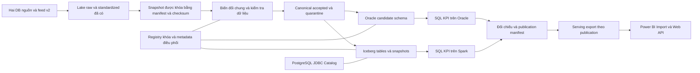

# Thiết kế vật lý và môi trường thử nghiệm CompanyE

CompanyE triển khai hai nhánh từ cùng snapshot nguồn: Oracle warehouse và Spark–Iceberg lakehouse. Cả hai giữ mô hình luận lý 1.1, cùng grain, SCD Type 2, tập dữ liệu hợp lệ và 47 KPI. Bản thử dùng Docker Desktop với WSL2 trên máy hiện tại; dữ liệu nóng nằm trong Docker volume trên ổ E. Ngày chốt thiết kế: 13/10/2026.

Phạm vi bước này là quyết định vật lý, khóa phiên bản, ánh xạ cột và cấu hình triển khai. Đã cài Oracle, Spark–Iceberg và PostgreSQL catalog; kiểm thử ghi/đọc và đọc lại sau restart đã đạt. Đã triển khai schema và hoàn tất ETL 16 dimension ngày 14/10/2026: 26.426 dòng mỗi nhánh, toàn bộ cột khớp, chạy lại không đổi dữ liệu/snapshot, 18 fixture đạt. Chưa nạp fact, công bố batch hoặc đo stress test. [Nghiệm thu dimension](../reports/dimension-etl/verification.json) và mục 17 là trạng thái mới nhất; bằng chứng schema rỗng bên dưới là mốc trước khi nạp. [Biên bản schema](../reports/schema-deployment/verification.json) lưu kết quả đối chiếu DDL và metadata. [Biên bản khởi tạo dịch vụ](../reports/analytics-runtime/verification.json) lưu bằng chứng thực thi. [Hợp đồng vật lý](../config/physical_design_v1.json) chứa đầy đủ quyết định và mapping 631 cột; [báo cáo kiểm tra](../reports/physical_design_v1_validation.json) phân biệt kiểm tra thiết kế với kiểm thử runtime.

## 1 Các quyết định chính

| Thành phần | Chọn cho bản thử | Lý do và phạm vi |
|---|---|---|
| Warehouse | Oracle AI Database 26ai Free, tag `23.26.3.0`, khóa bằng image digest | Giữ hướng Oracle đã chốt; chạy local không cần mua dịch vụ cloud. Đây là edition giới hạn, không phải cấu hình tập đoàn. |
| Lakehouse | Apache Spark 3.5.7, Scala 2.12.18, Java 11.0.27; Apache Iceberg 1.10.2 | Giữ runtime Spark đang dùng cho lake, bổ sung định dạng bảng có snapshot và catalog. Tổ hợp đã qua kiểm thử kết nối, kiểu dữ liệu và persistence sau restart; ETL nghiệp vụ được kiểm thử ở bước sau. |
| Catalog lakehouse | Iceberg JDBC Catalog trên một PostgreSQL 17 riêng | Có nơi lưu con trỏ metadata và commit bảng; không dùng chung embedded Derby của lake cũ. |
| Điều phối và mã khóa | Schema `ce_control` trong PostgreSQL metadata | Lưu registry khóa dùng chung, batch, chất lượng, publication và kết quả đo. Không chứa fact để làm phương án so sánh thứ ba. |
| Lưu trữ nóng | Docker named volumes, filesystem Linux trong VHDX trên E | Tránh ghi Oracle vào Windows bind mount và giảm bất lợi I/O của riêng một nhánh. Các phân vùng vẫn thuộc cùng SSD, chưa có phân tán vật lý. |
| Nạp dữ liệu | Spark chuẩn bị tập canonical hợp lệ; Oracle nạp qua JDBC; Iceberg nạp qua Spark | Một cách diễn giải quy tắc nghiệp vụ, hai đích vật lý. Truy vấn KPI sau đó phải thực thi độc lập trên từng engine. |
| Power BI và web bản đầu | Dùng serving export gắn publication, do từng engine tự tính | Giữ cùng batch và chất lượng trên giao diện. Đo engine tách khỏi export/refresh/UI; kết nối trực tiếp là bước tích hợp riêng. |

Oracle Free có giới hạn hai lõi xử lý, 2 GB RAM database và 12 GB dữ liệu người dùng. Giới hạn container 4 GiB không nâng các giới hạn này. Vì vậy không dùng kết quả bản thử để kết luận Oracle Enterprise kém hoặc hơn lakehouse ở quy mô tập đoàn. [Giới hạn chính thức của Oracle Free](https://docs.oracle.com/en/database/oracle/oracle-database/26/xeinl/licensing-restrictions.html).

Iceberg JDBC Catalog dùng database quan hệ để quản lý bảng và cần giao dịch nguyên tử của database catalog. Vai trò này khác việc lưu các fact của warehouse trong PostgreSQL. [Iceberg JDBC Catalog](https://iceberg.apache.org/docs/1.10.2/jdbc/).

## 2 Máy và dung lượng đã kiểm tra

CPU/RAM: [báo cáo môi trường ngày 13/10](../reports/local_environment_physical_design.json). Đường dẫn Docker và dung lượng C/D/E đã được cập nhật theo [biên bản chuyển Docker sang E](../reports/docker-storage-migration-20261013/verification.json), thời điểm 2026-10-13T05:34:56.5193480+07:00. RAM trống, tải CPU và dung lượng trống là số đo tức thời, phải kiểm tra lại trước khi chạy.

| Thành phần | Kết quả |
|---|---|
| CPU | Intel Core i7-14700F, 20 nhân, 28 bộ xử lý logic |
| RAM hệ điều hành nhìn thấy | 63,83 GiB; trống khoảng 30,02 GiB tại lần đo |
| GPU | RTX 4070 SUPER, khoảng 12 GiB VRAM; pipeline này không cấu hình GPU |
| Docker VM | 28 CPU logic, khoảng 31,26 GiB RAM |
| Ổ C trống | 95,89 GiB sau chuyển Docker sang E |
| Ổ D trống | 9,01 GiB sau chuyển Docker sang E |
| Ổ E trống | 312,38 GiB sau chuyển Docker sang E |
| VHDX Docker | `E:/DockerDesktopData/DockerDesktopWSL/disk/docker_data.vhdx`, kích thước khoảng 13,38 GiB tại lần đo |
| SSD | Samsung SSD 990 PRO 1 TB; C/D/E không phải ba thiết bị độc lập |
| Lake v2 đang có | Khoảng 60,9 MiB; catalog có 267 mục, tổng row_count đã biết là 591.242 |

CPU/RAM phù hợp để phát triển và chạy benchmark có giới hạn. Tải CPU toàn máy là 63% tại thời điểm kiểm tra, còn ứng dụng/container khác; đây không phải điều kiện để đo hiệu năng ngay. Khi benchmark, không tự dừng container của project khác. Riêng lần chuyển Docker sang E theo yêu cầu người dùng, đã tạm dừng rồi khôi phục đúng bốn container đang chạy; container vốn dừng vẫn giữ trạng thái dừng.

Catalog có cả bảng và feed/file nên 267 mục không có nghĩa 267 bảng nguồn. Hai DB nguồn vẫn là 41 bảng. Row count nguồn cũng không bằng số dòng fact đích: fact ngày phòng, ngày xe, đêm ở và tồn kho có thể được mở rộng từ khoảng thời gian.

Vùng nguồn trên D được mount chỉ đọc. Output lớn, staging, shuffle, Iceberg snapshots và Oracle datafile đi vào volume trên E. Không tăng dữ liệu thử trên D. Các file báo cáo/manifest nhỏ vẫn lưu trong Project; dừng xuất log lớn khi D dưới 5 GiB trống.

Trước lần cài/chạy đầu, E cần ít nhất 50 GiB trống và vẫn lớn hơn footprint bổ sung dự báo cộng 20 GiB dự phòng. Ngưỡng 50 GiB là ngân sách vận hành của project, không phải yêu cầu tối thiểu do Oracle công bố. Sau khi kéo image Oracle, tạo database và chạy probe, E còn 296.17 GiB; [số đo sau cài](../reports/analytics-runtime/host-storage.json) thay cho dung lượng tại lần chuyển Docker ở bảng trên. Docker có thể báo nhiều dung lượng trống bên trong VM trong khi E đã gần đầy; phải kiểm tra cả hai.

Docker Desktop đã thực hiện chuyển đĩa qua Settings → Resources → Advanced → Disk image location. Cả 5 container, 4 volume và image inventory được đối chiếu; số dòng từng bảng của bốn database CompanyE khớp trước/sau. Hai database v2 có 41 bảng và 591.242 dòng. Bản sao trước chuyển còn tại `E:/DockerMigrationBackup-20261013/docker_data.vhdx` (khoảng 13,38 GiB), đã đối chiếu SHA-256 khi Docker dừng; bản sao này không nhận cập nhật mới. Bind mount của source/lake/báo cáo trên D giữ nguyên. Ba named volume analytics đã được tạo trong VHDX trên E; Oracle và Iceberg đã provision. [Script kiểm tra](../scripts/verify-docker-storage-migration.ps1) và biên bản lưu bằng chứng; kiểm tra database dựa trên số dòng từng bảng, chưa so sánh từng ô.

## 3 Kiến trúc triển khai



Vùng canonical là đầu ra ETL có version, không phải nguồn nghiệp vụ thứ ba. Nó ghi rõ accepted, quarantine, dependency exclusion, ngày/cụm/KPI bị ảnh hưởng. Hai nhánh phải đọc cùng checksum và cùng registry. Dữ liệu audit-only/đối chứng của bộ sinh không được nhập vào quá trình biến đổi nghiệp vụ.

Khi đo phần xử lý chung, ghi riêng thời gian chuẩn hóa và kiểm tra. Khi đo nạp từng đích, bắt đầu từ cùng canonical snapshot. Khi đo end-to-end, cộng đúng thời gian chung và thời gian đích, không tính hai lần hoặc bỏ phần chung để tạo lợi thế. SQL KPI phải thực sự chạy ở từng engine; không tính bằng Spark rồi chép kết quả sang Oracle để gọi là so sánh SQL.

## 4 Khóa phiên bản và tổ chức môi trường

[Khóa runtime](../config/analytics_runtime_lock_v1.json) lưu image digest và các dependency Maven:

| Dependency | Phiên bản chốt |
|---|---|
| Iceberg Spark runtime | `org.apache.iceberg:iceberg-spark-runtime-3.5_2.12:1.10.2` |
| PostgreSQL JDBC | `org.postgresql:postgresql:42.7.8` |
| Oracle JDBC | `com.oracle.database.jdbc:ojdbc11:23.9.0.25.07` |

Image Oracle đã được kéo theo digest, Spark/PostgreSQL dùng đúng image digest đã chốt. Ba JAR runtime đã được tải vào `/analytics/jars`, xác minh checksum do Maven Central công bố và khóa SHA-256 trong runtime lock. Iceberg có SHA-512 công bố; hai JDBC driver có SHA-1 công bố, đồng thời lưu SHA-256/SHA-512 tính tại máy. Runtime Iceberg đóng gói các dependency cần thiết cho probe; bài kiểm tra ghi/đọc thực tế đã đạt, không phải chứng nhận mọi tính năng hay audit dependency. Không lấy `latest` trong một series đánh giá.

[Compose analytics](../compose.analytics.yaml) tạo project `companye-analytics`, tách khỏi `companye` vận hành và `companye-tests`. Nó định nghĩa Oracle, metadata và Spark, cùng ba named volume. Oracle publish `127.0.0.1:11521`; metadata không publish cổng host. Oracle dùng service `FREEPDB1`, charset `AL32UTF8`. Các thông số này theo cách chạy container Free của Oracle. [Tài liệu container chính thức](https://github.com/oracle/docker-images/blob/main/OracleDatabase/SingleInstance/README.md).

Compose đã vận hành cùng script bootstrap catalog/control schema, JAR và launcher nạp catalog credentials từ Docker secrets. Spark chạy job `spark-submit` với `local[2]`; chưa có Thrift/JDBC SQL server thường trực. Trạng thái container Up được bổ sung bằng probe truy cập PostgreSQL JDBC Catalog, ghi Parquet/Iceberg, ghi Oracle qua JDBC và đọc lại sau restart. DDL nghiệp vụ đã triển khai vào hai owner Oracle và namespace `ce.gold`; tài khoản ETL/BI và pipeline nạp được bổ sung ở bước sau.

Mật khẩu dùng `.env.analytics` riêng, lấy mẫu từ [.env.analytics.example](../.env.analytics.example); file thật đã được ignore. Không dùng mật khẩu admin Oracle/metadata cho ETL hoặc API. Khi provision, tạo role chuyên biệt: owner để tạo bảng, loader để nạp candidate, reader để đọc published, catalog writer cho schema `iceberg_catalog`, control writer cho schema `ce_control`. Chỉ bootstrap cần quyền admin.

## 5 Ngân sách tài nguyên

| Profile | Oracle | Spark | Metadata |
|---|---|---|---|
| Baseline để so sánh | 2 CPU quota, container 4 GiB; database vẫn bị giới hạn 2 GB | 2 CPU quota, container 4 GiB, driver heap 2 GiB, `local[2]`, shuffle partitions 8 | 1 CPU quota, container 512 MiB |
| Phát triển Spark mở rộng, tùy chọn | Giữ cấu hình Free | 4 CPU quota, container 6 GiB, driver heap 3 GiB, `local[4]` | Giữ cấu hình baseline |

Hai engine được đo lần lượt. Spark chuẩn bị dữ liệu phải kết thúc trước khi đo SQL Oracle; không chạy generator, test suite hoặc refresh Power BI trong cùng cửa sổ đo backend. Không coi CPU quota trên i7 có P-core/E-core là số lõi vật lý đồng nhất. Ghi tải nền và lặp nhiều lần.

Profile tùy chọn chưa bật trong Compose. Nếu tăng tài nguyên Spark thì đó là thí nghiệm mở rộng riêng, không gộp vào bảng “cùng ngân sách” với Oracle Free. Bộ nhớ heap Spark và SGA/PGA Oracle có cách sử dụng khác nhau; quota container giống nhau chỉ kiểm soát ngân sách ngoài, không làm hai engine tương đương hoàn toàn.

## 6 Tổ chức dữ liệu vật lý của Oracle

Oracle có hai owner `ce_dwh_a`, `ce_dwh_b` làm hai vùng candidate/published luân phiên, cùng `ce_stage` cho dữ liệu hỗ trợ hai validation view. Mỗi vùng gồm 35 bảng nghiệp vụ vật lý và hai view logic. Các cấu trúc metadata/registry/staging là cấu trúc kỹ thuật bổ sung, không được cộng thành fact mới hoặc sửa 37 entity luận lý.

Các bảng dùng heap storage, không partition ở baseline, không table compression, degree 1. Tablespace `ce_data` khởi tạo 256 MiB, tăng 64 MiB mỗi lần, trần 8 GiB cho cả hai owner; `ce_stage_data` trần 1 GiB. Các trần này phải xác minh khi dựng thật và ghi lượng đã cấp/lượng đang dùng. Dừng mở rộng khi tổng user data của Free tiến gần ngưỡng 9 GB vận hành; không chờ lỗi giới hạn 12 GB. Cần tính cả candidate, published, index và helper tables.

DDL sẽ dùng tên lowercase snake_case không quote. Oracle hiển thị tên không quote dạng uppercase trong catalog nhưng câu SQL vẫn dùng cùng tên logic. Session đặt UTC, `NLS_COMP=BINARY`, `NLS_SORT=BINARY`; không dựa vào thiết lập ngày/số của Windows. Literal ngày và timestamp dùng kiểu tường minh; chuỗi Unicode dùng AL32UTF8 và độ dài CHAR.

PK và UK tạo B-tree phục vụ tính toàn vẹn. Thiết kế hiện có 99 khai báo index/ràng buộc duy nhất trên 35 bảng cho mỗi owner; đây không phải 99 index tối ưu workload đã thử. Chưa thêm index riêng cho tất cả FK. Thu thập statistics bằng `DBMS_STATS` sau nạp; tính thời gian này vào giai đoạn nạp/chẩn đoán, không giấu trong thời gian làm nóng truy vấn.

Oracle nạp vào bảng đã tạo bằng DDL tường minh, không để Spark JDBC tự suy schema hoặc dùng overwrite làm mất constraint. Khởi đầu `numPartitions <= 2`, JDBC `batchsize=1000`; dimension được nạp và kiểm tra trước fact/bridge. Dữ liệu lỗi nghiệp vụ được phân loại ở canonical; nếu accepted vẫn vi phạm constraint đích thì coi là lỗi triển khai hoặc đối soát, không tự bỏ dòng để “nạp cho xong”.

## 7 Tổ chức bảng Iceberg

Catalog `ce` dùng JDBC URL đến schema `iceberg_catalog` trong database `ce_metadata`. Kho file là `file:///analytics/iceberg`, namespace nghiệp vụ `gold`. Catalog database giữ metadata đăng ký; data file và metadata JSON/manifest Iceberg nằm trong volume. Backup phải có cả hai phần và publication metadata.

Có 35 Iceberg table tương ứng 35 bảng Oracle. L03/L04 được dựng thành session view từ helper Parquet đã khóa theo publication; không mặc định rằng JDBC Catalog đang có persistent view với constraint như Oracle. Helper input và checksum phải có trong manifest để session view dựng lại giống nhau.

Baseline dùng format version 2, Parquet, Snappy, mục tiêu file 128 MiB, không partition và chưa định nghĩa sort order. Mục tiêu file không có nghĩa ép mọi bảng nhỏ thành file 128 MiB. Đo file count/kích thước sau nạp; tránh sinh hàng nghìn file nhỏ vì repartition theo cả khách sạn, ngày và loại dịch vụ. Các tùy chọn format/compression/file size là thuộc tính bảng Iceberg. [Iceberg configuration](https://iceberg.apache.org/docs/1.10.2/configuration/).

Delete/update/merge chọn copy-on-write cho thí nghiệm incremental sau này. Bản nạp đầu là full snapshot đã kiểm chứng. Khi thay thế candidate ở batch tiếp theo phải giữ đủ lịch sử SCD đã tích lũy, không lấy danh mục current rồi xóa các phiên bản cũ. Snapshot cũ của Iceberg không thay thế SCD Type 2: snapshot mô tả phiên bản kỹ thuật của bảng, SCD mô tả hiệu lực nghiệp vụ của từng đối tượng.

Mỗi commit bảng Iceberg là một đơn vị riêng. Đọc 35 bảng “latest” sau lỗi giữa pipeline có thể trộn batch, dù từng bảng đều hợp lệ. Consumer bắt buộc dùng snapshot ID trong một publication đã chốt. Không expire snapshot đang được publication hoặc reader lease tham chiếu. Baseline chưa bật tự động xóa metadata/snapshot.

## 8 Ánh xạ kiểu dữ liệu

Toàn bộ 631 cột đã được ánh xạ theo bảng dưới; tên cột, nullability và grain không thay đổi.

| Miền | Oracle | Spark SQL khi tạo Iceberg |
|---|---|---|
| KEY | NUMBER(18,0) | BIGINT |
| DATEKEY | NUMBER(8,0) | INT |
| COUNT | NUMBER(18,0) | BIGINT |
| INT | NUMBER(10,0) | INT |
| FLAG | NUMBER(1,0) | INT, kèm kiểm tra 0/1 |
| MONEY | NUMBER(19,0) | DECIMAL(19,0) |
| QTY | NUMBER(18,3) | DECIMAL(18,3) |
| VALUE | NUMBER(38,3) | DECIMAL(38,3) |
| DATE | DATE với giờ 00:00:00 | DATE |
| UTC | TIMESTAMP(6) | TIMESTAMP_NTZ |
| ID | VARCHAR2(128 CHAR) | STRING, kiểm tra dài tối đa 128 ký tự |
| CODE | VARCHAR2(64 CHAR) | STRING, kiểm tra dài tối đa 64 ký tự |
| TEXT | VARCHAR2(512 CHAR) | STRING, kiểm tra dài tối đa 512 ký tự |
| HASH | VARCHAR2(64 CHAR) | STRING, kiểm tra SHA256 hex 64 ký tự |

Các miền số khác nhau về dung lượng giữa engine nên pipeline phải kiểm tra miền giao nhau đã chốt: KEY tối đa 18 chữ số, INT nằm trong signed 32-bit, DATEKEY là ngày hợp lệ hoặc 0/-1 được phép. Không để một nhánh nhận được giá trị mà nhánh kia âm thầm cắt hoặc làm tròn.

Đối với UTC, chọn rõ `TIMESTAMP_NTZ` của Spark để tương ứng Iceberg timestamp **không timezone**, giống hợp đồng Oracle TIMESTAMP(6). Giá trị bên trong vẫn là thời điểm đã chuẩn hóa UTC; tên `_utc` thể hiện quy ước đó. Spark TIMESTAMP mặc định có thể ánh xạ sang Iceberg timestamp có timezone, nên chỉ đặt session UTC là chưa đủ. [Bảng tương thích kiểu Spark–Iceberg](https://iceberg.apache.org/docs/1.10.2/spark-getting-started/), [cấu hình Spark 3.5.7](https://spark.apache.org/docs/3.5.7/configuration.html).

Nguồn có offset `+07:00` cần chuyển đúng instant sang UTC trước khi ghi NTZ. Không được bỏ timezone bằng thao tác chuỗi rồi coi giờ địa phương là UTC. Ngày nghiệp vụ vẫn xác định theo Asia/Ho_Chi_Minh; không lấy ngày UTC thay ngày kinh doanh. Smoke test phải có một thời điểm gần nửa đêm Việt Nam và ranh giới SCD để bắt lỗi lệch ngày.

Spark bật ANSI và tắt cho phép mất precision của decimal. Tiền không dùng float. Khi SUM hoặc nhân vượt miền decimal phải báo lỗi tính toán; không đổi overflow thành NULL rồi công bố như thiếu dữ liệu nghiệp vụ. Tỷ lệ đối chiếu bằng tử/mẫu chính xác và quy tắc làm tròn KPI; định dạng phần trăm chỉ ở lớp hiển thị.

Chuỗi rỗng chuẩn hóa thành NULL trước khi tách nhánh để tương thích cách Oracle xử lý chuỗi rỗng. Giữ NULL khác số 0. Không trim/viết hoa mã nguồn tùy tiện; namespace luôn đi cùng BK.

## 9 Ràng buộc và lịch sử

Oracle thực thi NOT NULL, PK/UK, 106 vai trò FK đã khai báo và CHECK biểu diễn được. Các kiểm tra nhiều dòng như khoảng SCD chồng nhau hoặc trùng đêm phòng vẫn chạy ở pipeline. Hai view validation không tự có PK vật lý; khóa ghép phải được kiểm tra trên helper input và đối soát kết quả view.

Iceberg schema giữ required field nhưng không thay thế PK/UK/FK/CHECK. Identifier field của Iceberg không bảo đảm uniqueness; pipeline phải kiểm tra cùng tập quy tắc trước publish. Vì vậy không ghi “có PK” chỉ vì đã khai báo identifier field. [Iceberg specification, identifier fields](https://iceberg.apache.org/spec/).

Với 14 dimension SCD2:

1. PK là surrogate key của phiên bản; BK gồm namespace và mã nghiệp vụ.
2. UK1 trên BK + valid_from; UK2 trên BK + version_no, chỉ áp dụng dòng NORMAL.
3. Unique index có điều kiện trên BK khi `member_kind='NORMAL' AND is_current=1`.
4. Oracle thể hiện các UK có điều kiện bằng CASE cho từng cột; dòng đặc biệt được trả NULL ở biểu thức index để không tranh chấp với dòng NORMAL.
5. Kiểm tra khoảng `[valid_from, valid_to)` không chồng nhau; `valid_to=NULL` là chưa kết thúc, không phải thiếu dữ liệu cần sửa thành một ngày giả.
6. FK fact chọn phiên bản tại thời điểm đã chốt riêng cho từng vai trò; không thay toàn bộ bằng current. Thuộc tính cha site/hotel/centre cũng được resolve theo R17 đúng thời điểm.

DimDate và DimMeal giữ STATIC. Dòng 0 UNKNOWN và -1 NOT_APPLICABLE có chính sách riêng; chỉ dùng ở vai trò được phép. ID nguồn có giá trị nhưng sai không được đổi thành khóa đặc biệt. Registry cấp khóa phải dùng thao tác nguyên tử và khóa tự nhiên canonical, không dùng `row_number()` hoặc thứ tự đọc file. Registry là metadata điều phối dùng chung, không sửa seed nguồn.

## 10 Công bố batch và báo cáo thiếu

Quy trình publish dùng một coordinator và một publication ID. Đây là cơ chế kiểm soát phiên bản được nhìn thấy, không phải distributed transaction giữa Oracle, PostgreSQL và Iceberg.

1. Khóa source manifest, code hash, rule version và cutoff; tạo candidate run.
2. Sinh canonical accepted/quarantine, đếm dependency exclusions, cấp/tra registry khóa.
3. Oracle dựng candidate trong slot không active và không có reader lease. Iceberg ghi candidate tables rồi ghi snapshot ID từng bảng. Một lỗi giữa bước này không đổi active publication.
4. Đối chiếu row count, tổng tiền/lượng, grain, SCD và trạng thái chất lượng. Chạy query KPI ở hai engine; lỗi kỹ thuật khác với dòng lỗi nghiệp vụ đã cách ly.
5. Lưu manifest bất biến gồm Oracle slot, Iceberg snapshot IDs, view helper paths/hash, source cutoff, coverage và trạng thái mỗi KPI.
6. Sau khi cả hai nhánh của lần so sánh đã đủ bằng chứng, cập nhật active pointer trong một transaction metadata. Nếu crash ngay trước/sau switch, recovery đọc trạng thái publication và kiểm tra target đã ghi; không đoán từ file mới nhất.
7. Reader/BI refresh chốt publication một lần đầu phiên. Không đọc lại active pointer riêng cho từng visual/table. Reader lease giữ slot/snapshot khỏi bị tái sử dụng hoặc dọn dẹp.

Hai slot Oracle tiết kiệm hơn việc giữ mọi batch thành schema mới. Khi slot cũ vẫn được reader giữ, batch mới phải đợi hoặc kết thúc phiên đọc có kiểm soát; không ghi đè dữ liệu đang đọc. Không dùng chuỗi `CREATE OR REPLACE VIEW` cho 35 bảng rồi gọi đó là publish nguyên tử.

Chính sách người dùng đã chọn vẫn là báo cáo phần hợp lệ: KPI nhận COMPLETE, PARTIAL hoặc UNAVAILABLE theo nguồn/phạm vi bị ảnh hưởng. Nếu mất toàn file và không biết số dòng dự kiến, coverage là UNKNOWN; không bịa 0% hoặc 100%. Chỉ tiêu không tính được trả NULL và lý do, không trả 0. Lỗi engine, ghi dữ liệu hoặc cutoff không xác định làm candidate thất bại; không gắn nhãn PARTIAL cho một bộ dữ liệu không đủ tin cậy để công bố.

Các cấu trúc kỹ thuật dự kiến trong `ce_control`: key_registry, pipeline_run, quality_entity, quality_metric, publication, publication_table, active_publication, reader_lease, benchmark_run. DDL của chúng thuộc bước triển khai tiếp theo. Chúng không làm thay đổi grain của 37 entity nghiệp vụ.

## 11 Index và partition trong đánh giá

Baseline Oracle chỉ dùng index cho PK/UK; baseline Iceberg không partition. Dữ liệu hiện tại nhỏ, việc partition ngay theo ngày có thể tạo nhiều file nhỏ và làm thí nghiệm khó diễn giải. Đây là lựa chọn baseline của project, không phải khẳng định warehouse/lakehouse thực tế luôn nên không partition.

Sau baseline, mở một nhóm thí nghiệm tối ưu tách biệt. Oracle có thể thêm B-tree theo ngày/FK có trong workload; Iceberg có thể thử sắp xếp file, compaction và partition khi đủ dữ liệu. Mỗi thay đổi phải ghi cấu hình, thời gian dựng, dung lượng, query plan và kết quả trước/sau. Không đưa aggregate F15 vào riêng một nhánh khi so cùng cấu hình.

Các khóa ngày hiện là INT YYYYMMDD. Không gọi `months(date_key)` của Iceberg lên cột INT. Nếu thử phân vùng tháng mà giữ schema, có thể đánh giá `truncate(100, date_key)` sau khi kiểm chứng mã ngày; nếu đổi sang cột DATE thì phải quản lý như thay đổi schema ở cả hai nhánh. Các khóa đặc biệt cần được xử lý riêng. Chưa bật phương án này trong cấu hình hiện tại.

## 12 Phép đo và stress test

Lần đầu chạy 1x với v2 cố định, một writer và một reader. Các phép đo backend gồm thời gian chuẩn bị chung, thời gian nạp, kiểm tra dữ liệu/statistics, query SQL, export và tổng end-to-end. Dung lượng tách data, index, catalog/metadata, retained snapshots, staging và temp. Kết quả phải có seed/manifest/code/image digest, tài nguyên và quality status.

Với query SQL, dùng một lần warm-up và ít nhất năm lần đo, báo median/min/max. Đổi thứ tự Oracle/Iceberg giữa các series. Năm mẫu không đủ để quảng cáo p95 ổn định. Không bật Spark `CACHE TABLE` hay Oracle result-cache hint trong baseline. Restart container không chứng minh đã làm lạnh cache WSL/Windows; chỉ đặt tên cold-cache khi kiểm soát được lớp cache tương ứng.

Tăng quy mô theo 1x, 2x, 5x, 10x chỉ khi generator scale giữ được FK và công suất nghiệp vụ, kiểm tra đúng dữ liệu đạt, footprint dự báo nằm trong ngưỡng disk và Oracle chưa chạm ngưỡng vận hành. Không UNION ALL bản sao ID cũ để giả tăng dữ liệu. Tiếp theo mới tăng reader 1, 2, 4, 8; vẫn một writer, có publication pinning. Profile stress chưa bật.

Các fixture bắt buộc: SCD không đổi/đổi/ràng giới/A-B-A/đến muộn; replay; FK sai; đêm phòng trùng; mất file nguồn; thất bại sau một commit Iceberg; thất bại quanh thời điểm đổi active pointer. Fixture lỗi phải đi qua pipeline đích thật và kiểm tra nhãn PARTIAL, không chỉ qua phép tính tham chiếu Python.

Dừng tăng tải nếu E còn dưới 20 GiB dự phòng, D dưới 5 GiB cho báo cáo, host/container OOM, swap tăng kéo dài, user data Oracle gần 9 GB, hoặc đối soát không đạt. Ngưỡng tải chưa xác định trước: chọn từ bằng chứng đo từng nấc, không khẳng định máy chạy được một hệ số chỉ từ RAM.

Ngoài tốc độ, bảng so sánh cần ghi tính đúng/phục hồi, khả năng lưu lịch sử và tiến hóa schema, metadata, mức phức tạp vận hành, hạn chế một node và giới hạn edition. Cấu trúc này hỗ trợ đánh giá nhiều mặt; chưa thay thế việc đối chiếu rubric cuối cùng hoặc viết kết luận khi chưa có số đo.

## 13 Power BI và web

Phiên bản đầu xuất các dataset phục vụ phân tích từ SQL của từng engine, vào thư mục bất biến theo publication/branch. Power BI Import nhận cùng schema, định nghĩa tử/mẫu và quality metadata; web API đọc cùng publication. API chỉ trả dữ liệu đã published, không đọc thư mục candidate.

CSV/Parquet serving không trở thành nguồn chính và không chứng minh thời gian engine. Thời gian SQL, serialization/export, refresh Power BI và render web được ghi riêng. Tỷ lệ phải tính lại từ tổng tử/mẫu tại cấp tổng hợp được hỗ trợ, không trung bình các tỷ lệ đã xuất. Dataset có kèm source cutoff, publication_id, branch, status và phạm vi thiếu; client không tự đổi NULL thành 0.

Kết nối trực tiếp Oracle vào Power BI hoặc dùng JDBC/ODBC tới Spark là hướng tích hợp tùy chọn sau smoke test connector. Baseline không giả định đã có driver/giấy phép ODBC hoặc endpoint SQL chạy sẵn. Nếu bật direct connection, vẫn cần chốt publication cho toàn refresh và tính phần overhead connector riêng.

## 14 Bàn giao sang triển khai

Thứ tự triển khai tiếp theo:

1. Chạy preflight dung lượng/cổng, chuẩn bị secret riêng, kéo image theo digest và tải dependency theo khóa đã lưu.
2. Dựng ba service analytics; bootstrap role, catalog/control schema và thư mục volume. Xác minh Oracle version/charset/limits và Spark–Iceberg/JDBC.
3. Smoke test bằng bảng tạm riêng: create/write/read/restart/read lại; decimal, Unicode, NULL, UTC và ranh giới SCD. Không dùng bảng nghiệp vụ để thử cấu hình.
4. Sinh DDL Oracle và Iceberg từ hợp đồng vật lý, kèm manifest tên object/constraint. Tạo đầy đủ hai slot Oracle, helper input và 35 table Iceberg.
5. Triển khai ETL, quality metadata và publication coordinator theo mapping đã có; chạy fixture độc lập trước khi nạp v2 đầy đủ.
6. Chạy 47 KPI trên cả hai nhánh, đối chiếu rồi mới benchmark và tích hợp giao diện.

Tái tạo mapping bằng `python -X utf8 scripts/build-physical-design.py` từ Project. Script không kết nối database hoặc chạy container. Cấu hình Compose có thể kiểm tra bằng `docker compose -f compose.analytics.yaml --profile oracle --profile lakehouse config --quiet` với biến mật khẩu đã được cung cấp; không xuất cấu hình đã nội suy secret ra báo cáo.

Đã hoàn thành bước 1–2 và phần kiểm tra dịch vụ của bước 3: kết nối, Unicode, decimal, NULL, timestamp microsecond, ghi/đọc và persistence sau restart. Fixture SCD2/ràng buộc nghiệp vụ thuộc giai đoạn DDL/ETL tiếp theo. Bước 4 đã hoàn tất ngày 14/10/2026; chưa thực hiện bước 5–6. Nguồn v2, seed, lake đang vận hành, mô hình ý niệm, luận lý và hợp đồng biến đổi được giữ nguyên.


## 15 Vận hành dịch vụ đã khởi tạo

Project Compose là `companye-analytics`, tách với project nguồn `companye`.

| Dịch vụ | Runtime thực tế | Truy cập | Volume chính |
|---|---|---|---|
| Oracle | 26ai Free 23.26.3.0.0, FREEPDB1 mở READ WRITE, AL32UTF8 | Máy Windows: `127.0.0.1:11521/FREEPDB1`; trong mạng Compose: `oracle:1521/FREEPDB1` | `companye-analytics_oracle_data` |
| PostgreSQL metadata | 17.11, database `ce_metadata` | Nội bộ `metadata:5432`; không publish cổng ra Windows | `companye-analytics_metadata_data` |
| Spark và Iceberg | Spark 3.5.7, Iceberg 1.10.2, Java 11.0.27, Python 3.8.10 | Chạy `spark-submit` trong container Spark | `companye-analytics_analytics_data` |

`ce_catalog` chỉ quản lý schema `iceberg_catalog`; không dùng tài khoản PostgreSQL admin để chạy Spark. Iceberg tự tạo hai bảng `iceberg_tables` và `iceberg_namespace_properties`. Schema `ce_control` đã có nhưng chưa có bảng registry/publication và coordinator. Oracle có tài khoản `CE_PROBE` với quyền tạo bảng và quota 20 MiB để kiểm tra dịch vụ; đây không phải chủ sở hữu fact/dimension.

Mật khẩu riêng được sinh ngẫu nhiên, lưu trong `.env.analytics` và `.secrets/analytics/`; hai đường dẫn này đã nằm trong `.gitignore`. Muốn kết nối quản trị Oracle bằng DBeaver, dùng host `127.0.0.1`, port `11521`, service `FREEPDB1`, user `SYSTEM` và giá trị `COMPANYE_ORACLE_ADMIN_PASSWORD` trong file riêng. Không đưa file này vào báo cáo hay gói bài nộp. Đổi giá trị trong dotenv không tự đổi mật khẩu database đã khởi tạo.

Các lệnh sau chạy từ thư mục Project với Python trên máy. Có thể dùng Python runtime sẵn có của Codex nếu `python` chưa nằm trong PATH.

```powershell
python scripts/analytics-services.py prepare
python scripts/analytics-services.py up
python scripts/analytics-services.py bootstrap
python scripts/analytics-services.py jars
python scripts/analytics-probe.py write
python scripts/analytics-services.py restart
python scripts/analytics-probe.py verify
python scripts/analytics-services.py status
python scripts/finalize-analytics-runtime.py
```

`prepare` giữ các mật khẩu đã có; `up` tái sử dụng volume. `write` tạo run_id mới và thêm ba dòng kiểm thử vào `CE_PROBE.RUNTIME_PROBE` và `ce.runtime_probe.types_probe`; `verify` chỉ đọc run đã ghi gần nhất. Giữ hai bảng probe để truy vết, không đưa chúng vào phép đếm fact/dimension. Khởi động lại trong chuỗi kiểm tra chỉ tác động ba service analytics. Script finalize ghi bằng chứng của lần probe đã hoàn tất, không thay thế việc chạy probe.

Để bật hoặc tắt môi trường hằng ngày, không cần chạy lại probe:

```powershell
docker compose --env-file .env.analytics -f compose.analytics.yaml --profile oracle --profile lakehouse up -d
docker compose --env-file .env.analytics -f compose.analytics.yaml --profile oracle --profile lakehouse stop
```

Lệnh `stop` giữ dữ liệu. Không dùng `down -v` khi cần giữ database/catalog. Toàn bộ phiên bản, checksum JAR, cấu hình, snapshot ID và kết quả trước/sau restart được lưu trong [thư mục bằng chứng](../reports/analytics-runtime/verification.json). Bản sao Docker trước chuyển ổ E có thời điểm trước khi cài analytics nên không chứa ba volume analytics vừa tạo.


## 16 Schema nghiệp vụ đã triển khai ngày 14 tháng 10 năm 2026

Đã triển khai schema rỗng từ hợp đồng vật lý đã chốt, giữ nguyên mô hình luận lý 1.1, grain, 631 cột logic và các tham chiếu dimension. [Biên bản nghiệm thu](../reports/schema-deployment/verification.json) là nguồn trạng thái triển khai hiện hành. Hợp đồng vật lý và báo cáo thiết kế ngày 13/10 được giữ như snapshot đầu vào có checksum; trường status trong snapshot đó mô tả thời điểm trước khi triển khai, không phải trạng thái database hiện tại.

| Đích | Đã tạo | Kiểm tra thực tế |
|---|---|---|
| `CE_DWH_A` | 35 bảng: 16 dimension, 17 fact/aggregate, 2 bridge; 2 view | Đúng cột/kiểu/độ dài/NULL; 106 FK và 99 index duy nhất/PK; object VALID và constraint ENABLED VALIDATED |
| `CE_DWH_B` | Cùng cấu trúc với A để phục vụ candidate/published | Đối chiếu như A; không có dữ liệu nghiệp vụ |
| `CE_STAGE` | 4 helper table, tương ứng L03/L04 cho hai slot, có PK | View của từng owner đọc đúng helper thuộc slot đó |
| `ce.gold` | 35 bảng Iceberg, format v2, Parquet/Snappy, không partition hoặc sort ở baseline | Đối chiếu qua Iceberg Java metadata API, bao gồm required fields và table properties |
| Spark session | Bộ đăng ký hai view `validated_booking_service_link`, `site_crosswalk` | Thử với Parquet rỗng có manifest riêng; thiếu hoặc đổi checksum file bị từ chối |

Oracle có tổng 74 table và 4 view khi tính cả hai slot và các helper; con số này không có nghĩa mô hình logic đã tăng từ 37 entity lên 78 entity. Tablespace `CE_DATA` có trần 8 GiB dùng chung cho A/B; `CE_STAGE_DATA` trần 1 GiB. Hai owner cùng `CE_STAGE` là schema-only account (`NO AUTHENTICATION`), chưa phải tài khoản kết nối của ETL/BI. Bước pipeline sẽ cấp quyền phù hợp cho tài khoản thực thi riêng.

[DDL Oracle](../config/analytics/ddl/oracle_schema.sql), [DDL Iceberg](../config/analytics/ddl/iceberg_schema.sql) và [manifest triển khai](../config/analytics/ddl/manifest.json) được sinh từ hợp đồng máy đọc. Oracle tạo PK/UK, 106 FK mỗi slot, các CHECK trên từng dòng và unique index có điều kiện cho SCD2. Manifest ghi 433 predicate theo entity, bao gồm miền khóa, flag/count, thuộc tính bắt buộc của NORMAL, tính nhất quán phiên bản, số tiền và các công thức trên một dòng. Đây là phần biểu diễn được bằng kiểm tra cục bộ; không phải bằng chứng toàn bộ quy tắc nghiệp vụ đã có ETL thực thi.

Với SCD2, unique index ràng buộc BK/thời điểm hiệu lực, BK/số phiên bản và một dòng NORMAL current cho mỗi BK. Các dòng đặc biệt 0/-1 không bị unique BK áp dụng như khách thể NORMAL. CHECK chặn `is_current=1` mà có `valid_to`, hoặc `valid_from>=valid_to`; không ngăn được hai khoảng lịch sử chồng nhau. Bộ fixture đã cho thấy một dòng lịch sử chồng khoảng vẫn có thể được Oracle nhận, vì vậy kiểm tra non-overlap và tra đúng phiên bản theo thời điểm là bắt buộc ở ETL.

Iceberg chỉ thực thi kiểu dữ liệu và required fields ở mức schema. Nó không có PK/UK/FK/CHECK tương đương Oracle. Các predicate Spark và danh sách quy tắc nguồn/quan hệ nhiều dòng được giữ trong manifest để triển khai validator trước publish. Giới hạn độ dài chuỗi, miền số, sentinel theo vai trò, uniqueness, FK, SCD overlap và điều kiện hợp lệ giữa các nguồn vẫn cần áp dụng trước ghi/publish, không suy ra là đã đạt chỉ vì tạo bảng thành công.

Hai view Spark là session view. Mỗi job phải gọi `register_validation_views` với manifest publication cụ thể, đường dẫn helper Parquet, schema và checksum. Fixture có tên `SCHEMA_VALIDATION_ONLY_NOT_PUBLISHED` chỉ kiểm tra cơ chế đăng ký; nó không phải dữ liệu công bố cho báo cáo. Không dựng view rỗng để thay cho helper bị thiếu. Schema Oracle đã có view đọc helper rỗng nhưng cũng chưa được công bố thành báo cáo nghiệp vụ.

### Kiểm thử đã thực hiện

Oracle được đối chiếu trực tiếp qua data dictionary: inventory table/view/index, thứ tự cột, kiểu/precision/scale/CHAR semantics, NULL, trạng thái và biểu thức CHECK, PK/UK/FK, biểu thức function-based index, SQL của view, tablespace và số dòng. Iceberg được đối chiếu bằng metadata của catalog, thay vì chỉ tin vào Spark DataFrame vốn có thể biểu diễn nullability khác schema lưu trữ.

Đã thử sáu lỗi trên mỗi owner, tổng 12 trường hợp: trùng PK, hai phiên bản current cùng BK, thiếu thuộc tính bắt buộc của NORMAL, trạng thái current/end time mâu thuẫn, vi phạm NOT NULL và FK mồ côi. Tất cả bị từ chối đúng mã lỗi. Fixture được rollback, kiểm tra lại các bảng đã chạm đều rỗng. Nguồn v2, catalog lake, seed, KPI contract và source-to-target mapping không thay đổi.

### Sinh lại và triển khai

Chạy từ thư mục Project, trên môi trường analytics đã khởi tạo:

```powershell
python scripts/build-analytics-schema.py
python scripts/deploy-analytics-schema.py oracle
python scripts/deploy-analytics-schema.py verify-oracle
python scripts/deploy-analytics-schema.py iceberg
python scripts/test-analytics-schema.py
python scripts/finalize-schema-deployment.py
```

DDL không chứa DROP/TRUNCATE và không nạp dữ liệu. Oracle kiểm tra object đã tồn tại trước CREATE; Iceberg dùng IF NOT EXISTS. Nếu schema cũ khác hợp đồng, bước đối chiếu báo lỗi để xử lý migration có chủ đích; không tự sửa/xóa bảng để ép kết quả khớp. Fixture Oracle chỉ chạy trên các schema được xác nhận rỗng; sau khi nạp dữ liệu không chạy lại fixture này trên bảng nghiệp vụ.

Sau mốc nghiệm thu schema rỗng, bảng điều phối/registry, tài khoản ETL và luồng dimension đã được bổ sung ở mục 17; fact/bridge/helper là bước kế tiếp hiện hành. Chỉ sau nghiệm thu dữ liệu và publication mới tính 47 KPI và đo benchmark. F15 đã có schema nhưng vẫn là aggregate tùy chọn; việc tạo bảng không tự bật vật hóa hay đưa nó vào baseline so sánh.

## 17 Triển khai batch, registry và ETL dimension

Phần này tiếp nối nghiệm thu schema rỗng ở mục 16. Snapshot đầu vào vẫn là `v2_20261012T092023738754Z`; không sửa seed, danh mục nguồn, contract KPI hoặc mô hình luận lý. Lệnh triển khai ở [dimension-pipeline.py](../scripts/dimension-pipeline.py); DDL kỹ thuật ở [control_schema.sql](../config/analytics/ddl/control_schema.sql). Kết quả thực thi cuối cùng được ghi vào `reports/dimension-etl/`, tách khỏi bằng chứng schema rỗng để không làm mất lịch sử.

### 17.1 Phạm vi của lần nạp này

Nạp 16 dimension vào `CE_DWH_A` và `ce.gold`; slot A là candidate, chưa phải published. Slot B được giữ trống sau khi dọn fixture. Mỗi dimension có thành viên `0 / UNKNOWN` và `-1 / NOT_APPLICABLE`; thuộc tính nghiệp vụ của hai dòng này là NULL. Không dùng hai khóa đó để che ID nguồn có nội dung nhưng sai tham chiếu. Không nạp fact, bridge hoặc helper nghiệp vụ ở bước này.

Mã đã có bộ xử lý lịch sử SCD2 và được thử bằng các thay đổi thật trên hai engine. Launcher nghiệp vụ hiện chỉ cho phép **bootstrap snapshot đầu tiên và chạy lại đúng candidate đó**. Khi có một candidate DIMENSIONS_READY khác hoặc active publication, launcher từ chối nạp đè. Việc xử lý snapshot nghiệp vụ mới cần bổ sung điều phối slot, giữ lịch sử, rekey fact và publish ở bước sau; không đánh đồng bộ xử lý SCD2 với toàn bộ pipeline incremental đã hoàn thiện.

### 17.2 Metadata điều phối và quyền truy cập

PostgreSQL `ce_control` có chín bảng nghiệp vụ kỹ thuật, cộng `schema_version` để lưu phiên bản DDL:

| Bảng | Nội dung và vai trò trong bước này |
|---|---|
| `key_registry` | Khóa tự nhiên canonical đầy đủ, SK dương duy nhất và thời điểm đăng ký. Append-only qua hàm cấp khóa; loader không có quyền UPDATE/DELETE bảng này. |
| `pipeline_run` | run ID, batch nguồn, checksum manifest, phiên bản biến đổi, thời điểm bắt đầu, slot đích, trạng thái và liên kết bằng chứng. Trạng thái DIMENSIONS_READY chỉ xác nhận dimension. |
| `quality_entity` | COMPLETE/PARTIAL/UNAVAILABLE, số thành viên NORMAL được giữ, số lỗi nguồn/đích được ghi nhận, coverage và phạm vi nguồn. Không suy độ đầy đủ KPI từ bảng này. |
| `quality_metric` | Dành cho trạng thái từng KPI sau khi có fact; hiện chưa điền kết quả KPI. |
| `publication` | Dành cho manifest công bố bất biến gồm slot và bằng chứng; hiện chưa tạo publication nghiệp vụ. |
| `publication_table` | Dành cho snapshot Iceberg và checksum canonical từng entity thuộc publication. |
| `active_publication` | Một con trỏ active; hiện không có dòng. Loader dimension không có quyền thay đổi bảng này. |
| `reader_lease` | Dành cho phiên đọc giữ publication; hiện chưa có reader nghiệp vụ. |
| `benchmark_run` | Dành cho cấu hình và phép đo; chưa ghi kết quả benchmark. |

Tạo bảng không có nghĩa đã hoàn thành coordinator publication hoặc cơ chế lease. Những phần đó vẫn phải triển khai và thử lỗi sau khi nạp fact. Một session PostgreSQL giữ advisory lock `(5173,1)` trong suốt lượt nạp dimension để ngăn hai coordinator của pipeline này chạy đồng thời; khi kết nối kết thúc, khóa được giải phóng.

Tài khoản `CE_LOADER` chỉ có CREATE SESSION, SELECT đối tượng nghiệp vụ, INSERT 16 dimension của slot A; INSERT/DELETE riêng DIM_SITE của slot B phục vụ fixture. Không cấp UPDATE, ghi fact, DDL hoặc quản trị. `ce_control_writer` được đọc metadata, ghi run/quality và gọi hàm cấp khóa; không được trực tiếp sửa registry hoặc active publication. Secrets lưu riêng trong `.secrets/analytics/`, được ignore và mount vào Spark; không đưa vào mã nguồn hay báo cáo. Tài khoản quản trị chỉ dùng lúc bootstrap DDL/quyền.

### 17.3 Đóng băng đầu vào, chuẩn hóa và cách ly lỗi

1. Run ID kết hợp batch nguồn và hash cấu hình/mã biến đổi. Trước nạp đích, lưu checksum các contract nguồn–đích, thiết kế, DDL manifest, KPI contract và catalog nguồn. Thời điểm chạy được lưu một lần trong PostgreSQL; chạy lại lấy thời điểm đã lưu, không tự đổi effective time hoặc audit của dòng nghiệp vụ.
2. Đọc CSV raw thuộc lake theo `relative_path` trong catalog. Kiểm tra đường dẫn nằm trong lake, SHA-256, header theo đúng thứ tự cột và số dòng khai báo. Không đọc `generated/v2/audit_only`, không sử dụng nhãn đối chứng để nối hồ sơ khách. Dữ liệu danh mục được lấy từ snapshot lake, không trích lại DB đang thay đổi giữa lượt chạy.
3. Giải mã `\N` và chuỗi rỗng thành NULL; giữ nguyên nội dung ID, tên, điện thoại và email khác rỗng. Trường bắt buộc NULL hoặc chỉ chứa khoảng trắng bị loại. Không uppercase/trim mã rồi gộp đối tượng, không cắt chuỗi vượt độ dài Oracle để nạp cho qua.
4. Parse số nguyên và DECIMAL chính xác; từ chối số lẻ ở cột nguyên, vượt miền/precision/scale. Dữ liệu tiền chuyển DECIMAL đúng scale đích trước tạo hash và trước ghi hai nhánh. DATE giữ ngày nguồn; TIMESTAMPTZ bắt buộc offset rồi chuyển thành UTC không timezone để lưu. PostgreSQL COPY xuất offset dạng `+07` hoặc `+00` là hợp lệ: thêm phần phút `:00` trước khi parse bằng Python 3.8, không coi đó là thiếu timezone và không tự đoán offset cho timestamp thực sự không có timezone. Ngày kinh doanh được lấy sau chuyển +07:00.
5. Kiểm tra PK/UK nguồn; một nhóm khóa trùng bị cách ly toàn nhóm, không chọn ngẫu nhiên một dòng. Snapshot này không có bằng chứng delivery để tự coi dòng trùng là replay. Kiểm tra các CHECK nguồn đã khai báo bằng Spark SQL. Sau đó kiểm tra FK many-to-one với đúng một parent hợp lệ; lặp đến điểm ổn định để loại cả quan hệ phụ thuộc bắc cầu. FK optional NULL được giữ, FK có giá trị nhưng không có parent bị `DEPENDENCY_EXCLUDED`.
6. Kiểm tra thuộc tính bắt buộc của NORMAL, độ dài đích và predicate theo manifest DDL. Lỗi nghiệp vụ vào quarantine trước khi ghi. Nếu dữ liệu canonical đã được xác nhận vẫn vi phạm constraint đích, coi là lỗi kỹ thuật và dừng candidate; không âm thầm bỏ dòng ở JDBC writer.
7. Mất file được ghi UNAVAILABLE ở nguồn và làm dimension liên quan PARTIAL/UNAVAILABLE; coverage không xác định là NULL. Sai checksum/header/số dòng so với manifest là vi phạm tính toàn vẹn snapshot, làm lượt chạy thất bại để điều tra. Không lấy dữ liệu batch cũ bù vào mà vẫn gắn batch mới.

Canonical, event ledger, registry snapshot, quarantine và manifest được lưu dưới `/analytics/canonical/<run_id>/` trên Docker volume ổ E. Manifest chứa checksum mọi file; hai nhánh dùng chung bản Parquet có kiểu này. Đây là artifact được pipeline kiểm tra tính bất biến bằng checksum, chưa phải storage WORM chống sửa vật lý. Mỗi lần resume phải kiểm tra lại manifest/file; không chọn file theo tên “latest”. Nếu lỗi giữa chuẩn bị canonical trước khi manifest hoàn tất, giữ thư mục dở dang để điều tra và từ chối tái sử dụng mù quáng.

### 17.4 Quy tắc riêng của 16 dimension

| Dimension | Biến đổi và ý nghĩa |
|---|---|
| D01 Date | Quét DATE và ngày Việt Nam của TIMESTAMPTZ trong toàn bộ 41 bảng structured; thêm ngày trước kỳ công suất. Sinh lịch liên tục từ đầu năm nhỏ nhất đến cuối năm lớn nhất, hiện 2023–2026. SK = YYYYMMDD; Monday=1, quarter=(month−1)//3+1. Không sinh ngày lễ/mùa tự đoán và không mở rộng công suất ngoài 2024–2025. |
| D02 Site | Giữ site ID, tên và vùng khí hậu của hotel_ops; không tự hợp nhất site_code của entertainment. |
| D03 Hotel | Giữ tên, hạng sao, site ID và mã website; kiểm tra site tồn tại. |
| D04 Room | Giữ hotel ID, loại phòng, sức chứa, giá nền; kiểm tra khách sạn, sức chứa và giá nguồn. |
| D05 Channel | Hotel giữ channel_id/name/type/commission_bps. Entertainment tạo danh mục DISTINCT từ sales_channel hợp lệ, chỉ chấp nhận GATE và HOTEL_RECEPTION theo contract; channel_type=ENTERTAINMENT_SALES, commission_bps=NULL. Hai namespace vẫn độc lập. DISTINCT mã danh mục không loại giao dịch vé. |
| D06 Promotion | Giữ thời gian sale/stay, tỷ lệ giảm, chia tài trợ, trần giảm và tham chiếu channel/site optional. Không dùng giảm giá danh mục thay số tiền tài trợ thực tế của fact. |
| D07 CustomerProfile | UNION hồ sơ hotel và entertainment với source_system + source_customer_id. Giữ nguyên tên/phone/email; hotel member_card_ref=NULL. Không fuzzy-match hoặc coi hai người dùng chung phone là một khách tập đoàn. |
| D08 RatePlan | Giữ hotel/channel, tên gói, breakfast_included và refundable; kiểm tra hai tham chiếu và flag 0/1. |
| D09 Outlet | Giữ hotel ID, loại outlet, sức chứa, quality_profile. Chưa tính doanh thu hoặc quyền lợi buffet trong dimension. |
| D10 Meal | Bốn dòng cố định: BREAKFAST=1, LUNCH=2, DINNER=3, BAR=4; nhãn tiếng Việt. Mã meal sai ở giao dịch phải được bắt ở ETL fact, không map về BAR. |
| D11 Centre | Giữ centre ID, tên và site_code nguồn entertainment; crosswalk với Site thuộc helper ở bước sau. |
| D12 Activity | Giữ centre ID, tên, outdoor, công suất/ngày; kiểm tra centre hợp lệ. |
| D13 Vehicle | Giữ centre ID, loại và giá/ngày; kiểm tra centre hợp lệ. |
| D14 Supplier | Giữ tên, category, site ID optional và delivery_format. Không dùng các file receipt ngoài để tạo thêm supplier tự suy đoán. |
| D15 Item | Giữ tên, specification, base_unit và shelf_life_days; chưa cộng số lượng khác đơn vị trong dimension. |
| D16 Asset | Giữ hotel ID, room ID optional, asset_type, supplier ID; kiểm tra tham chiếu danh mục. |

File ngoài về nhận hàng chưa được tiêu thụ ở bước dimension; chúng dành cho fact mua hàng/nhận hàng và đối soát receipt version ở bước sau. Vì vậy dimension COMPLETE không có nghĩa dữ liệu mua hàng hoặc toàn bộ 47 KPI COMPLETE.

### 17.5 Cấp khóa và SCD Type 2

Hàm `ce_control.allocate_keys` nhận JSON array canonical có thứ tự. Khóa dimension gồm `[entity_id, source_system, business_key, valid_from_utc]`; effective time được serialize UTC microsecond. Unique constraint so sánh JSON đầy đủ, không cắt hash. INSERT ON CONFLICT và identity PostgreSQL đảm bảo hai lời gọi đồng thời cho cùng khóa nhận cùng SK. Sequence có thể có khoảng trống; không dùng SK để suy số dòng hoặc thứ tự nghiệp vụ. Date/Meal và hai thành viên đặc biệt dùng khóa cố định theo contract.

Payload hash SCD là SHA-256 của tracked_attributes theo thứ tự khai báo, với NULL giữ riêng, DATE ISO và DECIMAL fixed-scale. Không đưa SK, audit hoặc version_no vào payload hash. STATIC Date/Meal dùng các thuộc tính lịch/danh mục xác định; hai dòng đặc biệt không tham gia đổi phiên bản. Registry có snapshot trong artifact canonical để truy vết; không cấp lại khóa theo thứ tự đọc CSV.

Snapshot v2 không có lịch sử danh mục nên mỗi BK hợp lệ có một phiên bản với `valid_from_utc=2022-12-31T17:00:00Z`, `valid_to_utc=NULL`, `is_current=1`, `version_no=1`, `effective_time_basis=BOOTSTRAP_ASSUMPTION`. Mốc này tương ứng đầu ngày 01/01/2023 tại Việt Nam và chỉ là giả định dữ liệu mô phỏng. Không dùng thời điểm ETL năm 2026 để phân loại giao dịch năm 2024.

Bộ xử lý ở [scd2.py](../src/analytics_runtime/scd2.py) sắp sự kiện theo thời điểm hiệu lực, giữ event ledger kể cả sự kiện no-op. Các bước:

- Payload không đổi: không tạo phiên bản; khi replay giữ cả SK, created_at và updated_at.
- Đổi payload tại t: kết thúc khoảng cũ ở t, tạo phiên bản mới từ t với SK theo BK+t. Khoảng hiệu lực là `[from,to)`; tra đúng t lấy phiên bản mới.
- A→B→A: tạo ba phiên bản và ba SK; việc giá trị quay lại A không cho phép tái dùng SK của lần A đầu.
- Sự kiện đến muộn: dựng lại ranh giới từ event ledger, giữ thay đổi tương lai đã biết và đánh lại version_no theo thứ tự thời gian. Ranh giới cũ không đổi thì SK vẫn giữ, kể cả ordinal đổi. Việc giữ sự kiện no-op trước đó rất quan trọng: sau chèn một thay đổi cũ, quan sát tương lai từng là no-op có thể trở thành một ranh giới có ý nghĩa.
- Cùng BK/timestamp nhưng payload khác: báo conflict, không “last writer wins”. Bộ reducer trả lỗi để coordinator cách ly; luồng nhận sự kiện incremental và rekey fact chưa được bật cho dữ liệu nghiệp vụ.
- Lookup phải có đúng một interval; thiếu hoặc chồng khoảng đều từ chối. Không tự nối sang current.

Fixture kiểm tra những hành vi trên với expected interval viết độc lập, rồi ghi/đọc đúng schema DimSite trên Oracle slot B và namespace Iceberg thử. Dữ liệu fixture được xóa sau kiểm tra; ledger thử và báo cáo giữ để truy vết. Chưa dùng fixture thay đổi này để làm phong phú danh mục v2 thật.

### 17.6 Nạp hai nhánh, đối chiếu và chạy lại

Oracle nạp từng dimension bằng prepared statement, batchsize 1000, một transaction cho toàn bảng. Không dùng overwrite tạo lại bảng hoặc bỏ constraint. Với bảng đích đã có dòng, launcher chỉ đối chiếu; nếu khác canonical thì dừng, không xóa/nạp lại tự động. Iceberg append một commit cho dimension rỗng, lưu current snapshot ID; bảng đã có dữ liệu cũng phải khớp canonical hoàn toàn mới cho resume.

Đối chiếu cả nội dung: sắp theo SK, serialize toàn bộ cột theo thứ tự contract rồi SHA-256. Oracle được chuẩn hóa DATE/TIMESTAMP/NUMBER về kiểu logic trước so sánh; Iceberg đọc lại bằng Spark. So sánh bao gồm Unicode, NULL, tiền, audit và các cột SCD, không chỉ row count. Bộ validator chung kiểm tra PK/UK, một current/BK, version ordinal và interval không chồng trước khi ghi, vì Iceberg không tự có các constraint Oracle tương ứng.

Lỗi sau khi một nhánh/bảng đã commit vẫn để candidate chưa công bố. Resume đọc canonical đã đóng băng và kiểm tra bảng có sẵn, chỉ nạp bảng còn rỗng; không nhân đôi hàng đã commit. Đây là khả năng resume của bootstrap dimension, chưa phải nghiệm thu crash recovery của publication toàn mô hình.

Chạy tại thư mục Project bằng Python có sẵn trên máy:

```powershell
python -X utf8 scripts/dimension-pipeline.py bootstrap
python -X utf8 scripts/dimension-pipeline.py fixtures
python -X utf8 scripts/dimension-pipeline.py run
python -X utf8 scripts/dimension-pipeline.py verify
```

`bootstrap` giữ secret đã có và tạo quyền hạn chế. `fixtures` dùng bảng DIM_SITE trống của slot B và namespace `ce.etl_test`; từ chối khi có publication hoặc dữ liệu lạ, không chạy tùy tiện sau khi vận hành thật. `run` giữ canonical cùng hash, còn `verify` không ghi bảng nghiệp vụ, registry hoặc snapshot Iceberg. Không chạy lại công cụ nghiệm thu schema rỗng cũ sau khi đã nạp dimension: báo cáo cũ là bằng chứng tại thời điểm trước nạp, không phải phép kiểm đếm hiện trạng.

Adapter danh mục hiện thu thập dữ liệu trên driver, giới hạn 100.000 dòng cho mỗi nguồn cần dùng; Spark thực thi các kiểm tra SQL và đọc/ghi Iceberg. Oracle writer dùng JDBC qua driver, chưa phải pipeline phân tán cho hàng triệu hồ sơ. Đây là quyết định phù hợp bản local nhỏ, cần thay adapter bằng xử lý phân tán nếu tăng scale; không lấy thời gian chạy hiện tại làm kết luận benchmark Oracle versus lakehouse. Canonical, Oracle và Iceberg vẫn dùng volume đã chuyển sang ổ E.

Trong lần nghiệm thu, phát hiện và sửa hai lỗi tương thích Python 3.8 với định dạng timestamp PostgreSQL: đọc lại `started_at` của batch và offset rút gọn trong COPY. Lỗi thứ hai khiến bước quét ngày ban đầu ghi cảnh báo giả và gắn Date PARTIAL, dù các cột DATE khác đã tạo đủ lịch 2023–2026. Giữ nguyên bằng chứng/canonical ban đầu; không sửa lịch sử để che lỗi. [Hợp đồng sửa tương thích](../config/analytics/dimension_replay_compatibility_v1.json) khóa chính xác hash trước/sau và input; lần chạy lại quét toàn bộ nguồn, yêu cầu không còn lỗi ngày và **so sánh lại toàn bộ thuộc tính nghiệp vụ của cả 16 dimension** với canonical cũ. Chỉ khi khớp mới ghi bằng chứng `quality-revalidation.json` và cập nhật kết luận chất lượng. Không đổi khóa, hàng, audit hoặc snapshot đã nạp. Nếu payload khác thì dừng để xử lý một candidate mới.

Bản mã gốc và hợp đồng đầu vào lưu tại `reports/dimension-etl/frozen/<run_id>/`; mã sửa tương thích nằm trong thư mục `replay_<run_id>`. Các báo cáo chứa cả hash mã tạo dữ liệu và hash mã thực thi lần kiểm tra. Bản sao lưu registry/control ở `databases/ce_control-after-dimensions.dump` được kiểm tra mục lục archive bằng pg_restore; chưa tuyên bố đã diễn tập restore vào database khác. Canonical Parquet vẫn được lưu trên volume E; cần giữ volume hoặc sao lưu riêng nếu dọn môi trường.

### 17.7 Bước kế tiếp sau dimension

Triển khai ETL fact/bridge/helper theo phụ thuộc, lookup dimension tại đúng thời điểm, giữ grain và chống nhân doanh thu. Sau đó tính chất lượng theo phạm vi B01–B08/47 KPI, hoàn thiện coordinator công bố cùng snapshot/slot và reader lease, thử lỗi quanh commit/publication. Chỉ khi kết quả đúng và công bố nhất quán mới nối Power BI/web và thực hiện benchmark/stress test có kiểm soát. Chưa tạo reader/BI account trước khi có ranh giới publication được kiểm chứng.


Kết quả nghiệm thu mục 17: [PASSED_DIMENSION_ETL](../reports/dimension-etl/verification.json). Oracle và Iceberg mỗi bên có 26.426 dòng, trong đó 24.929 phiên bản NORMAL SCD2 dùng registry, 1.461 ngày NORMAL, 4 loại bữa và 32 thành viên đặc biệt. Tất cả 16 dimension hiện COMPLETE ở phạm vi đầu vào của chúng. 18 fixture đạt; slot B DIM_SITE và bảng thử Iceberg đã không còn dòng thử. Hồ sơ control có một run fixture được đóng bằng trạng thái FAILED kèm `fixture_only=true, intentional_close=true`; đó là dấu vết đóng bài thử có chủ đích, không phải lỗi candidate nghiệp vụ.

Đã kiểm tra lại checksum 267 file raw trong catalog; 41 bảng nguồn vẫn tương ứng 591.242 dòng của snapshot v2. Chưa có active publication, KPI quality hay benchmark. Bảng publication/lease đã có DDL nhưng chưa có vòng đời coordinator/reader hoạt động. Không diễn giải việc dimension đã sẵn sàng thành báo cáo nghiệp vụ đã sẵn sàng.

## 18. Triển khai ETL fact, bridge và đối soát

### 18.1 Căn cứ học phần và ranh giới triển khai

ETL này tiếp nối thiết kế ý niệm, luận lý và vật lý đã chốt; không thay đổi grain hoặc schema để thuận tiện cho lập trình. Các trang dưới đây dùng số trang PDF, tính từ 1. Bản trích đọc kèm đường dẫn gốc và SHA-256 nằm ở `reports/fact-etl/course-extracts.json`.

| Tài liệu học phần | Trang | Áp dụng vào CompanyE |
|---|---:|---|
| CO5173, Data Engineering – Chapter 2 – Data Warehouse and Data Management Architecture Design | 43, 46 | Trích xuất theo batch từ hai hệ thống nghiệp vụ, tích hợp thành tập dữ liệu nhất quán trước khi phục vụ phân tích. Snapshot v2 đã được trích vào raw lake; bước này đọc đúng snapshot đó, không tự sinh hoặc trích lại dữ liệu khác. |
| Cùng tài liệu | 78 | Metadata phải ghi cấu trúc, nguồn, biến đổi và lịch sử trích xuất. Mỗi run giữ hash nguồn/mã/hợp đồng, registry khóa, số dòng, lỗi, canonical và snapshot Iceberg. |
| Cùng tài liệu | 84–88 | Chọn quy trình, grain, dimension và fact. Tiền booking, đêm phòng, suất ăn, lượt vào cửa và biến động kho ở các grain khác nhau; không nối chi tiết để cộng doanh thu. |
| Cùng tài liệu | 101, 137–138 | Dữ liệu danh mục có thời gian hiệu lực; tích hợp/biến đổi phải minh bạch. Tra phiên bản SCD2 tại thời điểm nghiệp vụ, giữ khác biệt giữa ETL và ELT; không mô tả pipeline local này là một hệ thống phân tán quy mô tập đoàn. |
| Kho Dữ Liệu và Hệ Hỗ trợ Quyết Định, Lecture 3 – Data warehouse design | 26, 41–42 | Giữ quy trình thiết kế dimensional và surrogate key/hiệu lực cho SCD2. Fact không tự dùng bản current khi phiên bản lịch sử bị thiếu. |
| Cùng môn, Lecture 4 – ETL and data integration challenges | 8, 14, 46–47 | Bài giảng giới thiệu nhiều công cụ; SSIS là một lựa chọn minh họa. CompanyE dùng Python + Spark SQL/JDBC, kiểm tra tính đầy đủ, duy nhất, hợp lệ, nhất quán và metadata; không khẳng định có đủ các kiểm tra là đã chứng minh mọi giá trị đúng với thực tế. |
| CO5173, DE Presentation and Project Descriptions and Requirements, Semester 1, 2026–2027 | 2 | So sánh giải pháp và đánh giá đúng đắn, hiệu năng, tính hữu ích. ETL cung cấp cùng dữ liệu đầu vào cho Oracle/Iceberg và bằng chứng đúng đắn; thời gian nạp local chưa phải benchmark và chưa thay thế đánh giá hữu ích nghiệp vụ. |

Code mới nằm riêng ở `src/fact_etl/`, giữ nguyên bộ mã dimension đã đóng băng. Launcher `scripts/fact-pipeline.py` có ba action `bootstrap`, `run`, `verify`. Đây là nạp lần đầu và resume/replay cùng candidate; cập nhật snapshot mới, rekey do thay đổi SCD và công bố đồng bộ cho người đọc là bước tiếp theo.

### 18.2 Extract, kiểm tra nguồn và lineage

Đầu vào là 41 CSV nghiệp vụ đã đăng ký trong catalog của batch `v2_20261012T092023738754Z`, cộng các tập Parquet receipt_versions/latest/replays/quarantine đã chuẩn hóa tại lake. Mọi file raw trong catalog được kiểm checksum trước khi xử lý và trước khi nạp đích. Header, số dòng, kiểu, trường bắt buộc, PK/UK và CHECK của nguồn đều được kiểm tra. FK được kiểm đến điểm cố định: khi parent bị loại, child phụ thuộc cũng phải được ghi nhận, không mất âm thầm trong inner join.

`source-quality.json` phân hoạch mỗi bảng nguồn thành accepted, direct_quarantine và dependency_excluded. Khi file tồn tại, tổng ba nhóm phải bằng row_count trong catalog. File thiếu có coverage NULL, không được diễn giải thành tập rỗng hợp lệ. Kiểu tiền dùng Decimal; chuyển BIGINT VND sang DECIMAL đích không được làm tròn. Timestamp PostgreSQL mang offset được chuyển về UTC; ngày nghiệp vụ vẫn theo Việt Nam, nên 00:00 ngày D tương ứng 17:00 UTC ngày D−1.

Mỗi bảng đích có lineage qua mapping cột đã phê duyệt, source_batch_id, transform_version và row_hash. Fact dùng registry theo grain bền vững, không dùng SK của dimension trong khóa định danh fact. Hash payload thay khóa dimension bằng namespace/business key, phân biệt NULL/thành viên đặc biệt và giữ fixed scale cho decimal. created_at/updated_at giữ nguyên khi replay canonical.

### 18.3 Quy tắc biến đổi và thứ tự phụ thuộc

Lookup SCD2 phải khớp đúng một phiên bản NORMAL theo namespace + business key với `valid_from <= t < valid_to`; NULL valid_to là chưa kết thúc. Quan hệ hotel–site, room–hotel, outlet–hotel, vehicle/activity–centre cũng lấy thuộc tính từ phiên bản tại thời điểm đó. Thiếu hoặc chồng interval làm dòng phụ thuộc bị loại. Không đồng nhất khách hotel và entertainment bằng tên, điện thoại hoặc mã thẻ.

| Đích | Biến đổi và điều kiện giữ dòng |
|---|---|
| L04 SiteCrosswalk | Ghép centre.site_code với site_id công khai; mã centre phải duy nhất. Giữ lineage hai namespace, không phát sinh hệ thống định danh khách toàn công ty. |
| L03 ValidatedBookingServiceLink | Hợp các tham chiếu booking không NULL từ đơn vé và thuê xe. Mỗi dịch vụ phải tham chiếu một booking nguồn hợp lệ; tham chiếu NULL được ghi là business_filtered của helper. Không bắt booking COMPLETED ở helper và không đợi F04/F05 để tránh vòng phụ thuộc. |
| F01 Booking | Mỗi booking một dòng snapshot cuối. Giữ COMPLETED/CANCELLED/NO_SHOW; chép tiền một lần, không nối booking_rooms để tính tiền. Kiểm ngày và cân bằng discount/company/partner/customer_due. Tra dimension tại booked_on; promotion NULL dùng −1. |
| F08 MealSession | Mỗi outlet/ngày/bữa một phiên buffet, chỉ nhà hàng với BREAKFAST/DINNER. Giữ actual_covers và ingredient_cost; trùng grain bị loại cả nhóm. Đối soát sau F06/F07 với suất bao gồm đã đổi và suất trả tiền; không tự tạo phiên LUNCH/BAR. |
| F10 ActivityDay | Mỗi hoạt động/ngày trong kỳ công suất có một dòng. Công suất danh nghĩa lấy từ phiên bản activity, closure dùng EXISTS; không cộng nhiều closure. Nguồn closure thiếu/lỗi làm phạm vi công suất không chắc chắn, không tự mặc định mở cửa. |
| F11 VehicleDay | Mỗi xe/ngày, bảo dưỡng dùng hợp các khoảng; số thuê là số rental COMPLETED chồng ngày đó. Nếu lớn hơn 1 hoặc thuê khi bảo dưỡng thì loại grain xung đột. Dữ kiện vận hành độc lập với kiểm tra booking referral của F05. |
| F12 PurchaseLine | Giữ từng dòng đặt hàng, kể cả chưa nhận. Lấy supplier/hotel từ PO, item từ dòng; không nối receipt để nhân ordered_qty hoặc áp ngày chốt báo cáo ngay ở ETL. |
| F16 MaintenanceWork | Mỗi lần bảo dưỡng tài sản một dòng, cost ghi một lần. Tra asset/hotel/room tại starts_on; tài sản không gắn phòng dùng room −1. Không suy diễn nhà cung cấp tài sản là nhà thầu bảo dưỡng. |
| F17 WeatherDay | Mỗi site/ngày, giữ provenance SYNTHETIC. Không chuyển thành dữ liệu quan trắc thật hoặc cộng nhiệt độ theo thời gian; lỗi thời tiết cần lan truyền tới truy vấn có dùng bộ lọc thời tiết. |
| L02 RoomDayMaintenance | Bung khoảng bảo dưỡng `[starts_on,ends_on)` trong kỳ công suất, chỉ khi asset có phòng. Grain phòng/ngày/maintenance giữ chi tiết giao nhau; F02 lấy tập phòng/ngày duy nhất từ bridge. Không cộng chi phí qua bridge này. |
| F02 RoomDay | Tích phòng × 731 ngày của `[2024-01-01,2026-01-01)`. Inventory=1, blocked theo EXISTS L02, available=1−blocked. Nếu dữ liệu bảo dưỡng không đủ tin cậy, không biến phần chưa biết thành phòng trống khả dụng. |
| F04 TicketOrder | Một đơn vé, gross/refund/net ghi một lần; không nhân theo ticket/admission. Dịch vụ tra theo ordered_on. Referral hợp lệ kế thừa SK site/hotel/channel và ngày departure từ F01; không có referral dùng −1, có mã nhưng sai thì loại. |
| F05 Rental | Một rental, agreed_vnd giữ nguyên, không nhân số ngày. Tra tại pickup, khoảng thuê nửa mở; xung đột vận hành làm rental không hợp lệ. Referral xử lý như đơn vé; rental không có referral vẫn là khách độc lập hợp lệ. |
| F07 DiningOrder | Một hóa đơn ăn uống, outlet quyết định khách sạn cung cấp; booking_hotel là vai trò khác và kế thừa F01 nếu có. Guest NULL dùng 0, không tự suy ra từ booking. Giữ covers, net, rating_sum và rating_count; không gắn lại chi phí phiên buffet vào từng hóa đơn. |
| F09 Admission | Một lượt vào thực tế; ngày từ entered_at theo Việt Nam, lookup tại timestamp UTC chính xác. Ticket RESCHEDULED vẫn hợp lệ khi có admission. Kiểm centre của activity/order, sau đó kiểm toàn nhóm activity/ngày với F10; đóng cửa hoặc vượt công suất thì loại cả nhóm lượt vào liên quan. |
| F13 Receipt | Một phiếu nhận DB một dòng, late_accepted_qty chỉ khi received_on > expected_on. Expires NULL dùng date 0; không suy ra hạn từ shelf_life. File nhà cung cấp chỉ đối soát, không UNION thành phiếu nhận thứ hai. |
| L01 BookingRoom | Một booking_room, phụ thuộc F01 hợp lệ, tra room/rate tại booked_on và kiểm khách sạn/kênh. Bridge không mang doanh thu hay trọng số phân bổ; khi lọc room type cần EXISTS hoặc distinct booking. |
| F03 StayNight | Bung khoảng lưu trú thực `[checkin,checkout)`, chỉ booking COMPLETED. Kiểm phòng/rate/hotel/channel, phòng khả dụng F02. Mọi dòng cùng grain phòng/ngày đều bị loại nếu chồng nhau; không DISTINCT để giấu xung đột. |
| F14 StockMovement | Giữ từng biến động và lịch sử trước kỳ báo cáo. Kiểm receipt→line→PO, hotel/item và phiên sử dụng nếu có. IN dương, USE/WASTE âm; value=quantity×giá PO. Kiểm prefix theo tổng ngày; số dư âm làm ngày lỗi và phần phụ thuộc sau đó bị cách ly. Không tự sắp movement_id thành thứ tự trong ngày hoặc phát sinh WASTE chỉ vì hết hạn. |
| F06 BreakfastEntitlement | Booking COMPLETED, rate gồm sáng, đúng phòng/hotel/channel, duy nhất nhà hàng phù hợp tại ngày dùng. Ngày dùng phải thỏa checkin < ngày <= checkout và tồn tại F03 của đêm trước với đúng booking_room. Giữ eligible/redeemed, không tạo thêm doanh thu buffet. |
| F15 InventoryLotDay | Aggregate tùy chọn, tắt ở baseline. Không lấp đầy bảng này bằng số 0 hoặc coi bảng rỗng là dữ liệu tồn kho đã sẵn sàng. Có thể dựng sau như một phương án tối ưu có kiểm soát trên cả hai nhánh. |

### 18.4 Chất lượng, đối soát và báo thiếu

Đếm nguồn và đếm grain đích là hai đơn vị khác nhau. Một stay có thể sinh nhiều đêm; một maintenance có thể sinh nhiều ngày hoặc được lọc vì không gắn phòng. `quarantine.json` ghi entity, grain và lý do; `scope-quality.json` ghi lô/ngày từ đó số dư không đáng tin cậy. Không cộng số dòng lỗi của các bảng phụ thuộc rồi diễn giải là số giao dịch nguồn độc lập.

Validator đích kiểm các cột bắt buộc, FK dimension, uniqueness của từng grain và toàn bộ CHECK SQL trong manifest trên Spark trước nạp. Oracle tiếp tục thực thi ràng buộc vật lý. Iceberg sử dụng bộ kiểm tra chung; không tuyên bố Iceberg tự thực thi FK/PK như Oracle.

Sau khi biến đổi, đối chiếu actual_covers của phiên buffet với tổng F06.redeemed_covers + F07.covers đúng outlet/ngày/bữa. Chênh lệch được lưu, đánh PARTIAL cho entity phụ thuộc thay vì sửa tiền hoặc suất nguồn. Đối với kho, dòng lỗi có thể khiến prefix về sau không xác định dù các biến động còn lại trông hợp lệ; báo cáo số dư phải đọc phạm vi lỗi, không dùng COALESCE để thay bằng 0.

Feed nhà cung cấp giữ versions, latest, replays và quarantine. Latest phải là revision hợp lệ cao nhất, không chọn bằng thời gian nhận; revision mới nhất bị lỗi được cảnh báo riêng, kể cả khi có bản cũ hợp lệ. So receipt_ref, purchase_line_ref, supplier, hotel, accepted_qty_kg và unit_price_vnd với DB. Kết quả này không làm tăng F13 và không tự sửa DB. File feed đại diện một mẫu của phiếu nhận, không phải nguồn đầy đủ cho toàn bộ mua hàng.

Metadata `quality_entity` phân COMPLETE/PARTIAL/UNAVAILABLE; coverage chỉ có giá trị khi biết mẫu số đáng tin cậy. `metric-readiness.json` và `quality_metric` truyền trạng thái từ các fact cần cho 47 KPI. Đây là độ sẵn sàng của dữ liệu đầu vào theo batch; semantic layer còn phải truyền phạm vi filter, phụ thuộc thời tiết và lô lỗi khi thực thi truy vấn. COMPLETE ở đây chưa chứng minh công thức dashboard đã đúng hoặc dữ liệu tự sinh phản ánh thế giới thật.

### 18.5 Nạp, resume và bằng chứng

Canonical Parquet được tạo trong volume `/analytics` trên ổ E; manifest giữ checksum từng file, hash code/config và liên kết tới dimension run. Không sửa seed hoặc source DB để làm kết quả đối soát đẹp hơn. Các lần phát triển thất bại có thể để lại thư mục canonical chưa đóng băng và khoảng trống sequence; registry không được đánh số lại vì khoảng trống không vi phạm tính duy nhất.

Oracle: Spark JDBC ghi hai partition vào staging riêng `CE_STAGE.ETL_<entity>`, sau đó một câu INSERT SELECT nạp toàn bảng candidate A. Staging được phép xóa trước retry; bảng nghiệp vụ chỉ cấp INSERT, không cấp DELETE/UPDATE cho launcher này. Nếu INSERT vi phạm constraint, transaction của câu lệnh thất bại, không để một phần bảng A được coi là hoàn tất. Hai helper Oracle dùng input_a và view tương ứng; quyền đọc underlying table được cấp cho chủ view để có thể truy vấn qua tài khoản loader.

Iceberg: append vào bảng trống, ghi lại snapshot ID. Hai helper logic dùng Parquet canonical đã pin, đăng ký temp view trong session; không tạo hai bảng Iceberg nghiệp vụ ngoài manifest. Khi resume gặp bảng đã có dữ liệu, cả hai engine phải khớp toàn bộ cột canonical mới được tiếp tục; không tự xóa candidate khác. Bảng còn rỗng có thể nạp tiếp. Replay so sánh cả row hash nội dung và snapshot ID, tránh việc count không đổi nhưng đã ghi lại dữ liệu.

Từng bảng có bằng chứng sắp theo đầy đủ PK, serialize toàn bộ cột rồi SHA-256. Oracle NUMBER/DATE được chuẩn hóa về kiểu logic trước đối chiếu; Spark JDBC chuyển timestamp NTZ sang TimestampType trong session UTC để nạp Oracle. Ngày, decimal, Unicode, NULL, audit đều nằm trong phép so sánh. Control bổ sung trạng thái ETL_READY bằng migration nhỏ, không đánh PUBLISHED khi chưa có coordinator publication.

```powershell
# Chạy tại thư mục Project, sau khi dịch vụ và dimension đã sẵn sàng.
python -X utf8 scripts/fact-pipeline.py bootstrap
python -X utf8 tests/test_fact_transform.py
python -X utf8 scripts/fact-pipeline.py run
python -X utf8 scripts/fact-pipeline.py verify
```

`verify` không ghi bảng nghiệp vụ hay snapshot; nó cập nhật kết quả kiểm tra ở metadata. Giữ canonical volume và backup registry cùng nhau để phục hồi. Không chạy script kiểm tra “schema phải trống” của giai đoạn trước trên candidate đã nạp.

Adapter hiện vẫn thu nguồn và biến đổi Python trên driver, giới hạn 100.000 dòng/bảng nguồn; Spark dùng cho kiểm tra SQL, Parquet, JDBC và Iceberg. Đây là giới hạn có chủ đích của bản thử local, không đủ để chứng minh scale tập đoàn. Đo nạp có tiến trình, cache và runtime dùng chung; chưa phải phép so sánh hiệu năng công bằng. Trước benchmark lớn cần chuyển phép biến đổi sang phân tán, thiết kế workload/query tương đương và đo tuần tự theo cấu hình tài nguyên đã chốt.

### 18.6 Kết quả nghiệm thu ngày 14/10/2026

Run `facts_v2_20261012T092023738754Z_8a65e73962da` đạt [PASSED_FACT_ETL](../reports/fact-etl/verification.json). 41 bảng nguồn có 591.242 dòng; checksum 267 file raw giữ nguyên. Không chỉnh source, seed hoặc schema nghiệp vụ. 16 fact, 2 bridge và 2 helper có 745.138 dòng logic mỗi nhánh; cộng 26.426 dòng dimension có sẵn là 771.564 dòng. F15 giữ rỗng đúng cấu hình optional baseline, không tính là fact đã triển khai.

| Nhóm kiểm chứng | Kết quả |
|---|---|
| Quy tắc trên dữ liệu thử lỗi/biên | 16 kiểm thử đạt, gồm SCD gap/overlap/boundary, không nhân doanh thu, xung đột phòng/xe, buffet checkout, vé đổi lịch, ledger âm và grain ngày. |
| Đối soát độc lập từ CSV raw | 48 kiểm tra đạt trên hai engine: số dòng từng grain, tiền booking/vé/xe, đêm phòng, suất ăn, lượng đặt/nhận/IN/USE/WASTE và chi phí bảo dưỡng. Không đọc dữ liệu audit bí mật của generator để tính expected. |
| Nội dung hai nhánh | Toàn bộ cột của 20 entity mới khớp canonical. Hai lần kiểm tra sau nạp giữ nguyên payload, khóa, audit và snapshot Iceberg. |
| Dimension | Cả 16 dimension giữ nguyên nội dung và snapshot so với lần nghiệm thu trước. |
| Chất lượng nghiệp vụ của snapshot | Không có quarantine fact/bridge, không có chênh số suất buffet, không có prefix lô âm. 47 bản ghi readiness đầu vào COMPLETE; chưa nghiệm thu truy vấn KPI/dashboard. |
| Feed nhà cung cấp | 228 latest hợp lệ khớp DB, 0 mismatch. Giữ cảnh báo 12 sự kiện lỗi UNKNOWN_UNIT/INVALID_QUANTITY và 3 replay ở lake; không cộng thành receipt mới. |
| Metadata, mã và khóa | Mã/hợp đồng theo hash được lưu ở `reports/fact-etl/frozen/`; metadata canonical được xuất vào report. Backup `databases/ce_control-after-facts.dump` đã kiểm tra archive listing; chưa diễn tập restore. |

Lệnh kiểm chứng độc lập là `python -X utf8 scripts/verify-fact-etl.py`; chỉ chạy sau action `verify` khi muốn nghiệm thu lại đúng baseline v2 đầy đủ. Script này sẽ thất bại nếu áp máy móc cho một batch PARTIAL hoặc một nguồn khác; expected phải được thiết kế lại theo phạm vi dữ liệu của batch đó.

Các lượt chạy phát triển trước lần đạt gặp thiếu quyền đọc underlying helper view và cần chuyển kiểu BIGINT VND sang DECIMAL; đã sửa trước khi nạp fact vào bảng nghiệp vụ. Một lượt tạo canonical được chủ động dừng để bổ sung kiểm tra ledger trước nạp. Bằng chứng nghiệm thu trỏ tới đúng mã cuối đã thực thi, không gán kết quả đạt cho các lượt chưa hoàn tất. Các thư mục canonical chưa đóng băng có thể còn trên volume và không được dùng làm đầu vào báo cáo.

Trạng thái control hiện là **ETL_READY, chưa PUBLISHED**. Bước tiếp theo là coordinator công bố một tập slot/snapshot nhất quán cùng reader lease và thử lỗi tại ranh giới commit; sau đó xây truy vấn 47 KPI, truyền cảnh báo theo phạm vi vào semantic layer, nối Power BI/web. Benchmark, stress test và đánh giá hữu ích nghiệp vụ là các phần nghiệm thu tiếp theo, không được suy ra từ việc ETL đã chạy thành công.

## 19. Nghiên cứu và cơ chế công bố batch nhất quán

### 19.1 Nghiên cứu trước triển khai — ngày 14/10/2026

Chỉ sử dụng tài liệu chính thức và bài nghiên cứu gốc. Tài liệu web được tra ngày 14/10/2026; tài liệu Iceberg dùng đúng phiên bản runtime 1.10.2. Các nhận định trong bài báo lịch sử không được dùng để khẳng định giới hạn của mọi phiên bản sản phẩm hiện nay.

| Nguồn | Kiến thức rút ra | Quyết định cho CompanyE |
|---|---|---|
| [Apache Iceberg 1.10.2 — Reliability](https://iceberg.apache.org/docs/1.10.2/reliability/) | Snapshot và thay metadata nguyên tử bảo vệ một bảng; reader dùng một snapshot nhất quán. | Pin snapshot cụ thể từng bảng; không đọc latest riêng cho mỗi fact/dimension. Từ bảo đảm cấp bảng không suy ra Oracle và cả catalog cùng commit. |
| [Iceberg — Branching and Tagging](https://iceberg.apache.org/docs/1.10.2/branching/) | Có audit branch và tag giữ snapshot với lifecycle riêng; tag mặc định có thể giữ lịch sử lâu dài. | Tạo tag cho snapshot công bố; baseline giữ vô thời hạn, chưa tự expire. Dữ liệu candidate đã có nên không cần viết lại chỉ để tạo WAP branch. |
| [Apache Airflow — Best Practices](https://airflow.apache.org/docs/apache-airflow/stable/best-practices.html) | Task cần retry ra cùng kết quả và tránh để lại đầu ra chưa hoàn chỉnh được coi là thành công. | Mỗi bước prepare/publish/recovery có định danh bền vững và idempotency; một DAG thành công tự nó chưa chứng minh tính nguyên tử giữa engine. |
| [Dagster — Asset checks](https://dagster.io/docs/guides/test/asset-checks) | Kiểm tra thuộc tính dữ liệu được ghi riêng theo asset, có kết quả và metadata để quan sát. | Giữ kiểm chứng nội dung tách với readiness nghiệp vụ. Lỗi kỹ thuật chặn publish; PARTIAL nghiệp vụ có metadata đầy đủ vẫn được công bố theo lựa chọn người dùng. |
| [Project Nessie — About Nessie](https://projectnessie.org/guides/about/) | Commit/merge ở catalog có thể nhóm thay đổi nhiều bảng để người đọc thấy một phiên bản dữ liệu. | Đây là phương án ngành đáng cân nhắc cho lakehouse. Hiện giữ JDBC Catalog đã chốt; Nessie không tự làm transaction với Oracle, nên vẫn cần một hợp đồng đọc chung cho phép so sánh hai nhánh. |
| M. Armbrust và cộng sự, [Delta Lake: High-Performance ACID Table Storage over Cloud Object Stores](https://vldb.org/pvldb/vol13/p3411-armbrust.pdf), PVLDB 13(12), 2020, §3.2–3.3, §7 | Bài báo mô tả log, snapshot và optimistic concurrency; phạm vi isolation trong thiết kế được trình bày là một bảng. | Học nguyên tắc đọc bằng phiên bản đã chốt và kiểm xung đột; không đổi stack sang Delta hoặc suy rộng giới hạn năm 2020 thành kết luận về Delta hiện nay. |
| T. Götz và cộng sự, [LakeVilla: A Modular and Non-Invasive Toolbox for Lakehouse Transactions](https://arxiv.org/html/2504.20768v2), arXiv:2504.20768v2, 2025, §4 | Nghiên cứu phân biệt recovery, giao dịch nhiều thao tác/bảng và isolation; cần lớp phối hợp phiên bản ngoài thao tác bảng riêng lẻ. | Dùng để đặt tiêu chí failure injection và pin cả tập bảng. CompanyE không cài LakeVilla, không nhận các bảo đảm hay số đo hiệu năng của bài báo là kết quả của mình. |
| J. Gray và L. Lamport, [Consensus on Transaction Commit](https://www.microsoft.com/en-us/research/publication/consensus-on-transaction-commit/), 2006 | Transaction commit phân tán là bài toán phối hợp có mô hình lỗi; bài nghiên cứu so sánh two-phase commit và Paxos Commit. | Không đặt tên prepare→publish của project là XA/2PC hoặc Paxos. Đây là atomic visibility qua một metadata transaction sau khi dữ liệu đã bền vững. |
| [PostgreSQL 17 — Explicit Locking](https://www.postgresql.org/docs/17/explicit-locking.html) | Row lock và advisory lock cho phép tuần tự hóa các thao tác điều phối; transaction lock được giải phóng khi giao dịch kết thúc. | Serialize chuyển active pointer, cấp lease và kiểm slot bằng metadata lock; dùng compare-and-set để publisher cũ không ghi đè publication mới. |

**Kết luận thiết kế của project:** dùng coordinator Python nhỏ trên PostgreSQL hiện có, Oracle slot A/B bất biến sau seal, Iceberg snapshot/tag, manifest bất biến và reader lease. Chưa cài thêm Airflow/Dagster/Nessie vì công việc hiện tại là bảo đảm ranh giới công bố và giao thức đọc; các công cụ điều phối có thể gọi coordinator này ở bước vận hành sau. Chỉ đúng với reader tuân thủ giao thức; truy vấn thẳng `ce.gold.*` latest hoặc chọn schema Oracle tùy ý nằm ngoài bảo đảm.

### 19.2 Các bất biến cần kiểm chứng

1. Chỉ có một active publication; nó tham chiếu một manifest đầy đủ gồm cả 37 entity, đánh rõ F15 disabled, Oracle slot, snapshot IDs, helper checksums, batch nguồn và chất lượng KPI.
2. Cả hai nhánh phải được kiểm chứng và bảo vệ trước chuyển pointer. Lỗi trước commit giữ nguyên publication cũ; lỗi mất phản hồi sau commit được recovery bằng publication ID, không thực thi lại một lần chuyển về bản cũ.
3. Oracle slot đã seal chặn INSERT/UPDATE/DELETE ở database; không chỉ dựa vào việc các script cũ tự kiểm active pointer. Iceberg reader luôn pin snapshot, tag giữ snapshot khỏi expire thông thường.
4. Reader chốt publication cùng lúc cấp lease trong một transaction metadata. Các bảng/truy vấn trong phiên dùng cùng manifest. Lease hết hạn không được hồi sinh; lỗi metadata hoặc thiếu snapshot/helper phải trả lỗi, không fallback latest hay trả số 0.
5. Kết quả truy vấn chỉ được trả sau khi kiểm lease còn sống. Không trả DataFrame lazy để nó thực thi sau khi phiên đã hết hạn. Phiên cũ tiếp tục đọc publication cũ khi active đã chuyển.
6. Không tái sử dụng slot active hoặc slot có reader còn sống. Baseline chưa tự thu hồi publication/slot hoặc dọn snapshot: khi không còn slot an toàn, writer dừng chờ, không ghi đè. TTL là cơ chế liveness của reader, không phải lệnh tự xóa dữ liệu.
7. Lỗi chất lượng nghiệp vụ và lỗi nhất quán kỹ thuật là hai loại khác nhau. PARTIAL được giữ trong manifest để báo thiếu; thiếu nhánh, sai checksum hoặc manifest không đủ là lỗi chặn publish.

### 19.3 Giao thức đã triển khai

`config/analytics/ddl/publication_v3.sql` bổ sung metadata phiên bản 3. Mỗi lần công bố có publication ID xác định từ hai run dimension/fact và slot Oracle; retry cùng đầu vào dùng lại ID đó. `slot_reservation` giữ số generation để phân biệt quyền ghi của từng lần giữ chỗ. `publication_candidate` đi qua BUILDING → PREPARED → PUBLISHED; `publication_event` lưu dấu vết từng bước. Chỉ trạng thái PUBLISHED có thể trở thành dữ liệu chính thức cho reader.

| Bước | Điều kiện và thao tác | Nếu tiến trình dừng |
|---|---|---|
| Giữ chỗ | Run phải ETL_READY, active pointer đúng giá trị đã đọc; slot chưa thuộc publication được giữ lại và không có reader còn sống. Tăng generation và ghi BUILDING trong metadata transaction. | Chạy lại cùng ID nhận lại generation; không tạo một lần giữ chỗ mới. |
| Seal Oracle | Procedure khóa dòng guard của slot, đợi DML đang thực hiện hoàn tất rồi ghi SEALED. Trigger BEFORE INSERT/UPDATE/DELETE trên bảng nghiệp vụ và bảng input của helper kiểm guard. | Slot vẫn SEALED sau mất kết nối; retry chỉ được seal lại cho cùng publication ID. Không có thao tác tự mở khóa slot. |
| Kiểm dữ liệu | Kiểm hash code/hợp đồng và bằng chứng ETL, manifest/file canonical, 267 file raw; đọc toàn bộ cột Oracle và đúng snapshot Iceberg đã nghiệm thu, so hash theo PK/cột chuẩn. | Candidate vẫn BUILDING; không đổi active pointer. Khi resume, đọc và kiểm lại từ đầu thay vì tin một log chưa hoàn tất. |
| Chốt manifest | Pin tag trên 34 bảng Iceberg; ghi đủ 37 entity, hai helper Parquet với schema/checksum, F15 disabled, batch nguồn, quality và 47 trạng thái KPI. API kiểm inventory, generation và tính bất biến rồi ghi PREPARED. | PREPARED chưa được reader thấy. Nếu file manifest trên host chưa kịp lưu, chạy prepare khôi phục từ bản metadata và kiểm lại tag/helper/guard. |
| Công bố | Một PostgreSQL transaction ghi publication, 37 publication_table, active pointer, run/candidate PUBLISHED và event. Compare-and-set ngăn publisher cũ thay active pointer mới. | Trước COMMIT: không có bản mới hiển thị. Sau COMMIT nhưng mất phản hồi: gọi lại cùng ID trả ALREADY_COMMITTED, không quay pointer về bản cũ. |
| Đọc | Cấp lease và đọc active manifest dưới cùng khóa điều phối; reader dùng các phiên bản đã chốt trong toàn bộ phiên. | Mất kết nối hoặc hết lease làm truy vấn báo lỗi; không trả kết quả chưa qua kiểm tra lease cuối và không tự chọn latest. |

Đây là **công bố nguyên tử về khả năng nhìn thấy dữ liệu**. PostgreSQL không mở một distributed transaction với Oracle và Iceberg. Dữ liệu phải hoàn tất và được giữ ổn định trước khi cập nhật con trỏ. Nếu đọc thẳng bảng latest trong lake hoặc tự chọn schema Oracle thì không còn tuân thủ giao thức này.

### 19.4 Reader, chất lượng và quyền truy cập

`src/publication/core.py` cung cấp `Reader`: cấp lease mặc định 300 giây, tối đa 3.600 giây; tạo Spark session riêng với temp view đọc `snapshot-id`, nạp helper theo đúng đường dẫn/schema/hash trong manifest và ánh xạ Oracle theo slot đã chốt. Một query được renew/check trước khi chạy, collect hết kết quả rồi kiểm lease lần nữa trước khi trả về. Truy vấn quá lâu làm lease hết hạn bị bỏ kết quả; phải mở reader mới. Lease đã hết hạn không được hồi sinh.

Ví dụ dùng trong Spark session đã cấu hình:

```python
from publication.core import Reader
with Reader(spark, 'semantic-validation') as reader:
    result = reader.query(
        'SELECT COUNT(*), SUM(customer_due_vnd) FROM {F01}', 'oracle')
    # result gồm publication_id, rows và quality_metrics.
```

Query template do lập trình viên quản lý, không phải endpoint cho người dùng nhập SQL tùy ý. Khi xây Power BI/web, một lần refresh hoặc một request nhiều truy vấn cần dùng cùng reader/publication. Nếu mỗi chart tự mở reader vào thời điểm khác nhau, chúng có thể thuộc hai publication hợp lệ khác nhau; adapter hiện chưa tích hợp vào Power BI/web để kiểm soát toàn bộ refresh.

PARTIAL vẫn được phép công bố theo quyết định nghiệp vụ của nhóm. Reader trả metadata quality cùng kết quả; semantic layer phải dùng quality_scope và phạm vi filter để hiện báo thiếu, tránh biến UNAVAILABLE thành 0. Readiness COMPLETE mới xác nhận đầu vào sẵn sàng, chưa chứng minh công thức KPI. F15 bị tắt rõ ràng và truy vấn nó phải báo không khả dụng, không suy diễn bảng rỗng là tồn kho bằng 0.

PostgreSQL `ce_publisher` chỉ có SELECT metadata và quyền gọi API điều phối; không có quyền UPDATE active pointer trực tiếp. `ce_reader` chỉ gọi API lease. Oracle `CE_PUBLISHER` được gọi procedure seal và đọc guard; `CE_READER` có quyền READ các đối tượng báo cáo. Secret được mount qua file, không ghi vào báo cáo; `oracle-guards.sql` là bản đã che secret. Admin vẫn có khả năng sửa dữ liệu/trigger: đây là ranh giới tin cậy quản trị, không phải cơ chế chống DBA độc hại. Tài khoản catalog Spark vẫn có khả năng ghi; reader adapter chỉ thực hiện truy vấn đọc. Chưa triển khai một catalog service phân quyền đọc độc lập.

### 19.5 Runbook và phục hồi

Chạy từ thư mục Project; dùng cả hai file Compose để giữ mount secret publication và mã script cần kiểm checksum:

```powershell
docker compose --env-file .env.analytics -f compose.analytics.yaml -f compose.publication.yaml --profile oracle --profile lakehouse up -d metadata oracle spark
# Lần cài mới, sau khi DDL/ETL đã sẵn sàng:
python -X utf8 scripts/publication.py bootstrap
# Fixture chạy trước công bố production; chỉ reset namespace và bảng probe riêng:
python -X utf8 scripts/publication.py fixtures
# Batch thật:
python -X utf8 scripts/publication.py prepare
python -X utf8 scripts/publication.py publish
python -X utf8 scripts/publication.py verify
```

Không chạy lại fixture hiện tại sau khi production đã có active publication: bài kiểm thử được viết cho mốc trước publication đầu tiên và có assertion active rỗng. Không chạy launcher ETL baseline lên slot đã SEALED; trigger sẽ chặn việc sửa. Bootstrap phục vụ cài mới, không phải bước phải lặp mỗi lần máy khởi động. Các script nạp cũ đã đóng băng phục vụ tái lập giai đoạn ETL; không chỉnh chúng để lách guard.

Khi tiến trình mất kết nối, kiểm metadata trước khi retry. BUILDING: chạy prepare lại cùng đầu vào; PREPARED: khôi phục/kiểm manifest rồi publish; PUBLISHED: verify và retry publish chỉ để đối chiếu acknowledgement. Nếu hash khác, snapshot/helper mất hoặc guard thuộc ID khác, dừng và điều tra; không sửa pointer bằng SQL thủ công để bỏ qua kiểm tra. Trước khi rerun, giữ lại log lỗi vì launcher ghi đè log theo action.

Hai slot Oracle và tất cả snapshot/tag hiện được giữ lại vô thời hạn. **Chưa có retire publication, tái sử dụng slot hay garbage collection tự động.** Lease hết hạn không làm dữ liệu tự bị xóa. Sau khi dùng hết slot an toàn cần triển khai quy trình retire có kiểm reader và audit riêng; bản thử chủ động dừng thay vì ghi đè lịch sử. Launcher batch thật hiện gắn với baseline A; chưa triển khai bộ nạp incremental sang B hay CDC. Cơ chế chuyển A/B và reader cũ/mới được kiểm bằng fixture riêng.

Backup metadata không bao gồm bảng Oracle, Parquet hoặc Iceberg data files. Khôi phục hoàn chỉnh phải giữ các volume và metadata tương ứng; chỉ kiểm danh sách archive không tương đương diễn tập restore. Đây là môi trường local một máy, chưa có HA hay xác nhận khả năng chịu mọi kiểu mất điện/phần cứng.

### 19.6 Kết quả kiểm chứng và gián đoạn thực tế ngày 14/10/2026

[28 kiểm thử](../reports/publication/fixtures.json) đã đạt trước lần prepare baseline. Chúng dùng PostgreSQL `ce_pub_test`, Oracle `CE_STAGE.PUB_PROBE_*` và catalog namespace `ce.publication_test`, không thay dữ liệu nghiệp vụ. Các tình huống gồm: nhánh chưa đủ, PREPARED chưa hiển thị, rollback sát commit, mất acknowledgement, hai publisher đồng thời, generation/CAS cũ, reader cũ/mới qua lần chuyển batch, snapshot/helper mất, Oracle seal chờ writer đang chạy và chặn writer sau seal, lease hết hạn giữa query, quyền cấm sửa pointer trực tiếp và PARTIAL được công bố kèm metadata.

Trong lúc prepare baseline, người dùng báo máy bị lỗi và restart. Log kết thúc khoảng 01:59:05 giờ Việt Nam; không suy ra từ đó nguyên nhân reboot. Docker sau khởi động gặp lỗi socket `dockerInference`, sau đó `docker-secrets-engine/engine.sock` không truy cập được. Log và [issue Docker #448](https://github.com/docker/desktop-feedback/issues/448) có cùng dạng lỗi; đây là lỗi phục hồi Docker quan sát được, chưa chứng minh Docker gây ra việc máy restart. Đã dừng Docker, đổi tên giữ lại các thư mục chỉ chứa socket và cho Docker tạo mới đồng thời hai vị trí; không reset volume/VHDX. Các thư mục dự phòng được giữ tại `%LOCALAPPDATA%/Docker/run.before-recovery-20261014`, `%LOCALAPPDATA%/Docker/run.recovery2-20261014` và `%LOCALAPPDATA%/docker-secrets-engine.before-recovery-20261014`.

[Bằng chứng đọc sau reboot, trước resume](../reports/publication/reboot-recovery.json) lúc 02:12:21 xác nhận publication `pub_3f41f8fafa4c913187af2cc3` ở BUILDING, generation=1, chưa có active publication; Oracle A vẫn SEALED cho đúng ID; fact run vẫn ETL_READY. Log gián đoạn được giữ riêng và lưu SHA-256. Không chạy lại ETL hoặc sinh lại nguồn.

Prepare được chạy lại cùng ID/generation, kiểm toàn bộ nguồn/canonical và đối chiếu toàn cột Oracle–Iceberg, hoàn tất PREPARED khoảng 02:13:53. Publish COMMITTED khoảng 02:14:12; reader verification đạt khoảng 02:14:37. Manifest có 37 entity: 34 bảng có snapshot/tag, hai helper và F15 disabled; tổng 771.564 dòng logic trên mỗi nhánh. Reader đọc đủ 36 entity đang dùng và truy vấn F01 nối D03 có COUNT/SUM khớp hai engine. Publish retry trả ALREADY_COMMITTED. Không còn reader lease sống sau nghiệm thu.

[Biên bản tổng hợp](../reports/publication/verification.json) được tạo bằng `python -X utf8 scripts/finalize-publication.py`: kiểm active pointer/manifest hash, số entry và event, trạng thái guard/trigger, quyền truy cập, các hash ETL cũ và 267 file nguồn; lưu mã mới vào `reports/publication/frozen/<publication_id>/` cùng checksum. Bản sao `databases/ce_control-after-publication.dump` có kiểm danh sách archive, chưa diễn tập restore. Các báo cáo ETL trước đó vẫn giữ `published=false` vì phản ánh mốc nghiệm thu lịch sử, không sửa bằng chứng cũ để khớp trạng thái mới.

Lần phục hồi này chứng minh có thể tiếp tục một prepare bị gián đoạn ở BUILDING trong môi trường đã quan sát, không thay cho kiểm thử mọi điểm mất điện hay mất ổ đĩa. Những phần tiếp theo còn gồm semantic KPI và báo thiếu theo filter, Power BI/web, benchmark/stress test, quy trình retire slot và nạp incremental nếu mở rộng phạm vi.

## 20. Truy vấn và kiểm chứng 47 KPI

### 20.1 Phạm vi triển khai

Mã mới ở `src/semantic/` thực thi hợp đồng `companye-kpi-1.0` qua publication `pub_3f41f8fafa4c913187af2cc3`. Không sửa seed, raw, bảng nghiệp vụ, snapshot đã công bố hoặc định nghĩa KPI gốc. Đây là lớp truy vấn dùng chung cho hai nhánh; chưa phải dashboard Power BI hay API web. Đặc tả KPI cũ giữ trạng thái lịch sử của thời điểm lập đặc tả; kết quả nghiệm thu triển khai được ghi riêng tại [semantic/verification.json](../reports/semantic/verification.json).

`queries.py` sinh SQL từ context được kiểm tra; `service.py` áp chính sách bộ lọc và chất lượng; `reference.py` tính độc lập từ CSV nghiệp vụ; `fixtures.py` đưa dữ liệu tính tay vào CTE và chạy trên cả Oracle lẫn Spark. `main.py` điều khiển đọc bằng Publication Reader, đối chiếu và ghi bằng chứng. Các truy vấn trả tổng hợp, không thu toàn bộ dữ liệu nghiệp vụ về frontend.

Hệ thống gom phần tổng hợp chung thành tám query theo nhóm để tránh gọi riêng 47 lần cho một trang. Đồng thời xuất đủ **47 template SQL theo mã KPI** và tám template theo nhóm trong `reports/semantic/sql/`. Các file có placeholder `{F01}`, `{D03}`… được Publication Reader ánh xạ sang đúng slot/snapshot. Không thay placeholder bằng bảng latest khi nối dashboard. Mỗi query sinh ba cột cho từng KPI: `_n` là tử số/số cơ sở, `_d` là mẫu số (1 nếu không chia), `_value` là giá trị SQL.

### 20.2 Cách thực hiện từng nhóm

| Nhóm | Query và quy tắc giữ đúng grain |
|---|---|
| B01 — 5 KPI | Tổng `occupied_night` từ F03 theo service_date; tổng `available_day` từ F02 theo date; tổng F01 theo arrival cohort để đếm hủy/no-show trên toàn cohort. Công suất chia hai tổng. Lọc loại phòng của booking dùng EXISTS trên L01 và D04 nên booking nhiều phòng không bị nhân. Kênh bán chỉ được dùng cho đêm thực ở hoặc tỷ lệ booking, không áp lên công suất/khả dụng. |
| B02 — 6 KPI | F01 chỉ nhận COMPLETED, lọc departure trong `[S,E)`. Cộng gross, customer_due, company_share, partner_share, commission một lần mỗi booking; giữ lại = gross − company_share − commission. Không nối payment, revision hoặc booking_room để cộng doanh số; không phân bổ giá trị booking theo loại phòng. |
| B03 — 5 KPI | Tạo cohort F01 COMPLETED theo departure. F04 và F05 được tổng hợp riêng theo booking trước LEFT JOIN. L03 cung cấp khóa nguồn dịch vụ và nguồn booking; chỉ loại `TICKET_ORDER`/`RENTAL` tương ứng mới nối được. Vé tính net sau hoàn; xe chỉ COMPLETED. Cờ mua chéo dùng OR giữa hai cờ mua dương, không cộng hai cờ. Cohort không mua dịch vụ vẫn giữ trong mẫu số. Ngày mua vé/thuê xe không bị lọc theo kỳ departure. |
| B04 — 8 KPI | F06 entitlement, F07 hóa đơn và F08 phiên buffet được tổng hợp độc lập trước ghép một dòng tổng. Quyền lợi chỉ góp số suất, không góp doanh thu; lượt phục vụ = covers hóa đơn + redeemed. Chi phí F08 chỉ BREAKFAST/DINNER; chia tổng actual_covers cùng phiên. Rating chia tổng rating_sum cho rating_count, không lấy covers làm trọng số. Lọc hotel của F07 dùng service_hotel_key, không dùng nơi đặt phòng. |
| B05 — 6 KPI | F09 tổng lượt vào theo admission_date đã chuẩn hóa giờ Việt Nam; F10 tổng available_capacity; F11 tổng rented_day và available_day. Hai tỷ lệ tính riêng. Thời tiết dùng EXISTS theo site/ngày phục vụ tương ứng trên F17 và không làm nhân dòng. Hoạt động/outdoor chỉ áp nhóm hoạt động, loại xe chỉ áp nhóm xe. |
| B06 — 7 KPI | F12 tạo tập dòng có expected trong `[S,E)` và expected ≤ A. F13 chỉ nhận received ≤ A, tổng hợp theo source_system/purchase_line trước LEFT JOIN. Dòng chưa nhận giữ accepted/rejected/late/ontime=0. OTIF so ontime_accepted ≥ ordered từng dòng rồi đếm tỷ lệ dòng; không nhầm tổng đủ với đủ đúng hạn. Không cộng thêm feed đối soát ngoài vào F13. |
| B07 — 6 KPI | Đọc F14 từ đầu lịch sử đến trước E, không cắt nguồn ở S trước khi tính opening. Opening dùng signed_qty trước S; closing dùng toàn signed_qty trước E; USE/WASTE chỉ trong kỳ. Giá trị dùng đơn giá từng lô đã gắn ở fact. Mẫu số tỷ lệ hao hụt = giá trị opening + IN trong kỳ; không lấy closing làm mẫu số. Lô không có phát sinh trong kỳ vẫn góp tồn chuyển sang. Không dùng F15 đang disabled. |
| B08 — 4 KPI | F16 COMPLETED ghi toàn chi phí một lần theo end_date trong `[S,E)`, gồm tài sản chung. F02 đã giữ hợp ngày bảo trì theo room/date nên chỉ tổng blocked/available/inventory; không nối lại các công việc làm nhân ngày. Loại tài sản và loại công việc chỉ lọc chi phí; query từ chối áp chúng lên mẫu số khả dụng. |

Mọi filter dimension nối bằng surrogate key được ghi trên fact, không dùng is_current để thay phiên bản cũ. Bộ lọc dùng một giá trị cho mỗi trường; nhiều lựa chọn, time grouping tự động, drill-through và nhãn đặc biệt “Không khuyến mãi” là phần tích hợp BI cần triển khai thêm. Danh sách bộ lọc được phép theo từng KPI có trong [semantic_contract_v1.json](../config/semantic_contract_v1.json). Khi yêu cầu một nhóm nhưng chỉ một số KPI tương thích với bộ lọc, truyền rõ danh sách `metrics`; hệ thống từ chối yêu cầu không tương thích, không ngầm bỏ slicer.

### 20.3 NULL, lượng và chất lượng dữ liệu

Khoảng đã kiểm chứng của baseline này là `[2024-01-01,2026-01-01)`, A mặc định 31/12/2025. Context ngoài phạm vi được đánh UNAVAILABLE và không công bố giá trị số. Đây là giới hạn của bộ dữ liệu vận hành đã sinh, không phải giới hạn lịch D01 hoặc tuyên bố rằng nguồn không có ngày đặt năm 2023. Ngày đánh giá A tái tính từ snapshot cuối theo received_on/expected_on, không tái dựng những gì đã biết trong quá khứ.

Số đếm/tổng của tập hợp đầy đủ nhưng không có sự kiện trả 0. Mẫu số 0 trả NULL; response có `ZERO_DENOMINATOR`. Chi phí buffet dương nhưng không có covers thêm `BUFFET_COST_WITHOUT_COVERS`. SQL dùng DECIMAL để chia, bộ kiểm so sánh giá trị chia với Decimal chính xác từ tử/mẫu ở sai số tối đa 1e-9. Thành phần tiền/số lượng/tử/mẫu phải khớp tuyệt đối, không dùng dung sai số thực để che chênh tiền. JSON giữ Decimal dưới dạng chuỗi để không mất chữ số khi lưu bằng chứng.

B06.01–06 và B07.01–04 bắt buộc chọn một item trong bản thử. Không cộng gạo, cá và sữa chỉ vì tất cả đều có số lượng. Thiếu item, response trả NOT_APPLICABLE và `SELECT_ONE_ITEM_FOR_COMPATIBLE_QUANTITY`; OTIF dòng, giá trị VND và tỷ lệ hao hụt theo giá trị vẫn tính được ở toàn chuỗi. Mỗi item có quy cách/đơn vị trong D15. B04.01–03 tại LUNCH/DINNER/BAR và B04.06–07 tại LUNCH/BAR trả NOT_APPLICABLE. Cơ chế này không biến “không áp dụng” thành chất lượng dữ liệu kém.

`numerator`, `denominator`, `value` là trường để hiển thị. `diagnostic_accepted_numerator/denominator` chỉ để đối soát nội bộ: chúng có thể là tổng trước khi áp chính sách đơn vị hoặc thiếu dữ liệu, **không đưa trực tiếp lên dashboard**. SQL template độc lập cũng mới trả các thành phần này; phải đi qua `SemanticSession` để áp chính sách.

Quality kết hợp trạng thái KPI công bố và entity phụ thuộc; có filter thời tiết thì thêm F17, có filter dimension thì thêm dimension tương ứng, bán chéo thêm helper L03. PARTIAL giữ giá trị phần dữ liệu hợp lệ và cảnh báo; UNAVAILABLE giữ BLANK. Khi metadata chưa đủ chi tiết để chứng minh một filter không bị lỗi, cảnh báo áp dụng bảo thủ toàn batch, không tự nâng lên COMPLETE.

Đối với F14, scope lỗi âm lô có receipt_id/from_date nhưng chưa có đủ hotel/item trong payload. Nếu lỗi có thể nằm trước mốc tính tồn, các KPI opening/closing/tỷ lệ hao hụt bị giữ UNAVAILABLE; dòng USE/WASTE có thể trả phần còn hợp lệ kèm PARTIAL. Opening tại đúng ngày bắt đầu lỗi vẫn dùng lịch sử trước ngày đó. Không nói filter item/hotel đã tránh được lỗi khi metadata chưa chứng minh điều đó. 12 cảnh báo feed nhà cung cấp được giữ riêng; receipt DB vẫn là nguồn nghiệp vụ nên không tự biến toàn bộ KPI mua hàng thành thiếu chỉ vì feed đối soát có dòng lỗi.

### 20.4 Cách chạy và tích hợp tiếp

Sau khi ba service analytics có đủ Compose publication mounts, chạy từ Project:

```powershell
python -X utf8 scripts/kpi-pipeline.py fixtures
python -X utf8 scripts/kpi-pipeline.py baseline
python -X utf8 scripts/kpi-pipeline.py slices
python -X utf8 scripts/finalize-semantic.py
```

`finalize-semantic.py` đối chiếu lần baseline hiện tại với `baseline-first.json` đã giữ, kiểm hash mã và nguồn, kiểm quan hệ tổng hợp, đóng băng mã/SQL và ghi nghiệm thu. File `*-progress.json` là checkpoint của lượt chạy, không phải biên bản PASSED. Các log theo phase bị ghi đè khi chạy lại; cần giữ bản cũ nếu đang điều tra lỗi.

Ví dụ gọi trong Spark session đã cấu hình:

```python
from publication.core import Reader
from semantic.service import SemanticSession
with Reader(spark, 'report-refresh', ttl=600) as reader:
    semantic = SemanticSession(reader)
    result = semantic.query('B06', {
        'start': '2024-01-01', 'end': '2024-02-01',
        'assessment': '2024-01-31', 'filters': {'item': 'RICE'}
    }, 'oracle')
    # Đổi engine thành 'iceberg' để đọc đúng snapshot của cùng publication.
```

Giữ một reader cho cả lần refresh nhiều truy vấn. Response mang publication_id, source_batch_id, contract_version, semantic_version, engine, context, metrics và số cảnh báo đối soát ngoài. Hồ sơ nghiệm thu bổ sung thời điểm hoàn tất, hash mã/manifest và trạng thái kiểm tra. Power BI/web cần dùng value cùng quality/reasons, tính tổng từ tử/mẫu theo ngữ cảnh, và hiển thị BLANK đúng nghĩa. Chưa có endpoint hay mô hình DAX được triển khai ở bước này.

### 20.5 Bằng chứng nghiệm thu

Baseline kiểm 47 KPI trên hai engine và CSV raw độc lập. Bộ reference đọc 41 bảng nghiệp vụ từ catalog, kiểm checksum 267 file, tự dựng lại room-night, hợp ngày bảo trì, admission theo giờ Việt Nam, ngày xe và sổ kho. Nó không import ETL transformer hay dùng truth/audit_only của generator. 96 trường hợp lát cắt thực hiện 192 query nhóm trên hai engine, với 546 lần đối chiếu KPI: tháng 01/02 năm nhuận 2024 và tháng 12/2025, bốn site, sáu item, hai OTA, bốn bữa, hai trạng thái thời tiết và các bộ lọc còn lại.

20 fixture SQL chạy trên cả Oracle và Spark với 117 lần kiểm tra số tính tay; CTE chỉ tồn tại trong query, không ghi bảng fixture hay bảng thật. Bao phủ tám ví dụ nghiệp vụ, tám tập rỗng, tồn chuyển kỳ, lô không phát sinh, receipt sau A và ngày hoàn tất bảo trì đúng biên E. 15 kiểm tra chính sách bao phủ đơn vị không tương thích, bữa không áp dụng, thiếu lịch sử/thời tiết, PARTIAL, lỗi lô, slicer sai, ngày sai và filter không tồn tại. Hai nhánh dùng cùng logic SQL nên so sánh hai engine được bổ sung bằng số tính tay và bộ tính từ raw, không coi việc hai nhánh cùng trả một số là đủ chứng minh đúng.

Kiểm tổng bốn site theo tử số và mẫu số của cả 47 KPI; kiểm B01.02 = B08.03, hai công thức B02.06 tương đương và B03.05 = B02.02 + B03.03 + B03.04 dưới cùng cohort. Đọc lại baseline phải giữ nguyên toàn bộ kết quả; publication vẫn là một bản, metadata events không tăng và không còn lease sống sau kiểm tra.

Xem [bảng kết quả 47 KPI](../reports/semantic/KPI_Results.md), [baseline](../reports/semantic/baseline.json), [lát cắt](../reports/semantic/slices.json), [fixture](../reports/semantic/fixtures.json), [đối soát tổng hợp](../reports/semantic/reconciliation.json) và [nghiệm thu tổng hợp](../reports/semantic/verification.json). Đây là kiểm chứng đúng đắn trên baseline tự sinh và các fixture đã nêu; chưa là benchmark, stress test, kiểm chứng số liệu Power BI hoặc bằng chứng hiệu quả kinh doanh thực tế. Cast chia DECIMAL(28,12) hiện đủ biên độ dữ liệu local; phải xem lại 16 chữ số phần nguyên trước khi tăng quy mô đáng kể.

## 21. Power BI Import — kết nối và kiểm thử Desktop

### 21.1 Trạng thái và đường đi dữ liệu

Ngày 14/10/2026 đã tạo và mở/refresh thành công `powerbi/CompanyE.pbip`, semantic model TMSL `model.bim`, và báo cáo PBIR gồm trang tổng quan, tám trang B01–B08 cùng một trang QA. Bản dựng có 36 bảng, 69 quan hệ, 196 measure, gồm 47 KPI nghiệp vụ cùng các measure tử số, mẫu số, trạng thái và trình bày. Đã chạy DAX trên Desktop, thử tương tác trực tiếp, lưu và mở lại xác nhận dữ liệu còn hoạt động. Phạm vi nghiệm thu chi tiết ở mục 21.4; đây là bản bảng số liệu phục vụ nghiệm thu, chưa phải dashboard đồ họa hoàn thiện hoặc bản web.

Bộ cài chính thức Microsoft Power BI 2.158.1304.0 đã được winget tải và kiểm hash. Lần đầu UAC bị hủy/hết thời gian (`0x800704c7`, `0x80070642`); sau khi người dùng cấp quyền, Desktop đã cài thành công và chạy báo cáo. Log lỗi ban đầu được giữ làm lịch sử, không còn là trạng thái hiện hành.

Đường đi đã triển khai: publication reader giữ lease → Oracle reader chỉ đọc và Iceberg snapshot đã pin → kiểm toàn bộ cột xuất hai nhánh → CSV bất biến theo publication → Power Query Import → DAX → visual. Đây là kết nối qua dữ liệu xuất trung gian, chưa phải connector Oracle trực tiếp, DirectQuery, gateway hoặc lịch refresh tự động. Báo cáo không cần đưa mật khẩu database vào project và không cần publish lên Power BI Service. Khi đánh giá warehouse–lakehouse, đo truy vấn gốc ở mỗi engine; hai bản CSV bằng nhau không cho phép kết luận về hiệu năng hai kiến trúc.

### 21.2 Quy tắc dữ liệu phục vụ trình bày

`src/powerbi_export.py` xuất 32 entity đang dùng, tổng cộng 1.490.574 dòng Import. Dimension chỉ lưu một bản sau khi hai nhánh khớp dữ liệu; fact/helper giữ hai bản với cột `engine`. D07 thông tin khách hàng, D08 rate plan, F15 chưa hoạt động, L02 và L04 không cần cho measure hiện tại được bỏ khỏi bản xuất. Các khóa ngoại khách hàng còn trong fact là surrogate key; không có dimension hồ sơ khách hàng. Metadata audit và hiệu lực SCD không đưa vào báo cáo; mỗi fact vẫn tham chiếu đúng SK phiên bản dimension đã công bố. Không gộp dimension theo natural key và không áp `is_current` vào fact lịch sử.

Script `build-powerbi.py` tạo hai enrichment riêng, không sửa fact được công bố:

- F01: nối dịch vụ qua L03 bằng `(engine, service_source_system, service_type, service_id)`; tổng hợp về `(engine, booking_source_system, booking_id)` trước khi bổ sung giá trị vé, thuê xe và cờ mua chéo. Thuê xe chỉ lấy COMPLETED; cờ mua chéo dựa trên từng khoản dương. Vé và thuê xe giữ ngày sử dụng riêng nhưng KPI B03 lọc cohort theo ngày trả phòng, không lọc cứng ngày dịch vụ theo cùng kỳ. Booking không mua dịch vụ vẫn có trong mẫu số.
- F12: gom receipt theo `(engine, source_system, purchase_line_id)` với ngày nhận không sau **31/12/2025**. Bổ sung lượng nhận chấp nhận, từ chối, nhận trễ và cờ OTIF; OTIF chỉ đạt khi tổng chấp nhận nhận không trễ ngày hẹn lớn hơn hoặc bằng lượng đặt. Đơn chưa nhận không bị mất khỏi mẫu số. Bản báo cáo đầu tiên cố định ngày đánh giá này; không có slicer ngày đánh giá và không dùng enrichment này để trả lời ngày đánh giá khác. Một trường hợp SQL có assessment 01/01/2024 được ghi là ngoài phạm vi kiểm tra enrichment, không ghi thành đạt.

Các CSV đầu vào gốc có SHA-256; hai file enrichment và bảng điều khiển có checksum riêng trong `reports/powerbi/build.json`. Các script sinh, xuất và kiểm tra được lưu lại để tái tạo. Seed và dữ liệu nguồn không thay đổi.

### 21.3 Bộ lọc, tổng và cảnh báo đã định nghĩa

Bảng Period không nối trực tiếp với fact. Người xem chọn toàn kỳ, năm hoặc tháng; từng measure dùng đúng vai trò ngày trong đặc tả KPI và khoảng `[S,E)`. Không chọn kỳ thì dùng toàn bộ 2024–2025; không chọn engine thì dùng Oracle. Khi có nhiều engine hoặc nhiều kỳ được chọn, measure trả BLANK kèm yêu cầu chọn một. Tổng theo site dùng cùng measure trong ngữ cảnh tổng, vì vậy tỷ lệ được tính lại từ tổng tử/mẫu. KPI tồn kho dùng lịch sử trước S/E, không cộng các giá trị chốt tồn của từng tháng.

KPI số lượng B06.01–06 và B07.01–04 cần đúng một item. Khi chưa chọn item, giá trị hiển thị “—” và trạng thái “CHỌN MỘT MẶT HÀNG”, không hiển thị 0. B04 có chặn bữa ăn ngoài phạm vi. Bộ lọc không tương thích với measure trả BLANK và trạng thái tương ứng. Tổng của bảng liệt kê KPI khác đơn vị được để trống, kèm thông báo không cộng các KPI này.

Trang tổng quan có bộ lọc engine, kỳ, site, hotel và bảng so sánh site. Từng trang B01–B08 có bộ lọc chi tiết phù hợp như loại phòng, kênh, bữa ăn, centre hoặc item. Các bộ lọc nâng cao của SQL như thời tiết chưa được đưa lên giao diện đầu tiên. Model này không phải bản thay thế toàn bộ API truy vấn semantic.

Publication hiện tại đầy đủ; báo cáo hiển thị riêng 12 cảnh báo đối soát nguồn bên ngoài. Script dựng dừng nếu publication không còn COMPLETE, có lỗi phạm vi tồn kho hoặc số cảnh báo thay đổi, nhằm tránh giữ banner COMPLETE cho dữ liệu đã thay đổi chất lượng. Vì vậy hiện chưa tự động tiếp nhận publication PARTIAL mới. Trang QA mô phỏng COMPLETE, PARTIAL, UNAVAILABLE và mẫu số 0, được ghi rõ là dữ liệu kiểm thử. Mô phỏng PARTIAL vẫn hiển thị giá trị trên phần dữ liệu hợp lệ; UNAVAILABLE và mẫu số 0 hiển thị trống. Kiểm thử QA không thay cho kiểm thử publication lỗi thật.

### 21.4 Kiểm tra đã chạy và phạm vi nghiệm thu

Đã chạy `scripts/validate-powerbi.py`: bản sinh trước khi Desktop lưu có 95 tệp PBIR hợp lệ theo JSON Schema Microsoft (`static-validation-generated.json`). Desktop sau đó ghi 45 visual với schema 2.13.0; đường dẫn Microsoft và kho schema công khai trả HTTP 404. Kiểm tra hiện hành xác nhận 50 tệp còn lại, ghi 45 tệp là chưa kiểm được (`INCOMPLETE_SCHEMA_UNAVAILABLE`), không tự hạ phiên bản hoặc tính là đạt. Schema có sẵn được cache trong `config/powerbi/schema-cache/`. Đã chạy `scripts/verify-powerbi-inputs.py`: 32 checksum đúng, khóa phía dimension của 69 quan hệ duy nhất và toàn bộ FK thuộc miền hợp lệ; 298 phép kiểm tử/mẫu của enrichment B03/B06 trên hai nhánh khớp kết quả SQL đã nghiệm thu. Đây là kiểm tra cấu trúc và dữ liệu, **không phải kết quả chạy DAX hoặc visual**.

Desktop đã refresh 36 bảng. `prepare-powerbi-dax-tests.py` tạo bộ truy vấn từ kết quả SQL đã nghiệm thu; `query-powerbi.ps1` thực thi ADOMD trên Analysis Services local của Desktop; `verify-powerbi-dax.py` đối chiếu giá trị, tử số, mẫu số và trạng thái. Kết quả: **202 truy vấn, 1.148 lượt kiểm KPI, không có sai lệch**. Bao gồm 47 KPI baseline trên hai engine và các ngữ cảnh được hỗ trợ, gồm tồn kho qua ranh giới kỳ. Ba trường hợp bị loại công khai: weather_0, weather_1 và assessment khác ngày cố định 31/12/2025. Không suy rộng kết quả sang các bộ lọc chưa hỗ trợ.

Các lỗi phát hiện và sửa trong nghiệm thu:

- PBIR version phải là 2.0.0 và reportVersionAtImport của theme phải đúng cấu trúc; lỗi ban đầu làm Desktop mở không có trang dù một phần schema hợp lệ.
- Chia Currency khiến B04.07 bị làm tròn bốn chữ số; chuyển tử/mẫu sang DOUBLE tại phép chia. Tử/mẫu tiền vẫn giữ kiểu Currency. Đã chạy lại bộ đối chiếu sau sửa.
- Period thiếu kỳ một ngày 01/02/2024 khiến bộ lọc kiểm thử rơi về mặc định; bổ sung kỳ này để kiểm đúng carry-in.
- Bảng có tên KPI cần được tham chiếu `'KPI'` trong biểu thức trình bày. Đã sửa ba measure bao ngoài; truy vấn hiển thị cả 47 KPI chạy được và vẫn chạy được sau khi đóng/mở lại.
- Cỡ chữ NumericLiteral cần hậu tố D; cảnh báo dùng bảng có xuống dòng để đọc đầy đủ. Các bảng nhiều KPI có thanh cuộn dọc.

Kiểm thử UI dùng ảnh và accessibility tree ở `reports/powerbi/ui-evidence/`. Phạm vi đã thao tác: tổng toàn chuỗi; site SP; chuyển Oracle sang Iceberg tại SP; kỳ 01/2024; hotel DL-3; xóa bộ lọc; B06 chưa chọn item và chọn RICE; B04 chọn LUNCH; B07 chưa chọn item; các tình huống QA ghi rõ dữ liệu mô phỏng. Từng trang B01–B08 được mở kiểm tra bảng KPI. Không tuyên bố đã thao tác mọi tổ hợp slicer trên UI; bộ DAX bao phủ thêm các ngữ cảnh trong manifest.

Các giá trị kiểm chứng nổi bật:

| Ngữ cảnh UI | Đêm thực ở | Đêm khả dụng | Công suất | Giá trị giữ lại (VND) |
|---|---:|---:|---:|---:|
| Toàn chuỗi 2024–2025 | 73.275 | 174.478 | 42,00% | 105.545.873.007 |
| SP, Oracle và Iceberg | 18.313 | 43.621 | 41,98% | 26.282.805.889 |
| Tháng 01/2024 | 2.682 | 7.440 | 36,05% | 3.495.785.045 |
| Hotel DL-3 | 9.079 | 17.445 | 52,04% | 7.626.417.211 |

Tổng công suất tính từ tổng đêm thực ở / tổng đêm khả dụng. Tổng của danh sách KPI khác đơn vị để trống. `verify-powerbi-ui-reference.py` tổng hợp độc lập từ CSV bất biến và so với giá trị chép từ ảnh UI trong bảy ngữ cảnh; không phải script tự động thao tác UI. Xóa bộ lọc và mở lại project đều khôi phục tổng toàn chuỗi đúng. Project giữ cache local; mang sang máy khác cần mang cả thư mục liên quan, sửa đường dẫn File.Contents và Refresh nếu cache không có.

Hồ sơ: [DAX](../reports/powerbi/dax-verification.json), [UI](../reports/powerbi/ui-verification.json), [đối soát UI độc lập](../reports/powerbi/ui-reference-verification.json), [47 kết quả trình bày sau mở lại](../reports/powerbi/reopened-presentation-results.json). Còn ngoài phạm vi: publication PARTIAL thật đi xuyên Import, thời tiết, ngày đánh giá động B06, DirectQuery/gateway, lịch refresh, benchmark, web và đánh giá hiệu quả quyết định nghiệp vụ. Cảnh báo QA xác minh cách hiển thị; không thay cho thử batch lỗi thực tế.

Tham khảo định dạng chính thức: [Power BI report projects/PBIR](https://learn.microsoft.com/en-us/power-bi/developer/projects/projects-report), [semantic model project/TMSL](https://learn.microsoft.com/en-us/power-bi/developer/projects/projects-dataset), [Microsoft JSON schemas](https://github.com/microsoft/json-schemas/tree/main/fabric/item/report/definition).

## 22. Dashboard Power BI và biểu đồ nghiệp vụ

Dashboard nâng cấp tiếp tục dùng `powerbi/CompanyE.pbip`. Chín trang phân tích (tổng quan và B01–B08) có bố cục thống nhất: bộ lọc ở đầu, bốn thẻ KPI, hai biểu đồ, bảng đối soát, hướng dẫn đọc và thanh chất lượng. Tổng cộng có **36 thẻ KPI và 18 biểu đồ**. Trang QA giữ riêng để tránh nhầm dữ liệu mô phỏng với kết quả nghiệp vụ. Nền xanh đậm, biểu đồ xanh ngọc; chuỗi so sánh thứ hai dùng vàng. Số tiền trên thẻ/biểu đồ được ghi rõ đơn vị tỷ đồng; bảng chi tiết giữ VND.

| Trang | Biểu đồ so sánh | Biểu đồ xu hướng |
|---|---|---|
| Tổng quan | Giá trị giữ lại theo bốn điểm đến | Công suất phòng theo tháng |
| B01 | Đêm thực ở và đêm khả dụng theo tám khách sạn | Công suất phòng |
| B02 | Giá trị giữ lại theo kênh đặt phòng | Giá trị giữ lại |
| B03 | Tỷ lệ mua chéo theo khách sạn | Tỷ lệ mua chéo |
| B04 | Chi phí nguyên liệu/lượt buffet theo khách sạn | Giá trị ăn uống bán riêng |
| B05 | Tỷ lệ sử dụng giải trí và đội xe theo điểm đến | Hai tỷ lệ sử dụng theo tháng |
| B06 | OTIF theo nhà cung cấp | OTIF theo tháng hẹn giao |
| B07 | Tồn cuối theo khách sạn, cho một mặt hàng | Tồn cuối từng tháng, cho một mặt hàng |
| B08 | Ngày phòng ngừng bán theo khách sạn | Tỷ trọng ngày ngừng bán |

### 22.1 Ngữ nghĩa của trục tháng và tương tác

Thêm bảng `ChartMonth` gồm 24 dòng (2024–2025), không tạo quan hệ với fact. Bảng Period tiếp tục xác định kỳ người dùng chọn. Mỗi measure xu hướng kiểm tra tháng trên trục nằm trọn trong `[S,E)` rồi áp lại đúng kỳ tháng lên measure KPI đã được kiểm chứng. Vì thế biểu đồ không tính trung bình các tỷ lệ hoặc cộng các số chốt tồn. B07 lấy lịch sử trước cuối tháng; số tồn đầu kỳ không bị cắt bỏ bởi ngày đầu tháng.

Chọn cả năm hiển thị 12 tháng; chọn một tháng hiển thị một điểm; không chọn kỳ hiển thị 24 tháng. Kỳ một ngày không chứa tháng trọn vẹn nên biểu đồ xu hướng trống, còn thẻ và bảng vẫn tính đúng kỳ một ngày. Quy tắc này được ghi ngay dưới biểu đồ. Không nội suy tháng thiếu hoặc đổi BLANK thành 0.

Slicer lọc thẻ, biểu đồ và bảng trên cùng trang. Biểu đồ và bảng chi tiết được đặt `NoFilter` khi tác động đến visual khác: người xem dùng slicer để đổi phạm vi. Điều này tránh lựa chọn một điểm trên trục tháng rời làm thẻ tổng không đổi mà người dùng tưởng đã lọc, hoặc cross-highlight tạo ngữ cảnh không được hợp đồng KPI hỗ trợ. Bộ lọc trên các trang độc lập; tiêu đề động luôn cho biết nguồn và kỳ của trang hiện tại. B06/B07 cần chọn một mặt hàng để có số lượng; không chọn vẫn có lời hướng dẫn và trạng thái trong bảng.

Danh sách kênh/nhà cung cấp và bảng KPI có thể cần cuộn để xem hết. Tổng quan giới hạn đúng bốn site của publication đã chốt; không tạo KPI mới từ việc loại bỏ một nhóm dữ liệu không rõ nguồn. Những member UNKNOWN trong baseline không có giá trị đóng góp trong ngữ cảnh này. Tiền giữ lại được ghi rõ là trước chi phí vận hành, không gọi là lợi nhuận.

### 22.2 Tái tạo và kiểm chứng

`scripts/build-powerbi-dashboard.py` tạo lại report và thêm 27 measure trình bày; **196 measure hiện hữu được kiểm tra giữ nguyên biểu thức**, gồm 47 KPI nghiệp vụ. Mô hình có 37 bảng và giữ nguyên 69 quan hệ. Không sửa seed, fact, SQL hoặc publication. Bản trước nâng cấp nằm ở `reports/powerbi/dashboard/before-dashboard/`. Đóng Desktop trước khi chạy script để tránh ghi đè qua lại. Chạy `build-powerbi.py` cũ sẽ tạo lại bố cục bảng ban đầu; cần chạy tiếp `build-powerbi-dashboard.py` để có dashboard.

`scripts/verify-powerbi-dashboard.py prepare` tổng hợp CSV theo từng grain/ngày nghiệp vụ để tạo kết quả tham chiếu độc lập cho 24 tháng, hai engine. Dùng `query-powerbi.ps1` chạy `reports/powerbi/dashboard/vectors.json`, ghi `results.json`, rồi chạy `verify-powerbi-dashboard.py verify`. **57 truy vấn / 457 phép đối chiếu** bao gồm tỷ lệ tháng, tiền quy đổi, tồn cuối RICE, kỳ năm/tháng, tháng ngoài phạm vi, kỳ không đủ tháng, nhiều kỳ và chưa chọn item. Số tiền dùng `CONVERT(..., DOUBLE)` trước chia 10^9 để tránh làm tròn sớm do Currency; chỉ định dạng hiển thị mới làm tròn đến hai chữ số. Kết quả lỗi lần đầu được giữ riêng để truy vết.

Bộ hồi quy 47 KPI vẫn có **1.148 lượt kiểm đạt** sau khi bổ sung mô hình dashboard. Xem [kiểm chứng biểu đồ](../reports/powerbi/dashboard/verification.json), [hồi quy KPI](../reports/powerbi/dashboard/kpi-regression.json), [nghiệm thu giao diện](../reports/powerbi/dashboard/ui-verification.json) và [ảnh dashboard](../reports/powerbi/dashboard/ui/). Không dùng ảnh hoặc kiểm tra schema để thay thế phép đối chiếu số liệu.

Thanh cảnh báo hiện tại gắn publication COMPLETE cố định, 12 cảnh báo đối soát ngoài. Script dựng kiểm tra các điều kiện này và dừng nếu thay đổi. Các giới hạn tại mục 21 vẫn áp dụng: chưa tự refresh, chưa DirectQuery/web, chưa hỗ trợ publication PARTIAL mới đi xuyên Import, chưa có bộ lọc thời tiết hoặc ngày đánh giá B06 động. Dashboard không phải phép đo tốc độ Oracle so với Iceberg; tương tác Import chạy trên mô hình Power BI local.

Đã lưu trong Desktop và đóng/mở lại PBIP: tổng quan, bốn site, 24 điểm tháng và cảnh báo vẫn hiển thị đúng. B06/B07 lưu mặc định RICE. `scripts/finalize-powerbi-dashboard.py` kiểm tra bản đã lưu, xác nhận 196 biểu thức cũ không đổi, đếm biểu đồ/thẻ KPI, xác nhận mặc định và lưu checksum các tệp cùng ảnh đã quan sát. Các card dùng làm tiêu đề không tính vào 36 thẻ KPI. Kiểm tra schema sau Desktop Save xác nhận 95 tệp, còn 63 tệp dùng schema visual 2.13.0 chưa kiểm được vì nguồn schema trả 404; không tính các tệp đó là đạt. Kết quả DAX/UI được báo riêng.
