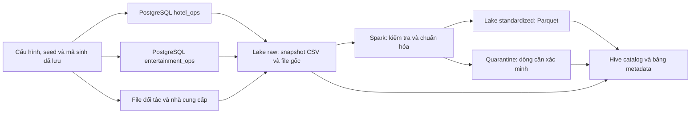

# CompanyE Source Databases and Basic Data Lake

Đây là bản nền dữ liệu chạy được cho case CompanyE: **hai database PostgreSQL nguồn, bộ sinh dữ liệu có thể tái lập, data lake trên filesystem, xử lý batch bằng Apache Spark và catalog bằng Hive Metastore có lưu bền vững**. Chưa xây warehouse, dashboard nghiệp vụ hay mô hình dự báo.

## Bản mở rộng v2 — dùng cho các bước tiếp theo

V2 đã được sinh và nạp vào **`hotel_ops_v2` và `entertainment_ops_v2`**, tổng cộng **41 bảng, 591.242 dòng**. Hai database là hai miền nghiệp vụ tách biệt nhưng đang chạy trên cùng PostgreSQL local; chưa mô phỏng các máy chủ ở nhiều địa phương. Bản v1, mã sinh v1 và catalog v1 được giữ để đối chiếu.

| Phần bổ sung | Dữ liệu thực tế trong v2 |
|---|---|
| Mua hàng nhiều mặt hàng | 4.007 đơn mua có nhiều loại hàng |
| Giao hàng nhiều đợt | 5.941 dòng đơn mua có nhiều phiếu nhận; bảo toàn lượng đặt = nhận + từ chối, theo dõi kho theo lô |
| Định danh khách phân tán | ID riêng không chứa số thứ tự dùng chung; có số điện thoại hộ gia đình, thiếu/đổi liên hệ, lỗi tên, email khác định dạng và 120 hồ sơ khách trùng |
| Điều chỉnh giao dịch | 160 booking có lịch sử giá trước/sau, chi tiết giá phòng và khoản thu bổ sung; thêm `booking_revisions`, `booking_room_revisions` |
| File đến trễ, gửi lại và sửa đổi | 240 phiếu nhận được biểu diễn qua file ngoài; 24 phiếu có bản sửa đến trước bản cũ, 3 dòng gửi lại và 12 dòng dùng đơn vị chưa chuẩn hóa |

Luồng file nhận hàng có **267 dòng đầu vào → 252 phiên bản hợp lệ + 12 dòng quarantine + 3 dòng gửi lại**. Từ 252 phiên bản hợp lệ lấy được **228 phiếu hiện hành**, giữ lại 24 phiên bản cũ để truy vết. Có 69 sự kiện hợp lệ đến trễ hơn hai ngày so với thời điểm ghi nhận ở nguồn. Đơn vị `g` được đổi sang `kg`; giá trong feed luôn là VND/kg. Dòng dùng đơn vị không xác định không được tự đoán quy đổi.

File ngoài là **biểu diễn của phiếu nhận đã có trong nguồn**. Không cộng thêm chúng như giao dịch mua mới, không cộng tất cả phiên bản thành tổng lượng nhận. Chọn trạng thái mới nhất theo số phiên bản, không theo thứ tự đến. Cùng event ID nhưng khác nội dung bị từ chối để điều tra.

### Chạy và truy vấn v2

Tại thư mục `Project`, với Docker Desktop đang chạy:

```powershell
# Xác minh dữ liệu đã tạo:
.\scripts\run-v2.ps1 -Action verify
# Truy vấn catalog riêng của v2:
.\scripts\run-v2.ps1 -Action query -Sql "SELECT * FROM companye_v2_external.receipt_latest LIMIT 10"
.\scripts\run-v2.ps1 -Action query -Sql "SELECT dataset_id, row_count, quality_status FROM companye_metadata.datasets ORDER BY dataset_id"
```

Để dựng lại trên môi trường mới: chạy `.\scripts\run.ps1 -Action up`, rồi `.\scripts\run-v2.ps1 -Action all`. Lệnh `all` tạo/xác minh seed v2, nạp DB nếu chưa tồn tại, ingest một batch mới, xây lake và đối soát. Lệnh `lake` trên batch hoàn tất chỉ kiểm tra lại; không append thêm. Các hướng dẫn `run.ps1` bên dưới vẫn dành cho v1.

V2 dùng `lake/v2/` và Hive/Derby metastore riêng. Catalog có 30 bảng `companye_v2_hotel`, 11 bảng `companye_v2_entertainment`, bốn bảng `companye_v2_external` (`receipt_versions`, `receipt_latest`, `receipt_replays`, `receipt_quarantine`) và bốn bảng metadata. Hồ sơ đầy đủ nằm ở `lake/v2/catalog/catalog.json`; các file raw có checksum, thời điểm nhận và nguồn, bảng dẫn xuất có schema và danh sách nguồn đầu vào.

### Tái lập và bằng chứng v2

- `config/generation_v2.json`: seed nền và bốn seed riêng cho mua hàng, định danh, giao file và điều chỉnh giá.
- `generated/v2/manifest.json`, `reports/reproducibility/v2/`: hash file, mã sinh/schema đóng băng, cấu hình, giả định, giới hạn và tổng đối chứng.
- `generated/v2/audit_only/`: đối chứng định danh chỉ để đánh giá, không ingest vào lake và không dùng làm đầu vào nối khách.
- `reports/reproducibility/v2/runtime.json`: image ID/digest của container đang chạy, phiên bản runtime, hash backup và liên kết bằng chứng.
- `databases/hotel_ops_v2.dump`, `databases/entertainment_ops_v2.dump`: backup database.
- `reports/source_v2_validation.json`, `reports/lake_v2_validation.json`: kết quả kiểm tra nguồn và lake vận hành.
- `reports/testing/20261012T092133914051Z/`: lần kiểm thử đạt **106/106**, gồm 94 ca nền và 12 ca mở rộng. V2 được sinh lại toàn bộ để so sánh từng byte của 41 bảng và các file ngoài; kiểm tra bảo toàn tiền/kho, fixture độc lập về gửi lại/sai thứ tự và từ chối event xung đột.

Đây là xử lý **batch với lịch sử phiên bản và thời điểm nhận file mô phỏng**, chưa phải CDC chạy liên tục. Chưa triển khai thuật toán tự hợp nhất hồ sơ khách, hủy một phần booking, ERP đầy đủ hoặc warehouse. Đối soát lake v2 hiện gồm checksum raw, số dòng và batch của 41 bảng, tổng cột số và so sánh phiếu nhận hiện hành với nguồn; không gọi đó là kiểm tra từng ô của mọi bảng v2. Các giả định mùa vụ và phân bổ chi phí của v1 vẫn phải được cân nhắc khi đánh giá warehouse.

## Trạng thái bản nền v1

| Thành phần | Bản đầu v1 |
|---|---|
| Giai đoạn mô phỏng | 01/01/2024–31/12/2025; ngày đặt có thể sớm hơn khoảng lưu trú |
| Random seed | `20261012` |
| `hotel_ops` | 28 bảng, 422.763 dòng |
| `entertainment_ops` | 11 bảng, 154.637 dòng |
| Tổng hai database | **39 bảng, 577.400 dòng** |
| Quy mô doanh nghiệp | 4 cụm, 8 khách sạn, 240 phòng, 4 trung tâm, 120 phương tiện |
| Booking khách sạn | 32.000 đơn, 36.711 phòng booking, 30.736 lượt lưu trú phòng |
| File bên ngoài | CSV đối soát, CSV chưa chuẩn, TXT, JSONL và SVG chứng từ giả lập |
| Catalog SQL | 39 bảng nguồn chuẩn kiểu, 2 bảng nhà cung cấp/kiểm tra, 3 bảng metadata |
| CSV nhà cung cấp | 121 dòng đầu vào: 77 dòng chấp nhận, 44 dòng cần xác minh |

Mọi khách, giá, hợp đồng, liên hệ và giao dịch đều giả lập. Email dùng miền `example.invalid`. Thương hiệu thật chỉ làm tên tham khảo trong quan hệ thương mại giả định.

## Công nghệ và vai trò

| Công nghệ | Vai trò |
|---|---|
| PostgreSQL 17 | Hai database nghiệp vụ độc lập, có PK, FK, CHECK và chỉ mục |
| Apache Spark 3.5.7, PySpark | Đọc bản xuất nguồn, ép kiểu theo contract, kiểm tra và ghi Parquet |
| Hive Metastore qua Spark Hive support | Lưu schema, tên bảng, vị trí dữ liệu và table properties qua nhiều lần chạy |
| Apache Derby embedded | Lưu vật lý metastore của bản triển khai một máy, một tiến trình truy cập mỗi lần |
| CSV, JSONL, TXT, SVG và Parquet | Giữ dữ liệu thô đa dạng, cung cấp bản bảng có kiểu để truy vấn |
| Docker Compose | Đóng gói hai dịch vụ `postgres` và `spark` riêng cho CompanyE |

Tài liệu project CO5173, mục 2.2, giới thiệu Hive và Spark Streaming; slide chương 2 giới thiệu data lake, catalog và metadata. Bản này dùng Spark SQL **batch**, chưa triển khai streaming. PostgreSQL là hệ quản trị nguồn; Docker là công cụ chạy môi trường. Không khẳng định đề bài bắt buộc chính xác stack này.

Data lake bản đầu dùng thư mục được mount từ máy Windows. **Chưa triển khai HDFS, object storage, metastore server nhiều người dùng hoặc lakehouse ACID.** Những giới hạn này giữ môi trường học tập nhỏ và dễ kiểm tra. Thư mục có tên `lake/catalog/warehouse` chỉ là vị trí mặc định kỹ thuật của Hive/Spark, không phải kho dữ liệu phân tích CompanyE đã được xây.

## Luồng dữ liệu



Raw được xuất **từ database đã nạp**, không chỉ sao chép lại CSV seed rồi gọi đó là dữ liệu đã trích xuất. Mỗi database dùng snapshot `REPEATABLE READ` riêng; đây không phải snapshot giao dịch phân tán đồng thời giữa hai database. Bản v1 nạp toàn bộ snapshot, chưa phải CDC.

Mỗi lần ingest tạo batch mới. Các file raw của batch trước được giữ; checksum giúp phát hiện sửa đổi. Chưa cấu hình cơ chế lưu trữ WORM hoặc quyền chống ghi vật lý. Parquet lưu theo `batch / source / table`. Các bảng Hive trỏ tới snapshot được publish gần nhất; **không nối chồng các snapshot rồi nhân đôi giao dịch**.

## Bố cục thư mục

```text
Project/
  CompanyE_Mo_ta_case.md       Bối cảnh doanh nghiệp đã chốt
  compose.yaml                Hai dịch vụ CompanyE
  .env                        Mật khẩu local tự sinh, không đưa vào Git
  config/
    generation.json           Seed, khoảng thời gian, quy mô
    source_contracts.json     Schema và từ điển nguồn
  src/
    model.py                  DDL, mô tả bảng/cột và ràng buộc
    generate.py               Toàn bộ thuật toán sinh dữ liệu
    audit_generation.py       Kiểm tra tái lập và hồ sơ phân bố
    manage.py                 Nạp DB, xuất snapshot, chạy và kiểm tra lake
    lake_job.py               Spark và catalog
  scripts/run.ps1             Lệnh chạy trên Windows
  generated/v1/
    hotel_ops/                DDL và CSV seed
    entertainment_ops/        DDL và CSV seed
    external/                 File đối tác và nhà cung cấp
    load.sql                  Script nạp nguồn
    manifest.json             Cấu hình, hash mã sinh và hash mọi file seed
    audit_only/               Đối chứng, giả định và giới hạn; không ingest
  databases/                  Backup PostgreSQL dạng pg_dump custom
  lake/
    raw/<batch>/              Snapshot, file gốc, ingestion manifest
    standardized/<batch>/    Bảng Parquet
    quarantine/<batch>/      Bản ghi lỗi giữ giá trị gốc và lý do
    catalog/                  Hive Metastore, JSON catalog và mục lục
    _jobs/<batch>/            SQL đã dùng để trích xuất
  reports/
    source_validation.json   Kiểm tra nghiệp vụ nguồn
    lake_build_<batch>.json  Kết quả Spark theo batch
    lake_validation.json     Kiểm tra lake và catalog sau khởi động lại
    reproducibility/v1/      Mã sinh đóng băng, seed, baseline và tái lập
```

## Cách chạy

Yêu cầu: Docker Desktop chạy Linux containers, Docker Compose và Python 3.11 có trong PATH. Python host chỉ dùng thư viện chuẩn; PySpark và Java nằm trong image Spark. Hai container được giới hạn bộ nhớ lần lượt 1 GB và 3 GB. Lần đầu cần tải image qua mạng.

Tại thư mục `Project`, chạy PowerShell:

```powershell
.\scripts\run.ps1 -Action all
```

Lệnh tạo hoặc xác minh bộ seed, kiểm tra sinh lại, khởi động dịch vụ, nạp hai DB nếu chưa tồn tại, giữ backup theo phiên bản, kiểm tra nguồn, ingest snapshot, chuẩn hóa, kiểm tra lake và chụp runtime. Không tự xóa database hoặc volume. Nếu database có số dòng hoặc tổng đối chứng khác baseline, lệnh dừng; baseline và backup cũ không tự bị ghi đè.

Các bước riêng:

```powershell
python -X utf8 src/generate.py
.\scripts\run.ps1 -Action up
.\scripts\run.ps1 -Action load
.\scripts\run.ps1 -Action ingest
.\scripts\run.ps1 -Action lake
.\scripts\run.ps1 -Action verify
python -X utf8 src/audit_generation.py
python -X utf8 src/capture_provenance.py
.\scripts\run.ps1 -Action status
```

`lake` trên batch đã hoàn tất sẽ kiểm tra lại, không append thêm dữ liệu. Các lệnh truy cập Hive được khóa để tránh hai JVM cùng mở embedded Derby. Chạy từng lệnh đến khi kết thúc; không chạy đồng thời hai phiên Spark truy cập cùng catalog.

PostgreSQL được publish tại `127.0.0.1:55432`, user `companye`, database `hotel_ops` và `entertainment_ops`. Mật khẩu ở `.env`. Đây là tài khoản quản trị của môi trường demo local; chưa triển khai phân quyền nhiều vai trò.

Khi cần dừng các dịch vụ nhưng giữ dữ liệu:

```powershell
docker compose stop
```

## Tra cứu catalog và metadata

Mở `lake/catalog/CATALOG.md` để xem mục lục hoặc `lake/catalog/catalog.json` để xem hồ sơ đầy đủ. Catalog thực tế nằm trong Hive Metastore, không chỉ là hai file này.

```powershell
.\scripts\run.ps1 -Action query -Sql "SHOW DATABASES"
.\scripts\run.ps1 -Action query -Sql "SHOW TABLES IN companye_hotel"
.\scripts\run.ps1 -Action query -Sql "DESCRIBE EXTENDED companye_hotel.bookings"
.\scripts\run.ps1 -Action query -Sql "SELECT dataset_id, row_count, quality_status FROM companye_metadata.datasets ORDER BY dataset_id"
.\scripts\run.ps1 -Action query -Sql "SELECT column_name, sql_type, description, constraints FROM companye_metadata.columns WHERE dataset_id='hotel_ops.bookings'"
.\scripts\run.ps1 -Action query -Sql "SELECT quality_reason, COUNT(*) AS records FROM companye_external.supplier_quarantine GROUP BY quality_reason"
```

Metadata gồm:

- **Nghiệp vụ:** mô tả, grain, đơn vị sở hữu, ý nghĩa cột, đơn vị VND và nhãn dữ liệu giả lập.
- **Kỹ thuật:** schema, kiểu SQL, nullable, PK/FK/CHECK được khai báo ở nguồn, định dạng và vị trí file/bảng. Hive chỉ lưu metadata; không tự thực thi các FK nguồn trên Parquet.
- **Vận hành:** batch, thời điểm nhận, số dòng, dung lượng, checksum, phiên bản seed và trạng thái chất lượng.
- **Truy vết:** hệ thống nguồn, file nguồn, hash nguồn và quan hệ raw → standardized. Mỗi bảng chuẩn có `_source_system`, `_source_path`, `_ingestion_batch`, `_ingested_at_utc`.

Các ảnh, văn bản và thông báo điều chỉnh chưa được chuẩn hóa vẫn có hồ sơ trong `companye_metadata.artifacts`. Ảnh SVG là chứng từ giả lập minh họa, **chưa có OCR**. Một dòng nhà cung cấp đã chuẩn hóa cũng chưa mặc nhiên là phiếu nhận hàng được phê duyệt hoặc khoản được phép thanh toán.

## Kiểm chứng và bảo vệ đánh giá warehouse về sau

`generated/v1/manifest.json` lưu seed, cấu hình, Python version, SHA-256 mã sinh và từng file. Mã sinh và cấu hình được đóng băng thêm ở `reports/reproducibility/v1/`. Nếu thay seed, thuật toán hoặc schema, tạo một phiên bản dữ liệu mới; không sửa âm thầm v1. Chỉ đổi seed mà không lưu phiên bản mã/Python không đủ bảo đảm tái lập.

`reports/runtime_environment.json` và thư mục `reports/runtime/` giữ digest image Docker thực tế, phiên bản PostgreSQL/Spark/Python, bản sao mã/cấu hình và checksum backup. `reports/processing/<batch>/` giữ mã của các lần gọi xử lý batch. Tag image trong Compose có thể có bản cập nhật; muốn tái lập đúng runtime đã kiểm tra, dùng digest đã lưu thay vì kéo lại tag một cách mặc định.

`audit_generation.py` sinh lại dữ liệu trong bộ nhớ, tuần tự hóa theo cùng hợp đồng và so sánh checksum cả 39 bảng với seed đã lưu. Script cũng kiểm tra seed khác tạo booking khác và ghi phân bố theo khách sạn/tháng. Không nạp bộ dùng để kiểm tra độ nhạy vào DB hoặc lake.

`generated/v1/audit_only/generation_audit.json` ghi từng quy tắc và rủi ro sai lệch: mùa vụ được áp đặt, tỷ lệ hủy giả định, cơ chế chọn khuyến mãi, xác suất mua chéo, liên hệ thời tiết–đóng hoạt động, phân bổ nguyên liệu và chất lượng nhà hàng. Những tương quan do bộ sinh tạo ra không phải bằng chứng để kết luận tác động kinh doanh thực tế.

File đối chứng nối khách và tổng kiểm tra chỉ phục vụ đánh giá riêng, không là đầu vào ETL. `manage.py` dùng danh sách nguồn cho phép; không quét cả `generated/` để ingest. `lake_job.py` chỉ đọc đối chứng tổng hợp ở lệnh `verify`, không dùng để tạo bảng chuẩn.

Đối chiếu warehouse sau này cần tối thiểu:

1. Lưu seed version, manifest hash, phiên bản mã ETL, quy tắc phân bổ và cấu hình chạy.
2. Kiểm tra số lượng và tổng tiền độc lập với kết quả hiển thị trên dashboard.
3. Kiểm tra không nhân đôi snapshot, gói dịch vụ, khoản tài trợ hoặc bảng kê đối tác.
4. Đánh giá nhiều seed, quy mô và kịch bản lỗi; tách thời gian sinh dữ liệu khỏi thời gian đo xử lý.
5. Không dùng dữ liệu đối chứng định danh làm đặc trưng nối khách hoặc làm dữ liệu huấn luyện.

**Giới hạn dữ liệu v1 cần tính tới khi chọn bài toán:**

- Dữ liệu là full snapshot, chưa có đầy đủ lịch sử cập nhật/CDC và hủy một phần booking.
- Có bán chéo gắn tham chiếu booking nhưng chưa có mô hình phân bổ toàn bộ gói nhiều dịch vụ.
- E Family mới ghi nhận chủ gói, chưa đầy đủ thành viên, sổ điểm và lịch dùng voucher.
- Suất buffet và bữa ăn của v1 mới tính người lớn; trẻ em được ghi trên booking nhưng chưa mô hình hóa riêng quyền lợi và phụ thu ăn uống.
- ID và tên khách có mẫu tổng hợp dễ nhận biết; v1 chưa phù hợp để kết luận chất lượng thuật toán giải quyết định danh trong dữ liệu thực.
- Chi phí nguyên liệu được phân bổ từ xuất kho theo lượt phục vụ; không dùng tương quan này để chứng minh mô hình dự báo phát hiện quan hệ mới.
- Nguồn cung mới mô phỏng đơn mua, nhận hàng và kho; chưa đầy đủ hóa đơn/công nợ nhà cung cấp hay điều chuyển kho.
- Chưa có đầy đủ lương, khấu hao, thuế và chi phí chung để tính lợi nhuận doanh nghiệp.
- Dữ liệu lỗi nhà cung cấp là fixture riêng, không tự coi mọi dòng fixture là giao nhận đã xảy ra trong database nguồn.
- Một máy và quy mô hiện tại là bản kiểm chứng chức năng, chưa phải bằng chứng hiệu năng Big Data.

Các giới hạn này không cản trở kiểm tra pipeline, schema, catalog và tính đúng khi chuyển dữ liệu. Chúng là điều kiện cần xem lại trước khi chọn các bài toán phân tích tương ứng.

## Bộ kiểm thử tự động (sáu bước nền và phần mở rộng v2)

Chạy từ thư mục `Project` bằng PowerShell:

```powershell
.\scripts\test.ps1 -Build
# Những lần sau dùng lại image đã xây:
.\scripts\test.ps1
# Chạy riêng một nhóm:
.\scripts\test.ps1 -Select 'property'
```

Lệnh tạo project Docker **companye-tests** riêng: PostgreSQL nạp bản sao seed v1 và v2 vào tmpfs, không publish cổng; runner Python 3.11.9 / Spark 3.5.7 có mount project chỉ đọc. Output được ghi riêng vào `reports/testing/`. PostgreSQL và lake vận hành của project **companye** không bị dừng hoặc thay dữ liệu. PostgreSQL kiểm thử bị gỡ sau lệnh PowerShell; dữ liệu lỗi thử nghiệm không trở thành nguồn nghiệp vụ. Không chạy trực tiếp `pytest` toàn bộ trong một process; dùng runner vì bước kiểm tra Hive cần kết thúc JVM sở hữu embedded Derby trước khi mở JVM mới.

| Bước | Hiện thực | Phạm vi |
|---|---|---|
| 1 | `tests/test_baseline.py`, `tests/test_sources.py` | Hash seed/code, tái sinh 39 bảng, 16 SQL invariant, kiểm thử ràng buộc từ chối dữ liệu sai và phát hiện overlap |
| 2 | `tests/scenario_matrix.json`, `tests/fixtures/`, `tests/test_coverage.py` | Ma trận tình huống v1, ghi rõ giới hạn của bản nền, dữ liệu nhỏ và đáp án viết độc lập |
| 3 | `tests/test_properties.py` | Hypothesis đổi seed/tháng, kiểm tra bảo toàn tiền, đêm phòng, số lượng kho, vé, buffet và tính tái lập |
| 4 | `tests/test_spark.py`, `tests/test_lake.py` | Biến đổi thực tế, lỗi ghi Parquet, retry, kiểm tra mọi giá trị của 39 bảng sau export PostgreSQL → raw → Parquet, catalog qua JVM mới |
| 5 | `tests/test_gx.py` | GX Core trên bảng booking PostgreSQL và snapshot Spark, có dữ liệu cố ý sai để chứng minh kiểm tra phát hiện được lỗi, xuất Data Docs |
| 6 | `tests/test_acceptance.py`, `tests/fixtures/business_acceptance.json` | Tám ca nghiệp vụ với đáp án tính tay và SQL tham chiếu; **chưa phải nghiệm thu warehouse triển khai thật** |

Sau sáu bước nền, runner chạy thêm `07_v2_extensions` với 12 ca trong `tests/test_v2.py`. Có thể chạy riêng bằng `-Select v2`. Cần sinh cả seed v1 và v2 trước khi chạy bộ kiểm thử trên môi trường mới.

Bước 4 chạy thành hai tiến trình pytest (Spark unit/recovery và lake integration), vẫn là cùng một bước triển khai. Bước 5 là thử nghiệm tương thích trên hai dataset; chưa khai báo GX cho cả 39 bảng. Nguồn PostgreSQL ở bước 5 là bản sao kiểm thử; dữ liệu Spark được đọc từ snapshot v1 vận hành ở chế độ chỉ đọc. Không cần tài khoản GX Cloud.

**Đọc bằng chứng:** `reports/testing/latest.json` trỏ tới lần chạy gần nhất. Mỗi lần có `summary.json`, JUnit XML, log từng bước, `cases.jsonl`, kết quả bao phủ tình huống, kiểm tra tái lập, đối soát từng bảng, kết quả GX và thư mục Data Docs. `runtime.json` lưu Python, toàn bộ phiên bản pip, hash manifest và mã nguồn; `code/` giữ bản sao mã/cấu hình/fixtures được dùng. Không ghi `.env` hoặc mật khẩu vận hành. Cấu hình Hypothesis lưu trong `tests/conftest.py`; lỗi được giữ trong báo cáo và nên chuyển thành fixture hồi quy cố định khi xử lý.

**Cách kết luận:** quy tắc bắt buộc, đối soát tiền và các fixture độc lập phải đúng hoàn toàn; lỗi có chủ đích chỉ được coi là test đạt khi bị phát hiện. Raw được phép chứa dữ liệu lỗi nhưng phải giữ nguyên checksum; bước chuẩn hóa phải phân loại đủ accepted/quarantine và lưu lý do. Hash/tổng baseline chỉ chứng minh hồi quy, không chứng minh dữ liệu mô phỏng giống thị trường thật. Ma trận ghi rõ tình huống nào chưa được sinh ở v1, dù toàn bộ test hiện có đạt.

**Phục hồi:** từng dataset Parquet mới được ghi vào thư mục staging rồi đổi tên sau `_SUCCESS`; retry chỉ tái sử dụng output đã hoàn tất và khớp nội dung. Output cũ thiếu `_SUCCESS` bị từ chối để điều tra, không tự xóa. Đây là tính hoàn tất ở mức dataset, **chưa phải transaction nguyên tử cho toàn batch và Hive catalog**: lỗi giữa batch có thể để lại một số bảng đã đăng ký; consumer phải kiểm tra trạng thái batch trước khi dùng. Cần lakehouse/chiến lược publish catalog khác nếu yêu cầu đọc đồng thời và atomic batch trong tương lai.

Mã xử lý được bổ sung kiểm tra nhà cung cấp thiếu đơn vị, giá không dương và thiếu khóa nghiệp vụ. Mã sinh, schema nguồn, seed v1, manifest và backup v1 được giữ nguyên. Các thay đổi của ETL được lưu độc lập trong bằng chứng kiểm thử.

**Trước khi nghiệm thu warehouse:** chốt tám định nghĩa chỉ tiêu, dimensional model và grain; nạp các fixture độc lập qua ETL warehouse; chạy truy vấn thật và đối chiếu với đáp án B01–B08. B06 có giao hàng nhiều đợt: v1 chưa bao phủ, v2 đã sinh tình huống này; fixture độc lập vẫn phải được chạy qua warehouse sau khi triển khai. Kết quả chạy SQL tham chiếu không thay thế kết quả warehouse. Bộ test hiện tại có đo thời gian từng bước để chẩn đoán, chưa phải benchmark hiệu năng nhiều quy mô.

## Nguồn tài liệu kiểm thử

- [pytest fixtures](https://docs.pytest.org/en/stable/how-to/fixtures.html)
- [Hypothesis](https://hypothesis.readthedocs.io/en/latest/)
- [Kiểm thử PySpark 3.5.7](https://spark.apache.org/docs/3.5.7/api/python/getting_started/testing_pyspark.html)
- [GX compatibility](https://docs.greatexpectations.io/docs/help/compatibility_reference/)
- [GX Data Docs](https://docs.greatexpectations.io/docs/core/configure_project_settings/configure_data_docs/)

## Tham khảo triển khai ban đầu

- Tài liệu project: `../Presentation and Project Description/DE_Presentation and Project Descriptions and Requirements-Semester 1-2026-2027.pdf`, mục 2.2.
- Slide kiến trúc dữ liệu: `../slides/Data Engineering - Chapter 2 - Data Warehouse  and Data Management Architecture Design.pdf`, các trang về metadata và data lake.
- [Spark 3.5.7 Hive support và persistent metastore](https://spark.apache.org/docs/3.5.7/sql-data-sources-hive-tables.html).
- [PostgreSQL COPY và cách biểu diễn NULL trong CSV](https://www.postgresql.org/docs/17/sql-copy.html).

Mã và tài liệu nền được tạo với sự hỗ trợ của Codex. Nhóm cần đọc, kiểm tra, điều chỉnh và ghi nhận phạm vi sử dụng AI khi sử dụng trong sản phẩm học phần theo quy định của môn học.
