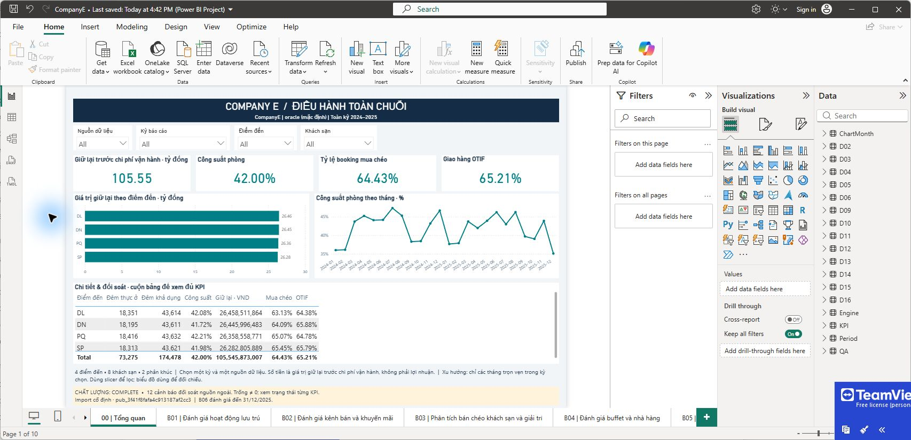
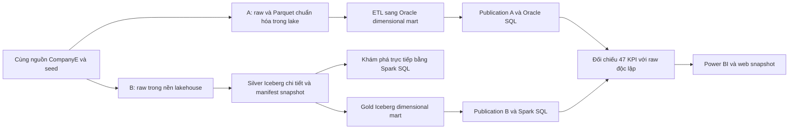

# DE-CaseCompanyE

Nền tảng dữ liệu có thể tái lập cho **CompanyE**, một doanh nghiệp du lịch giả lập tại Việt Nam: 8 khách sạn thuộc hai phân khúc 3 sao/5 sao, 4 trung tâm giải trí, nhà hàng/buffet/bar và dịch vụ thuê phương tiện tại Sa Pa, Đà Nẵng, Đà Lạt, Phú Quốc.

Project đi từ hai cơ sở dữ liệu nghiệp vụ và chứng từ nhà cung cấp chưa chuẩn hóa tới data lake có catalog, sau đó triển khai cùng mô hình phân tích trên **Oracle warehouse** và **Apache Iceberg lakehouse**. Tám nhu cầu B01–B08 được đặc tả thành **47 KPI**, đối chiếu với nguồn độc lập, rồi trình bày bằng Power BI và web demo.

**Dữ liệu hoàn toàn tự sinh.** Các tên thương hiệu trong case chỉ phục vụ giả định mô phỏng; không mô tả quan hệ đối tác hay hoạt động kinh doanh thực tế. Đây là prototype chạy local, chưa phải hệ thống vận hành của một tập đoàn thật.

[Xem web demo](https://tranphu1508.github.io/DE-CaseCompanyE/) · [Bản đồ tài liệu](docs/01-document-map.md) · [Tái lập nền tảng](docs/02-reproduce-platform.md) · [ETL và KPI](docs/03-analytics-and-validation.md) · [Bằng chứng và giới hạn](docs/04-evidence-and-limitations.md)



## Đọc theo trình tự

| Bước | Nội dung | Điểm bắt đầu |
|---|---|---|
| 1 | Doanh nghiệp, giả định vận hành, tám nhu cầu | [Mô tả case](Project/CompanyE_Mo_ta_case.md) |
| 2 | 47 KPI, công thức, grain, ngày nghiệp vụ, phạm vi lọc | [Đặc tả KPI](Project/docs/CompanyE_KPI_Specification.md) |
| 3 | Bus matrix, mô hình ý niệm, luận lý, vật lý | [Danh mục sơ đồ](docs/01-document-map.md) |
| 4 | Seed, nguồn nghiệp vụ, external feed, lake/catalog | [Gói tái lập nền tảng](docs/02-reproduce-platform.md) |
| 5 | Quy tắc biến đổi, SCD2, fact/bridge, publication | [Source-to-target mapping](Project/docs/CompanyE_Source_Target_Mapping.md) |
| 6 | SQL KPI và đối chiếu Oracle/Iceberg/nguồn | [Kết quả 47 KPI](Project/reports/semantic/KPI_Results.md) |
| 7 | Power BI, kiểm chứng DAX/UI, web snapshot | [Ứng dụng và kiểm thử](docs/03-analytics-and-validation.md) |

## Kiến trúc hai phương án

Hướng thiết kế được điều chỉnh ngày 14/10/2026: A giữ lake → Oracle warehouse; B quản lý raw, Silver và Gold trong một storage root lakehouse. **B đã có runtime, ETL, publication và reader độc lập với Oracle**, có thể truy vấn Silver trước khi công bố Gold. Xem [cấu trúc hai phương án](docs/05-architecture-alternatives.md), [runbook B](docs/06-independent-lakehouse.md) và [bằng chứng nghiệm thu mới](Project/reports/lakehouse-b/summary.json).



Hai database nguồn đang mô phỏng hai miền nghiệp vụ trên cùng một PostgreSQL local. Chúng chưa được triển khai tại các địa điểm vật lý khác nhau. Runtime lịch sử được giữ để đối chiếu; B mới dùng Spark và PostgreSQL JDBC catalog/control riêng, không có kết nối Oracle. Hai phương án là các lựa chọn thay thế, được dựng song song chỉ để kiểm chứng và so sánh. Power BI/web snapshot hiện vẫn gắn publication lịch sử, chưa đổi nhãn thành kết quả B mới.

## Chạy nhanh

Từ thư mục repo, với Python 3.11 hoặc 3.12:

```powershell
python -X utf8 scripts/verify-repository.py
python -X utf8 scripts/platform.py generate
python -X utf8 scripts/platform.py verify-seed
```

Hai lệnh cuối sinh đầy đủ v1/v2 và so checksum với manifest đã lưu. Chúng chỉ ghi vào `.work/platform/Project`, không sửa dữ liệu hay báo cáo lịch sử trong `Project`.

Với Docker Desktop chạy Linux containers:

```powershell
python -X utf8 scripts/platform.py all
python -X utf8 scripts/platform.py test
python -X utf8 scripts/platform.py stop
```

`all` dựng hai DB nguồn v2, ingest batch mới, xây lake và kiểm tra. `test` dựng môi trường kiểm thử riêng có cả nguồn v1/v2. Đọc [runbook](docs/02-reproduce-platform.md) trước khi chạy để biết dung lượng, cổng, đầu ra và cách chạy từng bước. Không cần Oracle hoặc Power BI để kiểm tra gói nền tảng này.

Sau khi đã có raw/catalog v2, chạy lakehouse B độc lập:

```powershell
python -X utf8 scripts/lakehouse.py all
```

Lệnh dựng runtime B → ingest raw → Silver → truy vấn Silver → Gold → công bố → kiểm KPI/fixtures, dừng ngay nếu lỗi. Đầu ra local nằm trong `.work/lakehouse-b`; xem [runbook](docs/06-independent-lakehouse.md) về retry, storage, tài nguyên và giới hạn một batch ban đầu.

Xem web snapshot không cần Docker:

```powershell
python -X utf8 Project/web/companye-demo/verify.py
python -m http.server 5173 --bind 127.0.0.1 --directory Project/web/companye-demo/dist
```

Mở `http://127.0.0.1:5173`. Web dùng kết quả đã kiểm chứng, không truy vấn trực tiếp database.

## Cấu trúc

```text
DE-CaseCompanyE/
  README.md
  docs/                    Hướng dẫn đọc, tái lập, ETL, bằng chứng
  scripts/                 Điều phối tái lập độc lập và kiểm tra gói
  evidence/                Inventory SHA-256, catalog lịch sử, kiểm tra đóng gói
  Project/
    CompanyE_Mo_ta_case.md
    config/                Seeds, contracts, mapping, DDL, cấu hình runtime
    docs/                  Đặc tả, PDF và sơ đồ draw.io
    src/                   Generator, lake, ETL, publication, semantic
    scripts/               Các lệnh triển khai và kiểm chứng từng giai đoạn
    tests/ + testing/      Pytest, Hypothesis, Great Expectations, Spark
    reports/               Bằng chứng các lần chạy trước, code snapshot, SQL
    powerbi/               PBIP/PBIR và semantic model; không kèm cache/import CSV
    web/companye-demo/     Mã web, snapshot đã đối soát và kiểm tra
  .work/                   Môi trường sinh lại trên máy; Git bỏ qua
```

## Trạng thái bàn giao

Đã có mã nguồn và bằng chứng cho sinh dữ liệu, lake/catalog, hai nhánh phân tích, publication, 47 KPI, Power BI và web demo. V2 có 41 bảng nguồn với 591.242 dòng; kết quả ETL đã lưu có 771.564 dòng logic trên mỗi nhánh.

**Chưa hoàn tất:** benchmark hiệu năng có kiểm soát giữa hai nhánh, đánh giá hiệu quả hỗ trợ quyết định, báo cáo/slide/video tổng kết. Chưa chứng nhận cold-start toàn bộ Oracle → Iceberg → Power BI trên một máy khác. Dashboard hiện gắn với publication đã kiểm chứng; không được tự thay ID để bỏ qua điều kiện nghiệm thu.

Các file trong `Project/reports` là bằng chứng lịch sử có timestamp, không tự động chứng minh lần chạy mới thành công. [Bảng bằng chứng](docs/04-evidence-and-limitations.md) chỉ rõ phạm vi từng phép kiểm tra. README cũ trong `Project` được giữ như nhật ký tiến triển; một số câu “bước tiếp theo” phản ánh thời điểm viết trước đó.

Repo không chứa mật khẩu, `.env` thật, volume Docker, database dump, raw/Parquet có thể sinh lại, thư viện cài sẵn hoặc giáo trình/danh sách sinh viên. Các file lớn bị lược khỏi Git được kê trong [inventory](evidence/assembly-inventory.json); không đổi hash hay kết quả cũ để che việc lược bỏ.

