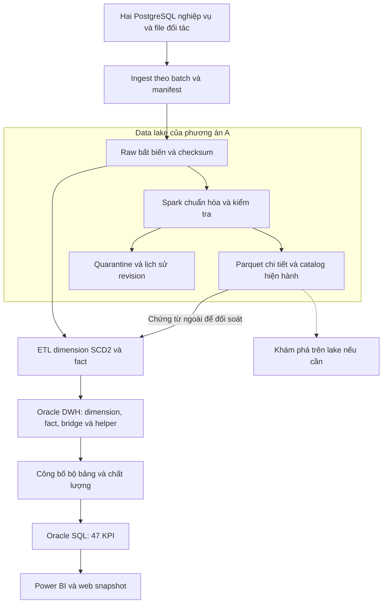
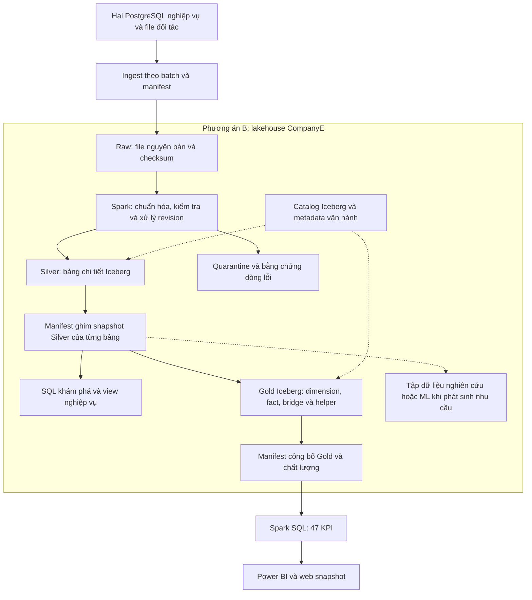

# Hai phương án kiến trúc CompanyE

Ngày quyết định: 14/10/2026. **B đã có runtime độc lập, raw → Silver Iceberg → Gold Iceberg và publication riêng.** Xem [runbook triển khai](06-independent-lakehouse.md) và [bằng chứng nghiệm thu B](../Project/reports/lakehouse-b/summary.json). Power BI và payload KPI trên web vẫn giữ publication lịch sử; việc thay nguồn BI là mốc nghiệm thu riêng.

CompanyE so sánh hai lựa chọn: A là data lake kết hợp Oracle warehouse; B là lakehouse quản lý dữ liệu chi tiết bằng Apache Iceberg trên nền lưu trữ lake. B không còn được mô tả chỉ như một đích ETL song song với Oracle. B hỗ trợ đọc dữ liệu chi tiết trước khi xây mart BI, còn Gold phục vụ cùng tám nhu cầu B01–B08 và 47 KPI đã chốt.

## Phạm vi giữ nguyên và thay đổi

- Giữ nguyên case CompanyE, generator/seed, dữ liệu nguồn, các quy tắc nghiệp vụ, grain và contract 47 KPI.
- Giữ nguyên phương án A làm đường triển khai lake → Oracle đã có. SCD2, đối soát nguồn ngoài, tránh ghi nhận doanh thu buffet hai lần và quy tắc đơn vị tính vẫn áp dụng cho cả hai phương án.
- Thay đổi thiết kế B: dữ liệu chi tiết Silver trở thành bảng Iceberg được quản lý trong lakehouse; mọi sản phẩm B đọc từ các snapshot Silver đã xác định. Gold là lớp phục vụ BI, không phải điều kiện để truy vấn dữ liệu.
- Dimensional model hiện tại vẫn là thiết kế Gold. Các tài liệu vật lý/DDL/ảnh runtime cũ mô tả phiên bản triển khai trước thay đổi này; không dùng chúng làm bằng chứng đã có Silver Iceberg.
- Các nhánh là hai lựa chọn thay thế. Việc dựng đồng thời để thử nghiệm không có nghĩa doanh nghiệp phải vận hành cả hai trong thực tế.

## Phương án A gồm lake và Oracle warehouse



Oracle là đích phục vụ BI chính của A. Parquet trong lake và bảng Oracle là hai biểu diễn được lưu ở hai hệ lưu trữ; pipeline cần bảo đảm lineage, đối soát và độ mới dữ liệu giữa chúng. A vẫn có thể cho phép khám phá trên lake; không dùng sự tồn tại của truy vấn ad hoc làm bằng chứng rằng chỉ B có khả năng này.

```text
A — các vị trí logic, chưa phải cấu hình đường dẫn mới
├── lake/
│   ├── raw/<batch>/                 CSV và file đối tác nguyên bản
│   ├── standardized/               Parquet chi tiết đã chuẩn hóa
│   ├── quarantine/                 Dòng lỗi và lý do
│   └── catalog/                    Schema, checksum, lineage, chất lượng
├── oracle-storage/                 Volume riêng của Oracle
│   ├── staging và slot ứng viên
│   └── dimension, fact, bridge, helper
└── control-and-evidence/            Publication, log, phiên bản và đối chứng
```

## Phương án B là lakehouse trên nền lưu trữ thống nhất



Tất cả vùng dữ liệu nghiệp vụ của B nằm dưới một storage root của lakehouse. Runtime local dùng volume `ce-lakehouse-b_lakehouse`, mount tại `/companye-lakehouse` ở các container liên quan. Không cần bổ sung object storage chỉ để đáp ứng quyết định này. Khi chuyển môi trường, storage root có thể chuyển sang object storage; đây chưa phải hạng mục triển khai hiện tại.

```text
B — storage root đã triển khai /companye-lakehouse
├── raw/<batch>/
│   ├── hotel_ops/                  Snapshot nguồn khách sạn
│   ├── entertainment_ops/          Snapshot nguồn giải trí
│   └── external/                   File đối tác nguyên bản
├── catalog/catalog.json           Manifest raw, schema và checksum
├── tables/                         Iceberg quản lý file; không sửa tay
│   ├── silver_hotel/               Bảng chi tiết theo miền khách sạn
│   ├── silver_entertainment/       Bảng chi tiết theo miền giải trí
│   ├── silver_external/            Phiên bản chứng từ, replay và đối soát
│   └── gold_b_<fingerprint>/       Ứng viên mart BI theo phiên bản
├── quarantine/<run_id>/           Bản ghi lỗi và lý do
└── manifests/                      Liên kết raw, snapshot, chất lượng, publication

Dịch vụ metadata bên cạnh storage root
├── PostgreSQL JDBC catalog         Định vị bảng và metadata Iceberg
└── Control metadata                Pipeline, quality, publication và reader lease

Vùng tạm riêng
└── scratch/                        Spark spill/cache và dữ liệu tạm có vòng đời rõ
```

Các namespace đã dùng là `ce.silver_hotel`, `ce.silver_entertainment`, `ce.silver_external` và `ce.gold_b_<fingerprint>`. Gold dùng namespace theo phiên bản để không overwrite ứng viên đã công bố; publication ghi đầy đủ tên bảng và snapshot. Mỗi bảng Iceberg có file dữ liệu và metadata do Iceberg quản lý; không coi cây thư mục minh họa là layout file bắt buộc của Iceberg. Schema/count/hash/location logic của từng bảng có trong manifest Silver/Gold của lần chạy.

PostgreSQL catalog/control chỉ lưu metadata vận hành, không chứa một bản sao thứ ba của các giao dịch. Raw có manifest/catalog cho file; các bảng Silver/Gold được đăng ký trong JDBC catalog. Catalog không biến file raw tùy ý thành bảng Iceberg và không cấp tính giao dịch cho raw.

## Quy tắc dữ liệu của phương án B

### Raw giữ khả năng truy vết

Giữ file nhận vào, định danh nguồn, checksum, batch và thời điểm ingest. Không bắt tạo thêm Bronze Iceberg chỉ để sao chép cùng payload raw. Schema-on-read được áp dụng khi diễn giải file raw; Bronze ở đây là vai trò của lớp dữ liệu, không phải yêu cầu về table format.

### Silver quản lý dữ liệu chi tiết

Silver tiếp nhận đầy đủ các dataset nguồn đã nằm trong contract v2, gồm 41 bảng nghiệp vụ và các dataset đối tác hiện có. Không chỉ chọn các cột đang được 47 KPI sử dụng. Grain bám theo từng thực thể/giao dịch nguồn và phiên bản chứng từ; không tổng hợp mất chi tiết trước khi có nhu cầu cụ thể.

Mỗi bảng cần contract kiểu dữ liệu, khóa nghiệp vụ có `source_system`, thông tin batch/lineage, quy tắc NULL, revision/replay và chất lượng. Các trường mới ở raw được giữ lại nhưng chỉ đưa vào schema Silver sau khi xác định kiểu, ý nghĩa và tương thích. Lịch sử snapshot Iceberg không thay thế lịch sử nghiệp vụ/SCD2: snapshot thể hiện trạng thái bảng lúc commit, không tự tạo thời điểm hiệu lực nghiệp vụ chưa có trong nguồn.

ETL B đọc bảng qua catalog với snapshot được ghim, không quét trực tiếp thư mục chứa file data của Iceberg. Không duy trì thêm một bản standardized Parquet giống Silver như đầu vào bắt buộc thường trực của B. Dữ liệu tạm/canonical cho debug và xác minh phải được phân loại, tính dung lượng và có chính sách lưu giữ; không tuyên bố B chỉ có một bản vật lý.

### Gold là sản phẩm BI

Trong phạm vi 47 KPI hiện tại, giữ các dimension, fact, bridge và helper đã thiết kế, materialize trong Iceberg để so sánh cùng mô hình với Oracle. SCD2 vẫn được thực hiện ở các dimension có chính sách đó. Gold đọc Silver; không cần Oracle chạy hoặc có dữ liệu để xây Gold B.

Truy vấn khám phá được phép đọc Silver theo quyền thích hợp ngay cả khi chưa dựng Gold. View theo nhu cầu mới có thể xây trên Silver trước khi quyết định materialize. Không yêu cầu chuyển toàn bộ Gold hiện có sang view: điều đó thay đổi khối lượng xử lý lúc truy vấn và làm mất tính tương đương của benchmark BI đã dự kiến.

### Nhất quán và dữ liệu thiếu

Iceberg commit nguyên tử theo bảng không đồng nghĩa nhiều bảng Silver hoặc Gold có cùng một giao dịch. Mỗi batch được chấp nhận phải có manifest ghi `source_batch_id`, hash raw, phiên bản transform/schema, snapshot ID của từng bảng, chất lượng và thời điểm công bố. Reader phân tích chính thức dùng bộ snapshot này; không đọc tùy ý snapshot mới nhất của từng bảng.

Giữ chính sách của CompanyE: báo cáo có thể được công bố với dữ liệu hợp lệ và trạng thái PARTIAL, nêu phạm vi thiếu và tác động lên KPI. Không âm thầm bù từ batch trước. Việc áp dụng PARTIAL cho BI mới phải được kiểm thử; dashboard lịch sử COMPLETE không tự chứng minh điều đó.

B phải có publication và reader riêng, không phụ thuộc tính sẵn sàng của Oracle. Bộ đối chiếu thử nghiệm bên ngoài ánh xạ publication A/B theo cùng input manifest và contract, không ép hai phương án phải triển khai chung một coordinator khi vận hành độc lập.

## So sánh công bằng hai phương án

| Nội dung | A | B |
|---|---|---|
| Đầu vào | Cùng snapshot nguồn và file đối tác | Cùng snapshot nguồn và file đối tác |
| Dữ liệu chi tiết chuẩn hóa | Parquet trong lake | Bảng Iceberg Silver trong nền lakehouse |
| BI chính thức | Oracle dimensional mart | Iceberg Gold dimensional mart |
| Engine truy vấn | Oracle SQL | Spark SQL |
| Khám phá trước mart | Spark trên lake, nếu sử dụng | Spark SQL trên Silver có quản lý snapshot |
| Biến đổi | Chuẩn hóa rồi ETL/nạp Oracle | Chuẩn hóa thành Silver rồi biến đổi nội bộ thành Gold |
| Hệ thống cần cho BI | Lake và Oracle | Lakehouse, Spark và metadata; không cần Oracle |

Tách ba nhóm đo. Thứ nhất, benchmark truy vấn BI trên cùng grain, dữ liệu, KPI, materialization và ngân sách tài nguyên. Thứ hai, đo thời gian và dung lượng toàn pipeline từ cùng điểm đầu vào tới publication sẵn sàng; tính cả raw, intermediate, Gold, snapshot giữ lại và staging của từng phương án. Thứ ba, đánh giá khả năng thêm một phân tích mới từ dữ liệu chi tiết trước Gold ở cả A và B, ghi số bước/code cần sửa, thời gian và tác động lên báo cáo cũ. Không mặc định B thắng vì dùng Iceberg.

Hai phương án có thể dùng chung fixture raw bất biến trong phòng thử nghiệm. Nếu tái sử dụng file thay vì sao chép, phải ghi nhận rõ trong cách đo dung lượng; không tính chi phí lưu hai bản thử nghiệm thành chi phí bắt buộc của một phương án độc lập. Tham chiếu KPI tiếp tục đọc raw độc lập, không dùng Silver/Gold do chính pipeline tạo ra làm đáp án.

## Trạng thái triển khai

| Thành phần | Runtime lịch sử giữ lại | B độc lập |
|---|---|---|
| Storage | `Project/lake/v2` và volume `analytics_data` tách nhau | Raw, Silver, Gold, quarantine và manifest trong một volume B |
| Catalog | JSON/Hive cho lake; JDBC cho Gold Iceberg | Catalog file raw; JDBC catalog Silver/Gold và control PostgreSQL riêng |
| Reader nguồn | `read_sources` đọc raw nghiệp vụ; standardized Parquet cho external | Gold đọc Silver ghim snapshot; raw chỉ là đầu vào Silver và tham chiếu kiểm chứng |
| Dimension/fact launcher | Có đường chạy cùng Oracle và Iceberg | Launcher B chỉ dùng Spark + metadata; không có Oracle driver, secret hoặc network alias |
| Publication | Coordinator cũ công bố hai nhánh trong runtime chung | B có coordinator/reader riêng; kiểm A qua bằng chứng Oracle lịch sử |
| BI | CSV/PBIP và web khóa publication lịch sử | Chưa đổi nguồn; cần xuất và kiểm DAX/UI lại theo publication B |
| Bằng chứng | Báo cáo v1 đã chốt | Báo cáo mới ở `Project/reports/lakehouse-b`, giữ nguyên báo cáo cũ |

Chỉ đổi mount path hoặc gom thư mục không hoàn tất migration. Không sửa location của bảng Iceberg hoặc chuyển file thủ công trong khi catalog vẫn tham chiếu location cũ. Nếu chọn import file Parquet không ghi lại, phải xác minh schema, partition và quyền sở hữu/vòng đời file; nếu không, dùng nạp lại có kiểm chứng và đo chi phí migration riêng.

## Các mốc triển khai và phần tiếp theo

1. Chốt schema/contract Silver, namespace, storage location và manifest snapshot; cập nhật source-to-target mapping cho B.
2. Dựng runtime B độc lập cùng catalog/control và vùng lưu trữ mới, không đổi runtime lịch sử.
3. Nạp raw → Silver; kiểm row count, khóa, giá trị tiền/lượng, NULL, replay/revision, quarantine và lineage với nguồn.
4. Tách source reader và target adapter; chạy dimension/fact B từ Silver, giữ mô hình Gold và quy tắc nghiệp vụ đã chốt.
5. Triển khai publication/reader B, kiểm failure giữa các lần commit bảng, retry, reader pinning và PARTIAL.
6. Chạy đối chứng 47 KPI, slices và fixtures bằng raw độc lập; kiểm thêm B hoạt động trong mạng riêng không có dịch vụ/alias Oracle và Silver truy vấn được trước Gold. Cấu hình B không kết nối Oracle; không cần dừng runtime Oracle lịch sử để chứng minh sự độc lập này.
7. Cập nhật Power BI/web theo publication mới sau kiểm chứng; mới bắt đầu benchmark kiến trúc.

Mã B và runbook đã triển khai các mốc 1–6 cho initial batch và retry; bằng chứng mới ghi riêng phạm vi đã kiểm tra. Mốc 7 chưa thay publication trên BI. DDL Gold nghiệp vụ giữ nguyên, còn schema và lineage Silver được triển khai từ catalog nguồn và mapping, lưu trong manifest từng bảng. Chưa có CDC/incremental production hoặc benchmark kết luận phương án nào nhanh hơn.

## Cơ sở tham khảo

- [Lakehouse, CIDR 2021](https://www.cidrdb.org/cidr2021/papers/cidr2021_paper17.pdf): kiến trúc quản lý dữ liệu trên lake và giảm sao chép giữa các hệ, vẫn cần ETL/ELT.
- [Apache Iceberg schema evolution](https://iceberg.apache.org/docs/latest/evolution/): thay đổi schema có quản lý; không đồng nhất schema evolution với schema-on-read.
- [Apache Iceberg Spark procedures](https://iceberg.apache.org/docs/latest/spark-procedures/): migration/import cần xem điều kiện và phiên bản thực tế trước khi sử dụng.
